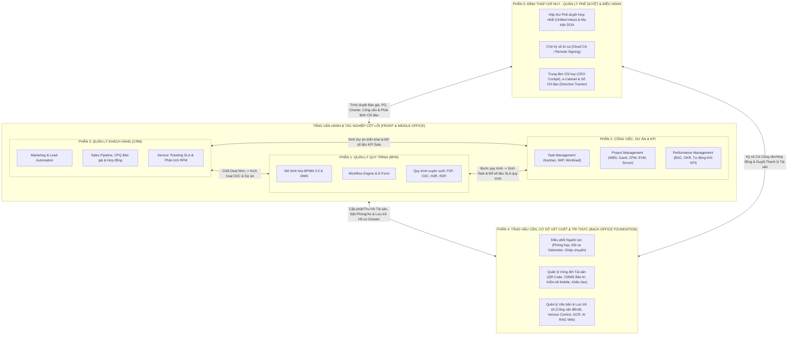
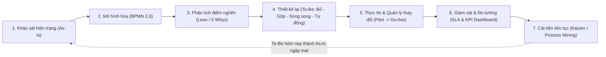
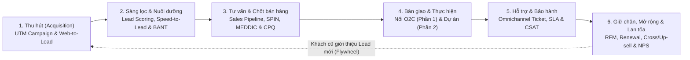
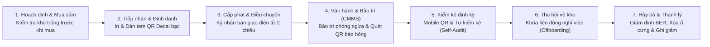

# BÁO CÁO NGHIÊN CỨU TOÀN DIỆN: HỆ THỐNG QUẢN TRỊ DOANH NGHIỆP VÀ VẬN HÀNH (ENTERPRISE MANAGEMENT)

> **Thông tin Báo cáo Nghiên cứu:**
> - **Đề tài:** Nghiên cứu Kiến trúc, Nghiệp vụ, Phương pháp luận và Công nghệ của Hệ thống Quản trị Doanh nghiệp và Vận hành Tổng thể (*Enterprise Management System / Unified Digital Workplace*).
> - **Phạm vi nghiên cứu:** Tổng hợp và hệ thống hóa toàn diện 50 chuyên đề thuộc 5 phân hệ cốt lõi:
>   1. **Phần 1:** Quản lý Quy trình hoạt động doanh nghiệp (*Business Process Management – BPM*).
>   2. **Phần 2:** Quản lý Công việc, Dự án và Đánh giá hiệu suất (*Task, Project & KPI/OKR Management*).
>   3. **Phần 3:** Quản lý Quan hệ Khách hàng (*Customer Relationship Management – CRM*).
>   4. **Phần 4:** Quản lý Nguồn lực dùng chung, Tài sản và Văn bản lưu trữ số (*Resource, Asset & Document/Record Management*).
>   5. **Phần 5:** Quản lý Phê duyệt, Chữ ký số và Trung tâm Chỉ huy Điều hành (*Approval, Digital Signature & Executive Operations*).
> - **Tình huống thực nghiệm xuyên suốt (Case Study):** **Công ty A** (doanh nghiệp quy mô 150 nhân sự, vận hành mô hình B2B & B2C kết hợp) và thương vụ cung cấp giải pháp 50 bộ máy tính văn phòng (800 triệu đồng) cho khách hàng **Công ty XYZ**.

---

## MỤC LỤC TỔNG QUAN

1. [Tóm tắt Điều hành & Kiến trúc Tổng thể 5 Trụ cột (Executive Summary & System Architecture)](#1-tóm-tắt-điều-hành--kiến-trúc-tổng-thể-5-trụ-cột)
2. [PHẦN 1: Quản lý Quy trình Hoạt động Doanh nghiệp (BPM & Workflow)](#2-phần-1-quản-lý-quy-trình-hoạt-động-doanh-nghiệp-bpm--workflow)
3. [PHẦN 2: Quản lý Công việc, Dự án và Mục tiêu Hiệu suất (Task, Project & KPI/OKR)](#3-phần-2-quản-lý-công-việc-dự-án-và-mục-tiêu-hiệu-suất-task-project--kpiokr)
4. [PHẦN 3: Quản lý Quan hệ Khách hàng (CRM – Marketing, Sales & Service)](#4-phần-3-quản-lý-quan-hệ-khách-hàng-crm--marketing-sales--service)
5. [PHẦN 4: Quản lý Nguồn lực, Tài sản và Văn bản Lưu trữ số (Resource, Asset & DMS)](#5-phần-4-quản-lý-nguồn-lực-tài-sản-và-văn-bản-lưu-trữ-số-resource-asset--dms)
6. [PHẦN 5: Quản lý Phê duyệt, Chữ ký số và Trung tâm Điều hành (Approval & Executive Cockpit)](#6-phần-5-quản-lý-phê-duyệt-chữ-ký-số-và-trung-tâm-điều-hành-approval--executive-cockpit)
7. [Tổng kết Đại cảnh: Kịch bản Liên thông End-to-End & Lộ trình Chuyển đổi số](#7-tổng-kết-đại-cảnh-kịch-bản-liên-thông-end-to-end--lộ-trình-chuyển-đổi-số)

---

## 1. TÓM TẮT ĐIỀU HÀNH & KIẾN TRÚC TỔNG THỂ 5 TRỤ CỘT

### 1.1. Đặt vấn đề: Nỗi đau của "Sự phân mảnh số" trong doanh nghiệp
Trong quá trình chuyển đổi số, phần lớn doanh nghiệp rơi vào bẫy **"Ốc đảo dữ liệu" (Data Silos)** và **"Mệt mỏi vì công cụ" (Tool Fatigue)**:
- Giao việc qua nhóm chat (Zalo, Messenger) dẫn đến trôi tin, thất lạc trách nhiệm.
- Duyệt tờ trình, công văn trên giấy hoặc email rời rạc khiến hồ sơ "đóng băng" khi lãnh đạo đi công tác.
- Quản lý khách hàng trên sổ tay hoặc file Excel cá nhân của nhân viên kinh doanh (Sales), dẫn đến nguy cơ mất trắng tài sản khách hàng khi nhân sự nghỉ việc.
- Quản lý tài sản và văn bản thiếu đồng bộ giữa Thế giới vật lý và Thế giới phần mềm, gây thất thoát thiết bị, lệch sổ kiểm kê với Kế toán và áp dụng nhầm các quy chế đã hết hiệu lực.
- Đánh giá KPI cuối quý bằng cách ngồi cộng sổ Excel thủ công, dẫn đến thiên kiến cảm tính (*Recency Bias, Halo Effect*) và hành vi thao túng số liệu (*Định luật Goodhart*).

**Hệ thống Quản trị Doanh nghiệp và Vận hành (Enterprise Management)** giải quyết triệt để bài toán trên bằng cách hợp nhất 5 trụ cột vận hành vào một **Không gian làm việc số thống nhất (Unified Digital Workspace)** dựa trên nguyên tắc **Một nguồn sự thật duy nhất (Single Source of Truth - SSOT)**.

### 1.2. Sơ đồ Kiến trúc Liên thông 5 Trụ cột (The 5-Pillar Architecture)

### 1.3. Bảng Ma trận Đối chiếu Tổng hợp 5 Phần của Hệ thống

| Phân hệ | Vai trò trong "Cơ thể Doanh nghiệp" | Thực thể dữ liệu trung tâm (Core Entities) | Khung Phương pháp luận & Tiêu chuẩn Quốc tế | Hệ thống Chỉ số Đo lường (Core KPIs) |
| :--- | :--- | :--- | :--- | :--- |
| **PHẦN 1: Quản lý Quy trình (BPM)** | **Hệ tuần hoàn & Đường ray:** Chuẩn hóa và tự động hóa các chuỗi công việc lặp lại liên phòng ban. | `Process Definition`, `Process Instance`, `Token`, `Activity/Task`, `Gateway`, `E-Form`, `DMN Rule`, `Event Log` | Chuỗi giá trị Porter, **BPMN 2.0 (ISO/IEC 19510)**, **SIPOC**, **Lean (8 lãng phí DOWNTIME)**, **Six Sigma (DMAIC)**, **BPR**, **PDCA/Kaizen**, **ISO 9001**, **CMMI/BPMM** | *Cycle Time*, *Waiting Time*, *PCE (Hiệu suất chu trình)*, *FPY & RTY (Tỷ lệ đạt lần đầu)*, *SLA Compliance %*, *COPQ* |
| **PHẦN 2: Công việc, Dự án & KPI** | **Cơ bắp thực thi & Thước đo chiến lược:** Biến mục tiêu thành dự án và công việc hằng ngày; tự động chấm điểm hiệu suất. | `Task / Subtask`, `Project`, `WBS Package`, `Milestone`, `Baseline`, `Sprint / Backlog`, `Objective`, `KPI Profile` | **Eisenhower**, **GTD**, **Kanban (WIP Limit)**, **Waterfall (CPM/PERT/EVM)**, **Agile (Scrum 3-5-3)**, **Hybrid**, **PMBOK 8**, **PRINCE2**, **MBO/SMART**, **BSC**, **OKR**, **Lương 3P** | *On-time Task Rate*, *SPI & CPI (EVM)*, *Velocity*, *Tổng điểm KPI chuẩn hóa (Thuận/Nghịch, Sàn/Trần)* |
| **PHẦN 3: Quản lý Khách hàng (CRM)** | **Đầu tàu tạo doanh thu:** Thu hút, chuyển đổi, chăm sóc và khai thác tối đa giá trị vòng đời khách hàng trên góc nhìn 360 độ. | `Suspect`, `Lead (MQL/SQL)`, `Account`, `Contact (Buying Center)`, `Opportunity/Deal`, `Quote (CPQ)`, `Contract`, `Ticket` | **3 Trụ cột (Operational, Analytical, Collaborative)**, **AIDA Funnel**, **Flywheel (Bánh đà)**, **BANT**, **MEDDIC**, **SPIN Selling**, **Challenger Sale**, **RFM**, **IDIC**, **Service-Profit Chain** | *CPL*, *Speed-to-Lead*, *Win Rate*, **Sales Velocity**, *Pipeline Coverage (3x)*, **Tỷ lệ LTV : CAC ($\ge 3:1$)**, *CRR vs. Churn Rate*, *NRR*, *FRT/FCR*, *CSAT/CES/NPS* |
| **PHẦN 4: Nguồn lực, Tài sản & Văn bản** | **Hậu phương vật chất & Trí nhớ pháp lý:** Điều phối tiện ích dùng chung, bảo toàn vòng đời tài sản và lưu trữ hồ sơ – tri thức số. | `Resource/Facility`, `Fleet Trip (Odometer)`, `Asset 360 (TSCĐ/CCDC/SAM)`, `QR Tag`, `Work Order (CMMS)`, `Consumables`, `Document`, `Record (Dossier)`, `Wiki` | **ISO 55000 (LCC/TCO)**, **ITAM (ISO 19770) & CMDB**, **TPM**, **5S**, **ISO 15489 (4 đặc tính Hồ sơ)**, **Mô hình tri thức SECI**, **Quy tắc sao lưu 3-2-1**, **Nghị định 30/2020 & TT 45/2013** | *Utilization Rate (60-80%)*, *No-show Rate ($\le 5\%$)*, *CPK (Chi phí/Km)*, **MTBF**, **MTTR**, **Availability (Uptime %)**, *PM Compliance ($\ge 95\%$)*, *Inventory Accuracy ($\ge 98\%$)*, *Retrieval Time* |
| **PHẦN 5: Phê duyệt & Điều hành** | **Bộ não ra quyết định & Đỉnh tháp chỉ huy:** Kiểm soát thẩm quyền phê duyệt trước khi hành động, ký số pháp lý và chỉ đạo toàn cục. | `e-Request / Proposal`, `DOA Matrix`, `Review / Approval`, `Delegation Rule`, `Digital Signature (CA)`, `Executive Directive`, `e-Cabinet`, `CEO Cockpit` | **Ma trận phân quyền DOA**, **Khung kiểm soát nội bộ COSO**, **Nguyên tắc Bất kiêm nhiệm (SoD)**, **Nguyên tắc Bốn mắt (Four-Eyes)**, **Mô hình quyết định RAPID**, **Luật Giao dịch điện tử 2023 & eIDAS** | *Approval TAT*, *Approver Response Time*, *FTAR (Duyệt đạt lần đầu $\ge 85\%$)*, *Retroactive Rate ($\le 2\%$)*, *CEO Offload (70-85%)*, *Directive Completion Rate ($\ge 95\%$)* |

---

## 2. PHẦN 1: QUẢN LÝ QUY TRÌNH HOẠT ĐỘNG DOANH NGHIỆP (BPM & WORKFLOW)

### 2.1. Bản chất, Thành phần và Phân loại Quy trình
1. **Cấu trúc 6 thành phần của một quy trình chuẩn:**
   - **Đầu vào (Input):** Yếu tố kích hoạt quy trình (ví dụ: *Phiếu đề nghị mua hàng*).
   - **Hoạt động (Activity):** Các bước xử lý tuần tự hoặc song song.
   - **Tác nhân (Actor / Role):** Cá nhân, bộ phận hoặc hệ thống thực hiện từng bước.
   - **Quy tắc nghiệp vụ (Business Rule):** Điều kiện rẽ nhánh, hạn mức, tiêu chuẩn kiểm soát.
   - **Đầu ra (Output):** Kết quả tạo giá trị cho khách hàng bên ngoài hoặc nội bộ.
   - **Chủ sở hữu quy trình (Process Owner):** Người chịu trách nhiệm cao nhất về thiết kế, hiệu suất và cải tiến toàn bộ quy trình xuyên suốt các phòng ban.
2. **Phân biệt 3 khái niệm cốt lõi:**
   - **BPM (Business Process Management):** Phương pháp luận và chu trình quản trị liên tục để thiết kế, thực thi, giám sát và tối ưu hóa quy trình.
   - **BPMN (Business Process Model and Notation – ISO/IEC 19510):** Ngôn ngữ ký hiệu đồ họa chuẩn quốc tế để vẽ mô hình quy trình.
   - **BPMS & Workflow Engine:** Hệ thống phần mềm và động cơ kỹ thuật giúp tự động điều hướng hồ sơ chạy theo đúng sơ đồ quy trình.
3. **Bốn hệ quy chiếu phân loại quy trình:**
   - *Theo Chuỗi giá trị (Michael Porter):* **Quy trình cốt lõi (Core)** trực tiếp tạo ra doanh thu (Bán hàng, Sản xuất, Chăm sóc khách hàng); **Quy trình hỗ trợ (Support)** giữ cho bộ máy vận hành (Mua hàng, Nhân sự, Kế toán, CNTT); **Quy trình quản lý (Management)** hoạch định chiến lược, ngân sách và kiểm soát rủi ro.
   - *Theo Phạm vi:* Nội bộ một phòng ban $\rightarrow$ **Liên phòng ban (Cross-functional)** (nơi dễ đứt gãy tại các điểm bàn giao nhất và cần BPMS nhất) $\rightarrow$ Liên doanh nghiệp (Chuỗi cung ứng).
   - *Theo Mức độ cấu trúc:* Có cấu trúc cao (*Structured* – phù hợp tự động hóa 100%) $\rightarrow$ Bán cấu trúc (*Semi-structured*) $\rightarrow$ Phi cấu trúc (*Unstructured / Case Management* – phụ thuộc phán đoán chuyên gia).
   - *Theo Mức độ tự động hóa:* Thủ công $\rightarrow$ Bán tự động $\rightarrow$ Tự động hoàn toàn (*Straight-Through Processing - STP*).
   - **Nguyên tắc cốt tử:** *"Tuyệt đối không tự động hóa một quy trình chưa được tối ưu — tự động hóa một quy trình tồi chỉ làm sai nhanh hơn!"*.

### 2.2. Vòng đời Quản lý Quy trình 7 Bước Khép kín (BPM Lifecycle)
Vòng đời BPM vận hành như một chu trình chẩn đoán và điều trị liên tục xoay quanh việc chuyển đổi từ **As-Is (Quy trình hiện tại thực tế)** sang **To-Be (Quy trình tương lai tối ưu)**:

- **Minh họa thực nghiệm tại Công ty A (Quy trình đề nghị mua hàng):**
  - *Bước 1 & 2 (As-Is & Modeling):* Phỏng vấn 8 người trực tiếp làm việc phát hiện quy chế viết 4 bước nhưng thực tế hồ sơ giấy phải đi bộ qua 3 tầng lầu với 7 bước, mua 1 cây bút cũng phải chờ Giám đốc ký theo lô (2 lần/tuần), tổng thời gian chu kỳ (**Cycle Time**) mất hơn **10 ngày**, nhưng thời gian xử lý thực tế (**Processing Time**) chỉ có **1 ngày** (90% thời gian là nằm chờ!).
  - *Bước 3 (Analysis):* Dùng công cụ **5 Tại sao (5 Whys)** và **Phân tích giá trị gia tăng (Value-Added Analysis)** chỉ ra nguyên nhân gốc: thiếu phân cấp hạn mức phê duyệt và thiếu biểu mẫu điện tử.
  - *Bước 4 (To-Be):* Áp dụng 4 hành động **Bỏ – Gộp – Song song – Tự động**: Phân cấp dưới 2 triệu chỉ cần Trưởng phòng duyệt; từ 2–20 triệu hệ thống tự kiểm tra ngân sách; trên 20 triệu mới trình Giám đốc; lập báo giá và kiểm tra ngân sách chạy song song.
  - *Bước 5, 6 & 7 (Execution, Monitoring & Improvement):* Chạy thí điểm (Pilot) ở phòng Kinh doanh 1 tháng rồi mở rộng toàn công ty. Sau 3 tháng, Dashboard ghi nhận chu kỳ giảm từ **10 ngày xuống 4,2 ngày**, đồng thời phát hiện bước "Lấy 3 báo giá" cho hàng thông dụng vẫn mất 2 ngày. Công ty cải tiến tiếp vòng 2 bằng cách thiết lập *Danh mục nhà cung cấp & Hợp đồng khung duyệt sẵn*, kéo chu kỳ xuống chỉ còn **3,0 – 3,6 ngày**!

### 2.3. Kỹ thuật Mô hình hóa Quy trình (Từ SIPOC đến BPMN 2.0)
1. **Phân tầng mô hình (4 mức độ từ Mức 0 đến Mức 3):** Mức 0 (Bản đồ chuỗi giá trị tổng quan cho Lãnh đạo) $\rightarrow$ Mức 1 (Các giai đoạn chính cho Quản lý) $\rightarrow$ Mức 2 (Lưu đồ chi tiết từng bước, cổng rẽ nhánh cho Người thực hiện, giới hạn 15–20 phần tử/sơ đồ) $\rightarrow$ Mức 3 (Hướng dẫn thao tác màn hình/biểu mẫu SOP).
2. **Thứ tự công cụ mô hình hóa:** Bắt đầu từ bảng **SIPOC** (*Supplier – Input – Process – Output – Customer* trên 1 trang) $\rightarrow$ **Flowchart** $\rightarrow$ **Swimlane** (chia làn theo bộ phận để lộ rõ các điểm bàn giao *handover*) $\rightarrow$ **BPMN 2.0** (chuẩn thực thi quốc tế).
3. **5 nhóm phần tử cốt lõi của BPMN 2.0:**
   - *Events (Sự kiện – Hình tròn):* Start Event (viền mảnh), Intermediate Event (viền đôi: hẹn giờ Timer, nhận tin Message, lỗi Error), End Event (viền dày).
   - *Activities (Hoạt động – Chữ nhật bo góc):* Task (User Task do người làm, Service Task do hệ thống gọi API tự làm) và Sub-process (Quy trình con có dấu `+`).
   - *Gateways (Cổng điều khiển – Hình thoi):* **XOR (Exclusive – Dấu $\times$):** chỉ chọn duy nhất 1 nhánh đúng điều kiện; **AND (Parallel – Dấu $+$):** tách chạy tất cả các nhánh song song và đợi hội tụ đủ; **OR (Inclusive – Hình tròn):** chọn một hoặc nhiều nhánh; **Event-based:** sự kiện nào xảy ra trước thì đi nhánh đó.
   - *Flows (Luồng nối):* Sequence Flow (mũi tên liền trong cùng 1 Pool), Message Flow (mũi tên nét đứt nối giữa 2 Pool của 2 tổ chức khác nhau như Công ty và Nhà cung cấp).
   - *Pool & Lane:* Pool đại diện cho một tổ chức độc lập; Lane là các làn bơi đại diện cho các phòng ban/vai trò bên trong Pool đó. Đi kèm sơ đồ luôn là tài liệu **SOP** và ma trận trách nhiệm **RACI**.

### 2.4. Phương pháp luận Cải tiến và Khung Tiêu chuẩn Tham chiếu
| Phương pháp / Khung | Trọng tâm cốt lõi | Công cụ & Khái niệm đặc trưng | Khi nào áp dụng? |
| :--- | :--- | :--- | :--- |
| **1. Lean (Tinh gọn)** | Loại bỏ lãng phí, tạo dòng chảy liên tục và tăng tốc độ tạo giá trị cho khách hàng. | **8 loại lãng phí (DOWNTIME):** *Defects (Lỗi), Overproduction (Làm thừa), Waiting (Chờ đợi), Non-utilized talent (Lãng phí năng lực), Transportation (Di chuyển hồ sơ), Inventory (Tồn đọng), Motion (Thao tác thừa), Extra-processing (Ký duyệt thừa)*. Công cụ: **VSM, 5S, Kanban, Poka-yoke, Gemba**. | Quy trình rườm rà, thời gian chờ đợi quá lâu, hiệu suất chu trình ($\text{PCE} = \text{Value-added Time} \div \text{Cycle Time}$) thấp. |
| **2. Six Sigma** | Giảm thiểu sai sót và sự biến thiên (độ lệch chuẩn $\sigma$) dựa trên phân tích thống kê dữ liệu. | Chu trình 5 bước **DMAIC** (*Define – Measure – Analyze – Improve – Control*); hướng tới mức $6\sigma$ (**3,4 lỗi / 1 triệu cơ hội – DPMO**); công cụ Pareto 80/20, Xương cá Ishikawa. | Quy trình có tỷ lệ hồ sơ bị trả lại, làm lại hoặc sai sót chất lượng cao và lặp đi lặp lại. |
| **3. BPR (Tái cấu trúc triệt để)** | Xem xét lại từ gốc và đập đi xây lại toàn bộ quy trình để đạt bước nhảy vọt (*Hammer & Champy*). | Tư duy *Fundamental – Radical – Dramatic*; nguyên tắc *"Đừng tự động hóa, hãy xóa bỏ bước không cần thiết"* (ví dụ: cho phép tự mua trong ngân sách tự quản, thay tiền kiểm bằng hậu kiểm). | Quy trình cũ đã quá lỗi thời, cải tiến nhỏ không còn tác dụng hoặc khi áp dụng công nghệ mới đột phá. |
| **4. PDCA & Kaizen** | Văn hóa cải tiến nhỏ, liên tục mỗi ngày với sự tham gia của toàn bộ nhân viên từ dưới lên. | Vòng tròn Deming **Plan – Do (Pilot) – Check – Act (Chuẩn hóa SDCA)**. | Duy trì động lực tối ưu hóa liên tục với rủi ro thấp và chi phí thấp sau khi quy trình đã ổn định. |
| **5. ISO 9001 & CMMI/BPMM** | Khung tiêu chuẩn hệ thống quản lý chất lượng và Thang đo 5 mức độ trưởng thành quy trình. | **5 mức trưởng thành CMMI/BPMM:** *Mức 1 (Tùy hứng/Chữa cháy) $\rightarrow$ Mức 2 (Quản lý cấp đơn vị) $\rightarrow$ Mức 3 (Chuẩn hóa toàn tổ chức) $\rightarrow$ Mức 4 (Quản lý định lượng bằng KPI) $\rightarrow$ Mức 5 (Tối ưu hóa liên tục)*. | Chuẩn hóa hệ thống để lấy chứng nhận quốc tế và xác định lộ trình nâng cấp năng lực quản trị. |

### 2.5. Sáu Nhóm Quy trình Xuyên suốt Điển hình (End-to-End Enterprise Processes)
1. **Mua hàng đến Thanh toán (Procure-to-Pay – P2P):** Lập đề nghị mua (PR) $\rightarrow$ Duyệt nhu cầu & ngân sách $\rightarrow$ Lấy báo giá (RFQ) & Chọn nhà cung cấp $\rightarrow$ Phát hành Đơn mua hàng (PO) $\rightarrow$ Nhận hàng nhập kho $\rightarrow$ **Đối chiếu 3 bên (3-Way Match: PO + Phiếu nhập kho + Hóa đơn VAT)** $\rightarrow$ Thanh toán. *(Kiểm soát: Tách biệt nhiệm vụ, chống mua ngoài luồng Maverick buying).*
2. **Đơn hàng đến Thu tiền (Order-to-Cash – O2C):** Tiếp nhận cơ hội (nối CRM) $\rightarrow$ Báo giá & Duyệt chiết khấu $\rightarrow$ Ký hợp đồng/Đơn hàng $\rightarrow$ Kiểm tra hạn mức tín dụng công nợ & tồn kho $\rightarrow$ Xuất kho giao hàng $\rightarrow$ Xuất hóa đơn $\rightarrow$ Thu tiền & Đối soát công nợ (đo bằng chỉ số **OTIF** và kỳ thu tiền bình quân **DSO**).
3. **Tuyển dụng đến Nghỉ việc (Hire-to-Retire – H2R):** Tuyển dụng theo định biên $\rightarrow$ **Onboarding** (tự động giao việc song song cho IT cấp máy/tài khoản, Hành chính cấp chỗ ngồi, HR ký hợp đồng) $\rightarrow$ Quá trình làm việc (Nghỉ phép, Tăng ca, Chấm công, Lương) $\rightarrow$ **Offboarding** (Bàn giao việc, khóa tài khoản ngay ngày nghỉ, thu hồi tài sản trước khi chốt lương).
4. **Tài chính – Kế toán (Record-to-Report – R2R):** Tạm ứng & Hoàn ứng (chốt chặn: chưa hoàn ứng khoản cũ quá hạn thì không được tạm ứng khoản mới); Duyệt chi theo hạn mức; Lập và kiểm soát ngân sách; Đóng sổ cuối kỳ và lập báo cáo tài chính.
5. **Hành chính & Dịch vụ CNTT (ITSM):** Xin cấp văn phòng phẩm, đặt phòng họp, điều xe công tác; Quản lý Ticket CNTT phân biệt rõ 3 luồng: **Sự cố (Incident)**, **Yêu cầu dịch vụ (Service Request)** và **Thay đổi hệ thống (Change)** kèm rà soát quyền truy cập định kỳ.
6. **Kế hoạch đến Sản xuất (Plan-to-Produce):** Dự báo nhu cầu $\rightarrow$ Kế hoạch sản xuất (MPS) $\rightarrow$ Hoạch định vật tư (MRP) $\rightarrow$ Lệnh sản xuất $\rightarrow$ Kiểm soát chất lượng (QC đầu vào, trong quá trình, đầu ra) $\rightarrow$ Nhập kho thành phẩm (đo bằng hiệu suất thiết bị tổng thể **OEE**).

### 2.6. Kiến trúc 10 Nhóm Chức năng BPMS, Công nghệ Hiện đại và Hệ thống Chỉ số KPI Quy trình
- **10 nhóm chức năng cốt lõi của phần mềm BPMS:** (1) Công cụ vẽ quy trình kéo thả chuẩn BPMN (*Process Designer*), (2) Quản lý thư viện và phiên bản quy trình (*Version Control*: hồ sơ đang chạy đi tiếp theo `v1`, hồ sơ mới chạy theo `v2`), (3) Động cơ thực thi (*Workflow Engine* quản lý *Instance* và *Token*), (4) Động cơ quy tắc nghiệp vụ tách rời (*Business Rules / DMN Decision Table*), (5) Biểu mẫu điện tử động (*E-Form* phân quyền ẩn/hiện/sửa từng ô theo từng bước), (6) Quản lý thời hạn cam kết (*SLA*), lịch làm việc và tự động leo thang (*Escalation*), (7) Theo dõi trạng thái trực quan và Nhật ký kiểm toán bất biến (*Immutable Audit Trail*), (8) Báo cáo Dashboard và Khai phá quy trình (*Process Mining*), (9) Tích hợp hệ thống (*REST API, Webhook, SSO, AD/LDAP*), (10) Phân quyền bảo mật (*RBAC*) và ứng dụng Di động.
- **Hệ sinh thái công nghệ liên quan:** Kết hợp **BPMS** (Nhạc trưởng điều phối toàn trình: *Camunda 8, Bizagi, Appian, Pega, Base Workflow, MISA AMIS Quy trình, 1Office*) + **RPA** (Nhạc công robot thao tác giao diện trên phần mềm cũ không có API: *UiPath, Power Automate*) + **Low-code/No-code** (có kiểm soát chống *Shadow IT*) + **Process Mining / Process Intelligence** (*Celonis, Signavio* – tự dựng lại quy trình thực tế từ *Event Log* để kiểm tra tuân thủ *Conformance*) + **AI 3 thế hệ** (ML phân loại/OCR IDP $\rightarrow$ GenAI hỗ trợ vẽ quy trình/tóm tắt hồ sơ $\rightarrow$ **Agentic Orchestration** điều phối tác tử AI kết hợp quy tắc xác định *Deterministic* và con người kiểm soát *Human-in-the-loop*).
- **Hệ thống KPI Quy trình (Khung Tứ giác quỷ – Devil's Quadrangle: Thời gian, Chi phí, Chất lượng, Linh hoạt + Tuân thủ & Hài lòng):**
  - *Nhóm Thời gian:* $\text{Cycle Time} = \text{Processing Time} + \text{Waiting Time}$; Hiệu suất chu trình $\text{PCE} = \frac{\text{Value-Added Time}}{\text{Cycle Time}} \times 100\%$. *(Lưu ý thống kê: luôn đo kèm **Trung vị - Median** và **Phân vị 90 - P90**, không chỉ nhìn số Trung bình dễ bị kéo lệch bởi vài hồ sơ ngoại lệ).*
  - *Nhóm Chất lượng:* Tỷ lệ đạt ngay lần đầu của một bước (**FPY – First-Pass Yield**) và của toàn chuỗi (**RTY – Rolled Throughput Yield** $= \text{FPY}_1 \times \text{FPY}_2 \times \dots \times \text{FPY}_n$).
  - *Nhóm Khối lượng & Định luật Little (Little's Law):*
    $$\text{WIP (Số hồ sơ dở dang trung bình)} = \text{Throughput (Thông lượng hoàn thành)} \times \text{Cycle Time (Thời gian chu kỳ)}$$
    *(Ý nghĩa: Muốn giảm tồn đọng WIP mà không giảm năng suất đầu ra thì bắt buộc phải rút ngắn Cycle Time; đồng thời không đẩy hiệu suất bận rộn Utilization của nhân sự lên 100% vì theo lý thuyết hàng đợi, khi Utilization tiến sát 100% thì thời gian chờ sẽ tăng vọt lên vô cùng!).*

---

## 3. PHẦN 2: QUẢN LÝ CÔNG VIỆC, DỰ ÁN VÀ MỤC TIÊU HIỆU SUẤT (TASK, PROJECT & KPI/OKR)

### 3.1. Chuỗi Liên kết Chiến lược ("Line of Sight") và Phân biệt các Tầng Khái niệm
Trong một doanh nghiệp vận hành hiệu quả, không có công việc nào được làm một cách vô nghĩa. Mọi hoạt động được nối với nhau theo chuỗi **"Đường nhìn thẳng" (Line of Sight)**:
$$\text{Chiến lược Công ty} \longrightarrow \text{Mục tiêu & KPI/OKR} \longrightarrow \begin{cases} \text{Dự án (Project - Nỗ lực tạm thời tạo thay đổi mới)} \\ \text{Quy trình (Process - Vận hành lặp lại duy trì ổn định)} \end{cases} \longrightarrow \text{Công việc hằng ngày (Task)}$$

- **Phân biệt Dự án (Project), Chương trình (Program), Danh mục (Portfolio) và PMO:**
  - *Dự án:* Nỗ lực tạm thời (có ngày bắt đầu và kết thúc), tạo ra sản phẩm/kết quả duy nhất, chịu sự chi phối của **Tam giác ràng buộc (Triple Constraint: Phạm vi Scope – Thời gian Time – Chi phí Cost, với Chất lượng & Giá trị ở tâm)**.
  - *Chương trình (Program):* Nhóm các dự án có liên quan được điều phối chung để tạo ra lợi ích tổng hợp.
  - *Danh mục dự án (Portfolio):* Tập hợp toàn bộ dự án/chương trình được lựa chọn và ưu tiên phân bổ nguồn lực theo chiến lược (*Portfolio hỏi "Có làm đúng thứ cần làm không?", còn Project hỏi "Có làm đúng cách không?"*).
  - *PMO (Project Management Office):* Văn phòng chuẩn hóa phương pháp luận, hỗ trợ và giám sát các dự án (3 cấp độ: Hỗ trợ – Kiểm soát – Chỉ đạo).

### 3.2. Nghiệp vụ Quản lý Công việc Hằng ngày (Task Management)
1. **Tiêu chuẩn của một Công việc "Đủ tốt" (6 câu hỏi & Cấu trúc phân cấp):**
   - Phân rã từ *Dự án $\rightarrow$ Giai đoạn $\rightarrow$ Gói công việc (WBS) $\rightarrow$ Công việc (Task) $\rightarrow$ Công việc con (Subtask) $\rightarrow$ Checklist*.
   - Mỗi Task bắt buộc phải có: (1) Tiêu đề bắt đầu bằng động từ + kết quả, (2) **Duy nhất 1 người chịu trách nhiệm chính (Assignee / Accountable)** (tránh giao chung cho cả nhóm dẫn đến "cha chung không ai khóc"), (3) Ngày giờ hạn hoàn thành cụ thể (*Deadline*), (4) Mức độ ưu tiên, (5) Trạng thái hiện tại, và (6) **Tiêu chí hoàn thành rõ ràng (Definition of Done – DoD)**.
2. **Vòng đời Trạng thái Công việc và Luồng Nghiệm thu:**
   - `Mới tạo (New)` $\rightarrow$ `Đã giao & Xác nhận (Assigned)` $\rightarrow$ `Đang thực hiện (In Progress)` $\rightarrow$ `Chờ rà soát / Nghiệm thu (In Review)` $\rightarrow$ `Hoàn thành (Done)`.
   - *Các nhánh đặc biệt:* Nếu vướng mắc chờ bên khác $\rightarrow$ Chuyển sang 🔴 **`Bị chặn (Blocked)`** (kèm ghi rõ lý do và người cần gỡ để báo động ngay cho quản lý); nếu kết quả chưa đạt DoD tại bước Review $\rightarrow$ Người giao bấm **`Trả lại (Returned)`** quay về `Đang thực hiện`.
3. **Phương pháp Ưu tiên hóa, Kanban và Quản lý Khối lượng (Workload):**
   - *Ma trận Eisenhower:* Phân loại theo *Quan trọng $\times$ Khẩn cấp* (Làm ngay – Lên lịch khóa thời gian *Time-blocking* cho ô Quan trọng nhưng Không khẩn cấp – Ủy quyền theo 5 cấp độ – Loại bỏ). Kết hợp *MoSCoW*, *RICE*, *GTD* và *Ảo tưởng lập kế hoạch (Planning Fallacy)*.
   - *Bảng Kanban & Giới hạn WIP (Work In Progress Limit):* Trực quan hóa luồng việc và giới hạn mỗi cá nhân chỉ mở tối đa **2–3 việc ở cột "Đang làm"** cùng lúc (*"Stop starting, start finishing"* – giảm tổn hao năng suất do chuyển ngữ cảnh *Context Switching*).
   - *Quản lý Tải nguồn lực (Capacity vs. Workload):* Một nhân sự làm 40 giờ/tuần, trừ 10 giờ họp/hành chính còn 30 giờ, **chừa khoảng đệm 20% (6 giờ) cho việc đột xuất** $\rightarrow$ Chỉ nên giao kế hoạch khoảng **24 giờ/tuần**. Dùng *Bản đồ nhiệt tải công việc (Workload Heatmap)* để cân bằng giữa người quá tải ($>100\%$) và người còn trống tải.

### 3.3. Nghiệp vụ Quản lý Dự án (Project Management) từ Khởi tạo đến Kết thúc
1. **Giai đoạn Khởi tạo (Initiating):** Lập Luận chứng kinh doanh (*Business Case*), viết **Điều lệ dự án (Project Charter)** công nhận chính thức dự án và trao quyền cho PM, lập ma trận phân tích **Các bên liên quan (Stakeholder Power $\times$ Interest Matrix)**.
2. **Giai đoạn Lập kế hoạch (Planning):**
   - *Phạm vi (Scope):* Xây dựng **Cây phân rã công việc (WBS – Work Breakdown Structure)** tuân thủ **Quy tắc 100%** (bao phủ 100% sản phẩm bàn giao *Deliverables*, chia xuống tới mức *Gói công việc – Work Package*).
   - *Tiến độ (Schedule):* Thiết lập 4 loại quan hệ phụ thuộc (**FS, SS, FF, SF** kèm độ trễ *Lag* / độ gối *Lead*). Ước lượng thời lượng theo phương pháp **3 điểm (PERT)**:
     $$\text{Thời lượng kỳ vọng } (T_e) = \frac{O\text{ (Lạc quan)} + 4M\text{ (Thường gặp)} + P\text{ (Bi quan)}}{6}$$
   - *Phương pháp Đường găng (CPM – Critical Path Method) & Biểu đồ Gantt:* Tính lượt đi (*ES, EF*) và lượt về (*LS, LF*) để tìm chuỗi công việc dài nhất có **Độ dự trữ (Float / Slack $= \text{LS} - \text{ES} = 0$)**. Mọi sự chậm trễ trên Đường găng đều làm trễ ngày kết thúc dự án. Khi cần rút ngắn tiến độ trên đường găng, áp dụng **Crashing** (thêm nguồn lực – tăng chi phí) hoặc **Fast-tracking** (gối đầu làm song song các việc vốn tuần tự – tăng rủi ro làm lại).
   - *Chi phí (Cost) & Rủi ro (Risk):* Lập ngân sách hoàn thành (**BAC**) cộng khoản Dự phòng rủi ro tính theo **Giá trị tiền kỳ vọng ($\text{EMV} = \text{Xác suất} \times \text{Mức thiệt hại}$)**. Chốt **3 Đường cơ sở (Scope, Schedule, Cost Baselines)**.
3. **Giai đoạn Thực thi, Giám sát & Kiểm soát bằng Quản lý Giá trị Thu được (EVM – Earned Value Management):**
   - Để biết dự án đang nhanh hay chậm, tiết kiệm hay vượt chi tại bất kỳ thời điểm nào, hệ thống đo 3 đại lượng gốc: **PV** (*Planned Value* – Giá trị kế hoạch đáng lẽ phải xong), **EV** (*Earned Value* – Giá trị kế hoạch của phần việc thực sự đã xong $= \% \text{ Hoàn thành thực} \times \text{BAC}$), và **AC** (*Actual Cost* – Chi phí thực tế đã chi).
   - **Hệ thống công thức chỉ số EVM chuẩn:**
     - Sai lệch tiến độ: $\text{SV} = \text{EV} - \text{PV}$ (Âm là trễ) $\quad \longrightarrow \quad$ **Chỉ số hiệu suất tiến độ:** $\text{SPI} = \frac{\text{EV}}{\text{PV}}$ ($\text{SPI} < 1$ là chậm tiến độ).
     - Sai lệch chi phí: $\text{CV} = \text{EV} - \text{AC}$ (Âm là vượt chi) $\quad \longrightarrow \quad$ **Chỉ số hiệu suất chi phí:** $\text{CPI} = \frac{\text{EV}}{\text{AC}}$ ($\text{CPI} < 1$ là vượt ngân sách).
     - **Dự báo tổng chi phí khi hoàn thành:** $\text{EAC} = \frac{\text{BAC}}{\text{CPI}} \quad \longrightarrow \quad$ Sai lệch ngân sách dự báo: $\text{VAC} = \text{BAC} - \text{EAC}$.
   - *Minh họa tại Dự án e-Workflow Công ty A ($\text{BAC} = 550\text{ triệu}$):* Hết tháng thứ 2, kế hoạch phải xong 45% ($\text{PV} = 247,5\text{tr}$), thực tế mới xong 40% ($\text{EV} = 220\text{tr}$), nhưng đã chi $\text{AC} = 250\text{tr}$. Hệ thống tính ngay: $\text{SPI} = 0,89$ (trễ) và $\text{CPI} = 0,88$ (vượt chi, dự báo $\text{EAC} = 625\text{tr}$, vượt $75\text{tr}$). Nhờ cảnh báo **Màu Vàng (Amber)** ở giữa dự án, PM can thiệp *Fast-tracking* trên đường găng và kéo dự án về đích đúng hạn!
   - *Quy trình Kiểm soát thay đổi (Change Control):* Mọi yêu cầu thêm tính năng ngoài Baseline phải lập **Change Request (CR)**, đánh giá tác động lên tam giác ràng buộc và trình Ban chỉ đạo (CCB) duyệt để chống bệnh *Phạm vi phình to (Scope Creep)*.
4. **Giai đoạn Kết thúc (Closing):** Nghiệm thu theo tiêu chí chấp nhận, **bàn giao cho Chủ quy trình vận hành (Process Owner)**, tổng kết bài học kinh nghiệm (*Lessons Learned*) và đo lường lợi ích thực tế sau 3 tháng Go-live.

### 3.4. Phương pháp luận Quản lý Dự án: Waterfall, Agile (Scrum/Kanban), Hybrid và Tiêu chuẩn Quốc tế
1. **Phân biệt chuẩn học thuật 6 tầng thuật ngữ:** *Tư duy (Mindset: Agile)* $\rightarrow$ *Mô hình vòng đời (Lifecycle: Waterfall, V-Model, Iterative)* $\rightarrow$ *Khung làm việc (Framework: Scrum, Kanban, SAFe)* $\rightarrow$ *Phương pháp luận quy trình chặt (Methodology: PRINCE2)* $\rightarrow$ *Bộ tiêu chuẩn tri thức (Standard: PMBOK Guide, ISO 21502)* $\rightarrow$ *Kỹ thuật cụ thể (Technique: WBS, CPM, EVM, User Story)*.
2. **Đảo ngược Tam giác ràng buộc giữa Waterfall và Agile:**
   - **Waterfall (Dự đoán) & V-Model:** Cố định **Phạm vi (Scope)** từ đầu, từ đó ước lượng Thời gian và Chi phí; làm tuần tự từng giai đoạn. Phù hợp khi yêu cầu đã rõ 100%, ít biến động, chi phí sửa đổi sau thi công rất cao (xây dựng, hạ tầng).
   - **Agile (Thích ứng – 4 giá trị, 12 nguyên tắc):** Cố định **Thời gian và Chi phí** của từng vòng lặp ngắn (Sprint), còn **Phạm vi (Scope)** được sắp xếp ưu tiên linh hoạt để bàn giao giá trị sớm nhất cho người dùng.
3. **Khung làm việc Scrum theo công thức "3 – 5 – 3" (Scrum Guide):**
   - **3 Vai trò (Accountabilities):** *Product Owner (PO)* (tối đa hóa giá trị sản phẩm, xếp ưu tiên Product Backlog), *Scrum Master (SM)* (lãnh đạo phục vụ, bảo vệ quy trình Scrum, gỡ rào cản *Impediments*), *Developers* (đội liên chức năng 3–9 người trực tiếp tạo ra Increment).
   - **3 Tạo phẩm (Artifacts) & 3 Cam kết:** *Product Backlog* (gắn với *Product Goal*), *Sprint Backlog* (gắn với *Sprint Goal*), *Increment* (phần sản phẩm chạy được gắn với *Definition of Done - DoD*).
   - **5 Sự kiện (Events):** *Sprint* (1–4 tuần, phổ biến 2 tuần) chứa: *Sprint Planning* $\rightarrow$ *Daily Scrum* (15 phút mỗi sáng) $\rightarrow$ *Sprint Review* (demo sản phẩm chạy thật) $\rightarrow$ *Sprint Retrospective* (họp nội bộ cải tiến cách làm việc Kaizen). Đi kèm kỹ thuật *User Story*, ước lượng *Story Points (Fibonacci)*, đo vận tốc *Velocity* và biểu đồ *Burndown Chart*.
4. **Trường phái Kết hợp (Hybrid – Xu hướng chủ đạo trong doanh nghiệp) & Nguyên tắc May đo (Tailoring):**
   - Mô hình **Water-Scrum-Fall** (như Dự án 4 tháng của Công ty A): Tháng 1 dùng *Waterfall* để lập Project Charter, chốt ngân sách trần 550 triệu và khung WBS trình Ban Giám đốc; Tháng 2 & 3 dùng *Agile/Scrum* chia làm 4 Sprints (2 tuần/Sprint) để cấu hình biểu mẫu và demo cho Phòng Mua hàng bấm thử liên tục; Tháng 4 dùng *Waterfall* để đào tạo tổng thể, nghiệm thu và Go-live.
   - **Tiêu chuẩn Quốc tế:** Sự tiến hóa của **PMBOK Guide** từ *Bản 6* (5 nhóm quy trình, 10 lĩnh vực tri thức) $\rightarrow$ *Bản 7* (12 nguyên tắc, 8 lĩnh vực hiệu suất) $\rightarrow$ **Bản 8 (11/2025)** (hợp nhất thành 6 nguyên tắc, 7 lĩnh vực hiệu suất, 5 vùng trọng tâm *Focus Areas* với 40 quy trình và tích hợp AI, PMO); đối chiếu với **PRINCE2** (công thức 7 Nguyên tắc – 7 Chủ đề – 7 Quy trình, nổi bật với *Quản lý theo giai đoạn* và *Quản lý theo ngoại lệ – Manage by Exception*).

### 3.5. Hệ thống Quản trị Mục tiêu và Đánh giá Hiệu suất Liên tục (MBO, BSC, OKR & KPI)
1. **Phân biệt hệ thống thuật ngữ đo lường:**
   - $\text{Mục tiêu hoàn chỉnh} = \text{Định hướng (Objective)} + \text{Thước đo cốt lõi (KPI)} + \text{Con số đích (Target)} + \text{Thời hạn (Timeframe)}$, được hiện thực hóa bằng các *Sáng kiến / Dự án / Công việc (Initiatives)*.
   - *Mô hình 4 lớp chỉ số của David Parmenter:* **KRI** (*Key Result Indicator* – kết quả tổng hợp cuối kỳ báo cáo HĐQT như Tổng doanh thu, Lợi nhuận) vs. **RI & PI** vs. **KPI** (*Key Performance Indicator* – chỉ số hiệu suất sống còn đo hằng ngày/tuần, gắn rõ người chịu trách nhiệm để hành động ngay).
   - **Cặp chỉ số Dẫn dắt (Leading) vs. Kết quả (Lagging):** *Lagging KPI* đo kết quả đã xảy ra trong quá khứ (như nhìn gương chiếu hậu); *Leading KPI* đo hoạt động tạo ra kết quả ở tương lai để can thiệp kịp thời ngay trong kỳ.
2. **Sự kết hợp hoàn hảo của 3 Khung quản trị: MBO/SMART + Balanced Scorecard (BSC) + OKR:**
   - **MBO (Peter Drucker, 1954) & Tiêu chuẩn SMART:** Thỏa thuận mục tiêu Cụ thể (*Specific*), Đo được (*Measurable*), Khả thi (*Achievable*), Liên quan (*Relevant*), Có thời hạn (*Time-bound*).
   - **Balanced Scorecard (BSC – Kaplan & Norton, 1992):** Bản đồ chiến lược (*Strategy Map*) kết nối nhân – quả qua **4 góc nhìn cân bằng**: **4. Học hỏi & Phát triển** (*Triển khai hệ thống e-Workflow & Đào tạo nhân sự*) $\longrightarrow$ **3. Quy trình nội bộ** (*Rút ngắn chu kỳ mua hàng từ 10 ngày xuống $\le 4$ ngày, SLA $\ge 90\%$*) $\longrightarrow$ **2. Khách hàng** (*Tăng điểm hài lòng CSAT lên $\ge 4,3/5$, giao hàng OTIF*) $\longrightarrow$ **1. Tài chính** (*Tiết kiệm $\ge 5\%$ chi phí mua sắm, tăng lợi nhuận ròng*).
   - **OKR (Objectives and Key Results – Andy Grove/Intel & John Doerr/Google):** Thiết lập theo Quý gồm 1 **Objective** truyền cảm hứng + 3–5 **Key Results** định lượng đo kết quả (*Outcome*). Đặc trưng: mục tiêu kéo giãn đầy tham vọng (*Stretch Goal / Moonshot* – đạt 70% tức $0,7/1,0$ điểm đã là xuất sắc), công khai minh bạch toàn công ty, phản hồi liên tục (*CFRs*) và **tách rời khỏi công thức tính thưởng trực tiếp** để nhân viên dám đặt mục tiêu đột phá.
   - **Mô hình phối hợp:** Dùng **BSC** hoạch định chiến lược năm $\rightarrow$ Dùng **KPI** (đồng hồ tap-lô) để duy trì sức khỏe **Quy trình vận hành thường xuyên (BAU)** và gắn với Lương 3P $\rightarrow$ Dùng **OKR** (GPS dẫn đường) gắn với các **Dự án cải tiến** để tạo bước nhảy vọt kéo KPI lên mặt bằng mới!
3. **Từ điển KPI 10 thuộc tính và Thuật toán Chuẩn hóa Tính điểm KPI (Scoring Engine):**
   - Mỗi KPI trong hệ thống phải được định nghĩa bằng 10 thuộc tính: *Mã/Tên, Mục tiêu gắn kết, Phạm vi/Trường hợp loại trừ, Công thức Tử số/Mẫu số, Đơn vị, Chiều hướng tốt (Polarity), Target & Ngưỡng RAG (Xanh-Vàng-Đỏ), Tần suất đo, Nguồn dữ liệu tự động, Chủ sở hữu (Owner)*.
   - **Quy tắc gán Trọng số ($W_i$):** Mỗi vị trí chỉ có **3–7 KPI**, tổng $\sum W_i = 100\%$, không có KPI nào $< 10\%$ hoặc $> 50\%$.
   - **Công thức chuẩn hóa Tỷ lệ hoàn thành ($P_i$) giữa các KPI khác đơn vị (Ngày, %, Tiền, Điểm):** Gọi $T$ là Chỉ tiêu (Target), $A$ là Thực tế đạt được (Actual):
     - *Trường hợp 1 – KPI Thuận (Càng cao càng tốt, ví dụ Tỷ lệ đúng SLA):*
       $$P_i = \frac{A}{T} \times 100\%$$
     - *Trường hợp 2 – KPI Nghịch (Càng thấp càng tốt, ví dụ Thời gian chu kỳ Cycle Time hoặc Tỷ lệ lỗi):*
       $$P_i = \left( 1 + \frac{T - A}{T} \right) \times 100\% = \frac{2T - A}{T} \times 100\% \quad \left(\text{hoặc } \frac{T}{A} \times 100\% \right)$$
     - *Trường hợp 3 – KPI Nghịch có $T = 0$ (Zero-defect):* Dùng quy tắc trừ điểm bậc thang (*Step/Penalty Scoring*).
     - *Áp dụng Ngưỡng sàn (Floor, ví dụ $<60\%$ tính là $0\%$) và Ngưỡng trần (Cap, ví dụ tối đa $120\%$)* để chống lệch bảng điểm, sau đó tính tổng điểm hiệu suất:
       $$\text{Tổng điểm KPI} = \sum_{i=1}^{n} \left( P_i \times W_i \right)$$
   - *Bảng kết quả thực tế Quý 3 của Chị Lan (Phòng Mua hàng Công ty A – Tự động kéo dữ liệu từ Phần 1 & Phần 2):*
     (1) *Cycle Time mua hàng* ($W_1 = 25\%, T = 4,0\text{ ngày}, A = 3,6\text{ ngày} \Rightarrow P_1 = 110\% \Rightarrow 27,5\%$) + (2) *Tỷ lệ đúng SLA* ($W_2 = 25\%, T = 90\%, A = 94,5\% \Rightarrow P_2 = 105\% \Rightarrow 26,25\%$) + (3) *Tỷ lệ lỗi PO* ($W_3 = 15\%, T = 3\%, A = 2,4\% \Rightarrow P_3 = 120\% \Rightarrow 18,0\%$) + (4) *Hoàn thành Task Dự án đúng hạn* ($W_4 = 20\%, T = 90\%, A = 85,5\% \Rightarrow P_4 = 95\% \Rightarrow 19,0\%$) + (5) *CSAT nội bộ* ($W_5 = 15\%, T = 4,2, A = 4,4 \Rightarrow P_5 = 104,8\% \Rightarrow 15,72\%$) $\Longrightarrow$ **Tổng điểm KPI = $106,47\%$ (Xếp loại A – Xuất sắc)**.
4. **Chu trình Đánh giá, Hiệu chỉnh (Calibration) và Đãi ngộ Lương 3P:**
   - Đánh giá trên ma trận 2 trục **What (Kết quả KPI: 70–80%) $\times$ How (Năng lực & Hành vi hợp tác: 20–30%)** kết hợp phản hồi 360 độ.
   - Tổ chức hội đồng **Calibration** cuối kỳ trên ma trận **9-Box Grid** để loại bỏ **6 thiên kiến tâm lý** (*Recency Bias, Halo/Horn Effect, Central Tendency, Leniency/Strictness, Similarity Bias, Fundamental Attribution Error*).
   - Kết nối thẳng với **Lương 3P** (*Pay for Position, Person, Performance*) và lập kế hoạch hỗ trợ cải thiện hiệu suất (**PIP – Performance Improvement Plan**) cho nhân sự dưới chuẩn, hoặc kích hoạt cải tiến lại quy trình (Phần 1) nếu cả phòng cùng không đạt KPI.

---

## 4. PHẦN 3: QUẢN LÝ QUAN HỆ KHÁCH HÀNG (CRM – MARKETING, SALES & SERVICE)

### 4.1. Bản chất 3 Tầng, Mô hình Thực thể Dữ liệu và Góc nhìn Khách hàng 360 Độ
1. **Ba tầng bản chất của CRM:**
   - *Triết lý (Philosophy):* Lấy khách hàng làm trung tâm (*Customer-Centricity*); chi phí giữ 1 khách hàng cũ mua lặp lại rẻ hơn **5–7 lần** chi phí tìm 1 khách hàng mới.
   - *Chiến lược & Quy trình (Strategy & Process):* Chuẩn hóa toàn bộ quy trình tiếp thị, bán hàng và dịch vụ sau bán.
   - *Hệ thống công nghệ (Technology):* Biến trí nhớ cá nhân của nhân viên Sale thành **trí nhớ tập thể và tài sản số của doanh nghiệp**.
2. **Dòng chảy Chuyển đổi 7 Thực thể Dữ liệu chuẩn trong CRM (Data Entity Conversion Flow):**
   $$\text{Suspect (Khách ghé thăm ẩn danh)} \longrightarrow \text{Raw Lead (Tiềm năng thô để lại SĐT/Email)} \xrightarrow{\text{Lead Scoring}} \text{MQL} \xrightarrow{\text{Gọi lọc BANT}} \text{SQL (Đủ điều kiện)}$$
   $$\text{SQL} \xrightarrow{\text{Bấm Convert (Chuyển đổi 1 chạm)}} \begin{cases} \mathbf{1.\ Account}\text{ (Hồ sơ Pháp nhân/Tổ chức: Công ty XYZ)} \\ \mathbf{2.\ Contacts}\text{ (Những cá nhân trong tổ chức đó: Chị Mai, Anh Sơn, Ông Bình)} \\ \mathbf{3.\ Opportunity / Deal}\text{ (Thương vụ cụ thể: 50 máy tính - 800 triệu)} \end{cases} \xrightarrow{\text{Closed-Won}} \mathbf{Customer}\text{ (Khách hàng chính thức)}$$
   *(Lý do kiến trúc phải tách bảng Lead riêng khỏi Account/Contact: Để ngăn hàng nghìn Lead rác/spam chưa sàng lọc làm ô nhiễm cơ sở dữ liệu khách hàng chính thức).*
3. **Góc nhìn Khách hàng 360 độ (Customer 360-Degree View):**
   - Hợp nhất toàn bộ thông tin từ mọi điểm chạm (*Touchpoints*) và mọi phòng ban lên một màn hình 3 cột duy nhất: (1) Định danh, Phân nhóm RFM, Hạng thẻ & Sơ đồ vai trò *Buying Center*; (2) **Dòng thời gian tương tác (Activity Timeline)** chứa mọi file ghi âm cuộc gọi VoIP, Email, chat Zalo, ghi chú cuộc gặp SPIN; (3) Danh sách Cơ hội, Báo giá, Hợp đồng, Hóa đơn công nợ (từ Kế toán), Dự án lắp đặt (từ Phần 2) và Phiếu bảo hành Ticket.

### 4.2. Phân loại Hệ thống CRM: 3 Trụ cột Kiến trúc & Đối chiếu B2B vs. B2C CRM
1. **Ba trụ cột kiến trúc hệ thống CRM:**
   - **Operational CRM (Đôi tay tác nghiệp):** Tự động hóa Marketing (**MA**), Tự động hóa lực lượng bán hàng (**SFA**) và Tự động hóa dịch vụ khách hàng (**CSA/Ticketing**).
   - **Analytical CRM (Bộ não phân tích):** Phân khúc khách hàng (**RFM**), dự báo doanh số, phân tích bán chéo/bán nâng cấp (*Cross-sell/Up-sell*), tính toán kinh tế đơn vị (**LTV, CAC**) và dự báo rời bỏ (**Churn Prediction**).
   - **Collaborative CRM (Hệ thần kinh kết nối):** Hợp nhất giao tiếp đa kênh (**Omnichannel**: VoIP, Email, Zalo OA/ZNS, Facebook, Livechat) và cộng tác liên phòng ban trên hồ sơ khách hàng.
2. **Sự khác biệt cốt lõi giữa B2B CRM và B2C CRM:**
   - **B2B CRM** (Bán cho tổ chức như *Công ty XYZ*): Ít khách, giá trị đơn rất lớn, chu kỳ bán dài, quyết định bởi một **Hội đồng mua hàng (Buying Center)** gồm nhiều vai trò (*Initiator/Gatekeeper: Chị Mai Mua hàng; Technical Influencer & Champion: Anh Sơn Trưởng IT; Economic Buyer/Decision Maker: Ông Bình Giám đốc*). Trọng tâm phần mềm: Cấu trúc *Account – Contact – Opportunity Pipeline*, báo giá đa phiên bản (**CPQ**), phê duyệt chiết khấu, quản lý hợp đồng, công nợ theo đợt và nối sang Dự án triển khai (Phần 2).
   - **B2C CRM** (Bán cho cá nhân): Hàng trăm nghìn khách, đơn nhỏ, chốt nhanh. Trọng tâm phần mềm: Thu thập và chăm sóc tự động hàng loạt qua *Omnichannel (Zalo/FB/POS/TMĐT)*, tích điểm hạng thẻ thành viên (*Loyalty Program*), voucher và phân nhóm *RFM* tự động.

### 4.3. Vòng đời Khách hàng 6 Giai đoạn và Nghiệp vụ Marketing – Bán hàng – Dịch vụ – Phân tích

1. **Nghiệp vụ Marketing & Điều phối Lead (Giai đoạn 1 & 2):**
   - Quản lý chiến dịch gắn mã `UTM` và tính **ROI Chiến dịch thật** dựa trên doanh thu các hợp đồng `Closed-Won` sinh ra từ chiến dịch đó.
   - **Chấm điểm Lead (Lead Scoring)** theo Nhân khẩu học/Quy mô + Hành vi tương tác để lọc ra **MQL**.
   - **4 cơ chế chia Lead tự động:** Chia xoay vòng đều (*Round-Robin*), Chia theo vùng/ngành (*Rule-based Territory*), Đưa vào bể chung ai nhanh bấm nhận (*Lead Pool*), và Giữ chủ sở hữu cũ (*Account Ownership Matching*).
   - **Quy tắc "Tốc độ vàng" (Speed-to-Lead $\le 15\text{ phút}$) & Tự động thu hồi Lead (Auto Re-claiming):** Nếu Sale nhận Lead mà quá thời gian SLA (ví dụ 2 giờ) không phát sinh cuộc gọi/tương tác trên CRM, hệ thống **tự động thu hồi Lead khỏi giỏ của Sale đó để chia cho người tiếp theo**, chấm dứt hoàn toàn bệnh "ôm khách bỏ bê"!
2. **Nghiệp vụ Đường ống Bán hàng (Sales Pipeline), Dự báo & Thương mại CPQ (Giai đoạn 3 & 4):**
   - Thiết kế bảng Kanban **Sales Pipeline** (5–7 bước chuẩn), mỗi bước gắn với **Điều kiện thoát bước bắt buộc (Stage Gate / Exit Criteria)** và **Xác suất thắng ($P_i\%$)**, kèm cơ chế cảnh báo đỏ khi thương vụ nằm im quá hạn (**Deal Rotting**).
   - **Công thức Dự báo doanh số có trọng số (Weighted Sales Forecast):**
     $$\text{Tổng Doanh số Dự báo} = \text{Doanh số đã chốt (Won } 100\%) + \sum_{i=1}^{k} \left( \text{Giá trị thương vụ } V_i \times \text{Xác suất bước hiện tại } P_i\% \right)$$
   - **Quản lý Đa bảng giá (Pricebooks) & Lập báo giá tự động (CPQ – Configure, Price, Quote):** Xuất báo giá PDF chuẩn trong 30 giây, quản lý phiên bản (*v1, v2*); nếu chiết khấu vượt thẩm quyền ($\le 5\%$ Sale tự quyết, $> 5\%$ khóa nút xuất file và tự động đẩy sang **Phần 5** trình Trưởng phòng/Giám đốc duyệt!). Chốt thắng tự động chuyển thành Đơn hàng/Hợp đồng và theo dõi các đợt thanh toán công nợ.
3. **Nghiệp vụ Dịch vụ CSKH (Ticketing & SLA) và Phân tích Khách hàng RFM & VoC (Giai đoạn 5 & 6):**
   - **Hệ thống Ticketing & 2 đồng hồ SLA:** Mọi yêu cầu bảo hành/khiếu nại từ đa kênh đều biến thành mã **Ticket** (phân loại mức ưu tiên **P1 – Khẩn cấp** đến **P4 – Thấp**), đếm ngược độc lập 2 đồng hồ: **Thời gian phản hồi đầu tiên (FRT)** và **Thời gian giải quyết dứt điểm (Resolution Time)** (tự động tạm dừng đồng hồ khi chờ khách phản hồi `Pending Customer` và tự động leo thang khi chạm 75% hạn SLA).
   - **Mô hình Phân khúc khách hàng RFM tự động (Analytical CRM):** Chấm điểm thang 1–5 cho toàn bộ khách hàng dựa trên 3 biến số giao dịch: **R (Recency – Mua lần cuối cách đây bao nhiêu ngày, càng gần điểm càng cao)**, **F (Frequency – Tổng số lần đã mua)**, **M (Monetary – Tổng doanh thu mang lại)**. Từ đó hệ thống tự chia thành **6 nhóm chiến lược**: *1. Khách VIP/Quán quân (`5-5-5`), 2. Khách trung thành (`4-5-3`), 3. Khách mới tiềm năng lớn (`5-1-5`), 4. Khách sắp ngủ đông (`2-2-3`), 5. Khách lớn không thể để mất (`1-5-5` – bật cảnh báo đỏ giao Task khẩn cho Trưởng phòng cứu khách Win-back!), và 6. Khách đã rời bỏ (`1-1-1`)*.
   - **Đo lường Tiếng nói khách hàng (VoC) & Vòng phản hồi khép kín (Closed-Loop Feedback):** Kết hợp **CSAT** (1–5 sao ngay sau khi đóng Ticket/giao hàng), **CES** (mức độ dễ dàng thang 1–7) và **NPS** ($\text{NPS} = \% \text{Promoters (9–10 điểm)} - \% \text{Detractors (0–6 điểm)}$). Nếu khách chấm CSAT $\le 2\text{ sao}$, CRM tự động mở ngay 1 Ticket Khiếu nại P1 giao Trưởng bộ phận gọi xin lỗi và xử lý trong 2 giờ!

### 4.4. Phương pháp luận Bán hàng, Bảo mật Chống Thất thoát Dữ liệu và Hệ thống KPI của CRM
- **4 nhóm phương pháp luận nhúng vào màn hình CRM:** (1) Chuyển từ *Phễu AIDA* sang **Bánh đà (Flywheel: Attract – Engage – Delight)** với mục tiêu giảm ma sát nội bộ (*Friction*); (2) Khung sàng lọc cơ hội **BANT** (*Budget, Authority, Need, Timeline*) và **MEDDIC** (*Metrics, Economic Buyer, Decision Criteria, Decision Process, Identify Pain, Champion*); (3) Mẫu ghi chú tư vấn theo 4 nhóm câu hỏi **SPIN Selling** (*Situation – Problem – Implication – Need-Payoff*) và **The Challenger Sale** (*Teach – Tailor – Take Control*); (4) Mô hình cá nhân hóa **IDIC** (*Identify – Differentiate – Interact – Customize*) và **Chuỗi lợi nhuận dịch vụ (Service-Profit Chain)**.
- **5 lớp khóa Bảo mật chống nhân viên tải trộm danh sách khách hàng:** (1) Phân quyền theo cây tổ chức & chủ sở hữu (Sale nào chỉ thấy khách của người đó), (2) **Che giấu số điện thoại (Data Masking: `0903***689`) kết hợp bấm gọi trực tiếp qua tổng đài VoIP (Click-to-Call)**, (3) Khóa hoàn toàn quyền xuất file Excel (*Disable Export*), (4) **Cảnh báo AI và tự động khóa tài khoản khi phát hiện hành vi mở xem hàng loạt hồ sơ bất thường**, (5) Thu hồi quyền và chuyển giao toàn bộ khách hàng chỉ bằng 1 chạm (*Mass Transfer*) khi nhân sự nghỉ việc.
- **Công thức Vận tốc Bán hàng (Sales Velocity) và Tỷ lệ Vàng Kinh tế Đơn vị ($\text{LTV} : \text{CAC}$):**
  $$\text{Sales Velocity (Doanh thu tạo ra mỗi ngày)} = \frac{\text{Số Cơ hội SQL } (N) \times \text{Giá trị đơn TB } (V) \times \text{Tỷ lệ thắng Win Rate } (W\%)}{\text{Độ dài chu kỳ bán hàng } (L\text{ ngày})}$$
  $$\text{CAC} = \frac{\text{Tổng chi phí Marketing + Bán hàng}}{\text{Số khách hàng mới}} \quad ; \quad \text{LTV} = \text{Giá trị đơn TB} \times \text{Tần suất mua/năm} \times \text{Số năm gắn bó} \times \text{Biên LN gộp (\%)}$$
  *(Ngưỡng chuẩn khỏe mạnh: **Độ phủ Pipeline Coverage $\ge 3\text{x}–4\text{x}$** chỉ tiêu doanh số; **Tỷ lệ $\text{LTV} : \text{CAC} \ge 3 : 1$**; và **Tỷ lệ duy trì doanh thu ròng $\text{NRR} > 100\%$**).*

---

## 5. PHẦN 4: QUẢN LÝ NGUỒN LỰC, TÀI SẢN VÀ VĂN BẢN LƯU TRỮ SỐ (RESOURCE, ASSET & DMS)

### 5.1. Phân định Bản chất 3 Trụ cột Hậu cần – Vật chất – Tri thức
1. **Trụ cột 1 – Nguồn lực dùng chung (Shared Resources & Facilities):** Các tiện ích hữu hạn dùng chung theo khung thời gian (Phòng họp, Hội trường, Đội xe ô tô công tác, Thiết bị lưu động và Quỹ kỹ năng nhân sự *Resource Pool*) cần điều phối lịch thời gian thực để chống xung đột và tối ưu công suất.
2. **Trụ cột 2 – Tài sản và Trang thiết bị (Enterprise Assets – EAM / ITAM):** Tách bạch rõ 4 loại hình có cơ chế quản lý nghiệp vụ và kế toán khác nhau:
   - *Tài sản cố định hữu hình (Fixed Assets):* Thời gian sử dụng $> 1\text{ năm}$, nguyên giá $\ge 30\text{ triệu đồng}$ (theo *Thông tư 45/2013/TT-BTC*) $\rightarrow$ Dán mã **QR Code định danh từng cá thể** và **trích khấu hao** dài hạn.
   - *Tài sản vô hình & Bản quyền phần mềm (SAM):* Quản lý theo **Số lượng suất giấy phép (Licenses/Seats)**, người đang được gán và cảnh báo ngày hết hạn gia hạn.
   - *Công cụ dụng cụ (CCDC – Low-value Assets):* Nguyên giá $< 30\text{ triệu đồng}$ (như Laptop 22 triệu, màn hình, máy in, bàn ghế) $\rightarrow$ Về kế toán thì phân bổ chi phí 12–36 tháng, nhưng **về vận hành vẫn bắt buộc dán tem QR Code quản lý đích danh từng chiếc theo người giữ (Custodian)**!
   - *Vật tư tiêu hao / Văn phòng phẩm (Consumables):* Giấy A4, bút, mực in $\rightarrow$ Không dán QR từng chiếc mà quản lý theo **Tồn kho tổng (Nhập – Xuất – Tồn), Cảnh báo tồn tối thiểu (Min-stock) và Định mức ngân sách phòng ban (Quota)**.
3. **Trụ cột 3 – Văn bản, Hồ sơ và Tri thức số (DMS / ECM / Wiki):** Phân biệt 4 cấp độ theo chuẩn **ISO 15489**: (1) *Công văn hành chính* (Văn bản đến, Văn bản đi, Quyết định nội bộ có số ký hiệu & bút phê), (2) *Tài liệu tác nghiệp đang xử lý (Working Documents)* có nhiều phiên bản sửa đổi, (3) **Hồ sơ lưu trữ pháp lý (Records)** đã chốt ký số và **khóa bất biến (Immutable)** để làm bằng chứng pháp lý/kiểm toán theo thời hạn bảo quản, và (4) *Tri thức nội bộ (Corporate Wiki)*.

### 5.2. Nghiệp vụ Điều phối Nguồn lực Dùng chung: Phòng họp thông minh & Đội xe công tác
- **Hai chế độ đặt chỗ:** *Đặt tự động tức thì (Instant Booking – First-Come, First-Served)* cho phòng họp thường/thiết bị phổ thông; và *Đặt qua phê duyệt điều phối (Approval/Dispatch Booking)* cho phòng VIP, hội trường và xe ô tô công tác.
- **Đặt lịch Phòng họp & Quy tắc chống giữ chỗ ảo (No-show Auto-Release):** Hệ thống lọc phòng theo sức chứa (chặn 2 người đặt phòng 30 chỗ), khóa chống trùng giờ kèm khoảng đệm dọn phòng (*Buffer time* 15 phút). Khi đến giờ họp, người chủ trì phải quét mã QR tại cửa phòng để **Check-in**; nếu **quá 15 phút không Check-in, hệ thống tự động hủy lịch và giải phóng phòng về trạng thái "Trống"** cho nhóm khác sử dụng!
- **Điều phối Đội xe công tác, Ghép chuyến (Carpooling) & Kiểm soát Công-tơ-mét (Odometer):**
  - Khi bạn Hùng (Sales) và chị Lan (Mua hàng) cùng đặt xe đi KCN Bắc Ninh vào sáng thứ Tư, màn hình điều phối tự động gợi ý chị Hạnh (Hành chính) **Ghép chuyến** cả hai vào chung chiếc xe 7 chỗ `30A-123.45` (tiết kiệm 100% tiền thuê xe ngoài).
  - Tài xế nhận lệnh trên App, bắt buộc nhập/chụp ảnh **Số Km bắt đầu (`45.120 km`)** và **Số Km kết thúc (`45.210 km`)** $\rightarrow$ Hệ thống tự tính quãng đường $90\text{ km}$ để đối chiếu định mức xăng dầu, hạch toán chi phí vào đúng phòng ban/dự án, và **tự động đẩy số Km tích lũy sang phân hệ Bảo trì tài sản để nhắc lịch bảo dưỡng xe định kỳ mỗi $5.000\text{ km}$**!

### 5.3. Vòng đời Quản lý Tài sản 7 Giai đoạn, Bảo trì CMMS và Kiểm kê Mobile QR

1. **Ba chốt chặn vàng chống thất thoát tài sản:**
   - *Chốt chặn 1 (Trước khi mua & Khi thanh toán):* Phải kiểm tra kho tài sản trống trước khi duyệt mua mới; và trên quy trình Mua hàng (Phần 1), Kế toán chỉ được mở khóa thanh toán khi thiết bị về kho đã được cấp **Mã tài sản & Dán tem QR Code decal bạc (in mực Resin chống nước/nhiệt)**.
   - *Chốt chặn 2 (Khi cấp phát & điều chuyển):* Người nhận (như bạn Hùng nhận laptop `TS-IT-2026-088`) phải bấm **"Ký xác nhận bàn giao điện tử"** trên App thì máy mới chuyển sang trạng thái `Đang sử dụng (Hùng giữ)`. Mọi sự di chuyển máy giữa các phòng phải qua *Phiếu điều chuyển* để chi phí khấu hao hằng tháng tự động chạy theo phòng ban đang giữ máy.
   - *Chốt chặn 3 (Khóa liên động khi nghỉ việc – Offboarding Interlock):* Khi nhân viên nộp đơn nghỉ việc, hệ thống tự động liệt kê toàn bộ tài sản vật lý và bản quyền phần mềm người đó đang giữ; bộ phận IT và Hành chính phải bấm xác nhận đã thu hồi đủ 100% tài sản thì bước chốt thanh toán lương cuối kỳ mới được mở khóa!
2. **Nghiệp vụ Bảo trì CMMS (Bảo trì phòng ngừa vs. Sửa chữa sự cố):**
   - Chuyển từ *"Chờ hỏng mới sửa (Corrective)"* sang *"Bảo trì phòng ngừa định kỳ (Preventive Maintenance)"* theo lịch thời gian (3–6 tháng) hoặc theo chỉ số vận hành (số Km xe chạy).
   - Khi thiết bị hỏng, nhân viên dùng điện thoại **quét mã QR trên thân máy báo hỏng trong 10 giây**. Ngay trên phiếu báo hỏng của IT, hệ thống **tự động hiển thị cảnh báo màu xanh nếu máy CÒN BẢO HÀNH CHÍNH HÃNG** để gọi hãng sửa miễn phí (0 đồng), đồng thời cảnh báo những tài sản hay hỏng vặt có chi phí sửa vượt ngưỡng kinh tế (**BER – Beyond Economic Repair**) để đưa vào diện Thanh lý (kèm bước bắt buộc **Xóa trắng dữ liệu ổ cứng – Data Sanitization** trước khi thanh lý).
3. **Nghiệp vụ Kiểm kê Tài sản thần tốc bằng Mobile QR & Chế độ "Tự kiểm kê (Crowdsourced Self-Audit)":**
   - Thay vì mất 2 tuần cầm danh sách giấy đi đếm 800 tài sản, hệ thống phát động **150 nhân viên tự mở App quét mã QR trên laptop/màn hình của mình kèm chụp ảnh thực tế trong 15 phút đầu giờ sáng**! Tổ kiểm kê chỉ cần quét tài sản ở khu vực chung.
   - Phần mềm tự động đối chiếu với sổ sách và tách ngay thành 4 danh sách: 🟢 *Khớp hoàn toàn* – 🟡 *Sai lệch vị trí/người giữ* (cho phép bấm cập nhật lại hàng loạt) – 🟠 *Hư hỏng* – 🔴 *Thất lạc/Chưa quét*.

### 5.4. Nghiệp vụ Quản lý Văn bản, Công văn, Kiểm soát Phiên bản, OCR và AI RAG
1. **Hai luồng Văn thư Hành chính chuẩn (Nghị định 30/2020/NĐ-CP):**
   - *Luồng Văn bản đến (6 bước):* Tiếp nhận & Scan **OCR / IDP** (AI tự động bóc tách Nơi gửi, Số ký hiệu, Ngày, Trích yếu) $\rightarrow$ Cấp số đến tự động $\rightarrow$ Trình Giám đốc **Bút phê chỉ đạo trên điện thoại** $\rightarrow$ **Hệ thống tự động biến lời bút phê thành Công việc (Task có hạn SLA ở Phần 2)** giao cho phòng ban chủ trì $\rightarrow$ Theo dõi đôn đốc phúc đáp $\rightarrow$ Đóng hồ sơ lưu trữ.
   - *Luồng Văn bản đi & Định chế nội bộ (6 bước):* Dự thảo theo biểu mẫu chuẩn $\rightarrow$ Trưởng bộ phận & Pháp chế/Văn thư kiểm tra thể thức $\rightarrow$ Lãnh đạo phê duyệt & Ký số cá nhân (Phần 5) $\rightarrow$ **Chỉ sau khi Lãnh đạo ký duyệt xong mới tự động Cấp số công văn đi & Đóng dấu chữ ký số pháp nhân công ty** (chống nhảy cóc, trống số sổ công văn) $\rightarrow$ Phát hành & Lưu bản gốc.
2. **Kiểm soát Phiên bản Quy chế (Version Control) & Tính năng "Bắt buộc xác nhận đã đọc":**
   - Khi Quy chế mua hàng phiên bản `v2.0` có hiệu lực từ ngày 01/01/2026, hệ thống **tự động chuyển bản cũ `v1.0` sang trạng thái 🔴 `Hết hiệu lực (Obsolete)` và ẩn khỏi màn hình tra cứu của nhân viên**, đảm bảo 100% nhân viên chỉ nhìn thấy bản `v2.0` đang hiệu lực.
   - Bật chế độ **Mandatory Read & Acknowledge**: Thống kê chính xác tới từng người ai đã mở đọc và bấm cam kết tuân thủ quy chế mới, tự động nhắc những người chưa đọc.
3. **Kho Lưu trữ Hồ sơ số (ISO 15489), Tìm kiếm toàn văn OCR 3 giây & Trợ lý AI RAG:**
   - Gom toàn bộ tài liệu liên quan đến một thương vụ vào một **Cặp hồ sơ ảo (Dossier / Case File)**, gắn thẻ **Metadata** và khóa quyền xóa theo **Bảng thời hạn bảo quản (Retention Lock: 5 năm, 10 năm, Vĩnh viễn)** kèm sao lưu theo **Quy tắc 3-2-1**.
   - **Động cơ OCR & Trợ lý AI RAG (Retrieval-Augmented Generation):** Đánh chỉ mục toàn bộ chữ tiếng Việt bên trong file PDF scan để tìm ra đúng trang hợp đồng chứa từ khóa trong 3 giây. Đặc biệt, nhân viên có thể chat hỏi **Trợ lý AI Nội bộ** bằng ngôn ngữ tự nhiên (*"Đi công tác Bắc Ninh trong ngày được phụ cấp bao nhiêu?"*) $\rightarrow$ AI chỉ truy xuất trong các quy chế đang hiệu lực và trả lời chính xác con số kèm **trích dẫn rõ Điều, Khoản, Số trang** của văn bản gốc!
   - **Bảo mật tài liệu (DRM & Dynamic Watermark):** Phân quyền 5 cấp (*Chỉ xem trên trình duyệt khóa tải về – Tải – In – Sửa – Chia sẻ link có hạn*); tự động phủ lớp **Dấu chìm động (Dynamic Watermark)** ghi rõ *Họ tên + Mã nhân viên + Giờ mở xem* của người đang đăng nhập lên nền tài liệu mật để chống chụp ảnh màn hình phát tán.

### 5.5. Phương pháp luận (ISO 55000, LCC, TPM, 5S, SECI) và Hệ thống KPI của Phần 4
- **Phương pháp tính Chi phí trọn vòng đời tài sản (LCC – Life Cycle Costing theo ISO 55000):**
  $$\text{LCC (Tổng chi phí vòng đời)} = C_{\text{Mua & Lắp đặt}} + C_{\text{Vận hành (Điện, Xăng, Mực)}} + C_{\text{Bảo trì & Sửa chữa}} + C_{\text{Thiệt hại ngừng máy}} - V_{\text{Thanh lý}}$$
  *(Giúp Phòng Mua hàng chọn mua máy photocopy Hãng Y giá mua 55 triệu nhưng bền và tiết kiệm mực, có tổng LCC sau 4 năm chỉ 82 triệu — rẻ hơn 30 triệu so với Hãng X giá mua 40 triệu nhưng tốn 72 triệu tiền mực và sửa chữa!).*
- **Mô hình chuyển hóa tri thức SECI (Nonaka & Takeuchi):** Chuyển hóa giữa *Tri thức ẩn trong đầu nhân viên (Tacit)* và *Tri thức hiện trên hệ thống Wiki/SOP (Explicit)* qua 4 bước: *Socialization (Xã hội hóa) $\rightarrow$ Externalization (Ngoại hóa thành văn bản) $\rightarrow$ Combination (Hệ thống hóa trên DMS/Wiki) $\rightarrow$ Internalization (Nội hóa qua học tập)*.
- **Bộ ba chỉ số Vàng đo Độ tin cậy và Bảo trì Tài sản (MTBF – MTTR – Availability):**
  $$\text{MTBF (Thời gian chạy tốt TB giữa 2 lần hỏng)} = \frac{\text{Tổng thời gian hoạt động (Uptime)}}{\text{Số lần xảy ra sự cố hỏng hóc}} \quad (\text{Càng cao càng tốt})$$
  $$\text{MTTR (Thời gian TB sửa chữa xong 1 sự cố)} = \frac{\text{Tổng thời gian ngừng máy sửa chữa (Downtime)}}{\text{Tổng số lần sự cố đã xử lý}} \quad (\text{Càng thấp càng tốt})$$
  $$\text{Độ sẵn sàng của Tài sản (Availability / Uptime \%)} = \frac{\text{MTBF}}{\text{MTBF} + \text{MTTR}} \times 100\% \quad (\text{Mục tiêu hạ tầng } \ge 99,9\%)$$
  *(Đi kèm chỉ số đối trọng: **Tỷ lệ tuân thủ lịch bảo trì phòng ngừa PM Compliance $\ge 95\%$** và **Tỷ lệ hỏng lặp lại trong 14 ngày $\le 3\%$** để chống sửa ẩu lấy điểm MTTR nhanh).*

---

## 6. PHẦN 5: QUẢN LÝ PHÊ DUYỆT, CHỮ KÝ SỐ VÀ TRUNG TÂM ĐIỀU HÀNH (APPROVAL & EXECUTIVE COCKPIT)

### 6.1. Bản chất Vòng tuần hoàn Quyền lực 2 Chiều và Sự khác biệt với Phần 1 (BPM)
1. **Hai nửa khép kín của Phần 5:**
   - **Chiều từ dưới đệ trình lên (Bottom-Up — Quản lý Phê duyệt & Ký số):** Kiểm soát thẩm quyền cấp phép trước khi hành động (*Ex-ante Control*) thông qua Ma trận phân quyền (**DOA**), kiểm tra ngân sách tức thời và đóng chữ ký số pháp lý.
   - **Chiều từ trên chỉ đạo xuống (Top-Down — Quản trị Điều hành):** Giúp Ban Giám đốc giám sát toàn cảnh sức khỏe doanh nghiệp trên một màn hình duy nhất (**CEO Cockpit**), họp điều hành không giấy tờ (**e-Cabinet**), phát hành thông báo định chế và theo dõi thực thi mệnh lệnh đến cùng (**Executive Directive Tracker**).
2. **Điểm khác biệt học thuật với Phần 1 (BPM):** Phần 1 quản lý *sự phối hợp tác nghiệp ngang* giữa các bước công việc lặp lại cố định; còn Phần 5 quản lý *thẩm quyền ra quyết định dọc (Vertical Governance)*, bao phủ cả các bước duyệt trong quy trình cố định LẪN hàng trăm **Tờ trình đề xuất đột xuất/ngoại lệ (Ad-hoc Requests)** phát sinh hằng ngày, gắn liền với kiểm soát ngân sách, chữ ký số pháp nhân và chỉ huy vĩ mô.

### 6.2. Phân loại 5 Nhóm Tờ trình, 3 Kiểu Luồng duyệt và 3 Cấp độ Pháp lý của Chữ ký
1. **5 nhóm tờ trình phê duyệt gắn với Dữ liệu căn cứ tự động trên màn hình Sếp:**
   - *Nhóm 1 – Tài chính & Ngân sách (Tạm ứng, Thanh toán, Hoàn ứng):* Tự động hiển thị **Số dư ngân sách quý còn lại của phòng ban** và lịch sử tạm ứng cũ chưa hoàn.
   - *Nhóm 2 – Mua sắm, Tài sản & Nguồn lực (PR, PO, Thanh lý tài sản, Đặt xe đi tỉnh):* Tự động hiển thị **Số lượng tài sản cùng loại đang trống trong kho (Phần 4)** và bảng so sánh 3 báo giá / chi phí vòng đời LCC.
   - *Nhóm 3 – Kinh doanh & CRM (Báo giá chiết khấu vượt khung, Hợp đồng bán hàng, Mở hạn mức nợ):* Tự động hiển thị **Biên lợi nhuận gộp còn lại (Gross Margin %)** của đơn hàng sau chiết khấu và số dư công nợ quá hạn của khách hàng đó.
   - *Nhóm 4 – Nhân sự & Hành chính (Nghỉ phép, OT, Tuyển dụng, Tăng lương):* Tự động hiển thị **Quỹ phép còn lại**, số người trong phòng nghỉ trùng ngày và định biên nhân sự.
   - *Nhóm 5 – Dự án, KPI & Định chế (Project Charter, Change Request, Bảng KPI, Ban hành Quy chế/Công văn đi):* Tự động hiển thị tác động lên Đường găng/EVM và bản so sánh thay đổi phiên bản văn bản (*Version Diff*).
2. **3 kiểu cấu trúc luồng duyệt:** *Luồng cố định (Fixed Route)* $\rightarrow$ *Luồng động co giãn theo quy tắc hạn mức (Rule-based DOA Route)* $\rightarrow$ *Luồng tự do cho tờ trình đột xuất (Ad-hoc / Free-route Request)*.
3. **3 cấp độ pháp lý của xác nhận và chữ ký số (Theo Luật Giao dịch điện tử 2023 & chuẩn eIDAS):**
   - **Cấp độ 1 – Bấm nút Phê duyệt hệ thống (System Click-Approve / SES):** Ghi nhận User ID và Timestamp vào Audit Trail; dùng cho 70% bước duyệt vận hành nội bộ thông thường (nhanh 1 giây, chi phí 0 đồng).
   - **Cấp độ 2 – Chữ ký điện tử nội bộ nâng cao (Advanced e-Signature / AES):** Xác thực OTP/FaceID và đóng hình ảnh chữ ký tay + dấu thời gian khóa cứng file PDF nội bộ (dùng cho Biên bản bàn giao tài sản, Bảng chốt KPI, Tờ trình ngân sách nội bộ).
   - **Cấp độ 3 – Chữ ký số công cộng có Chứng thư số hợp pháp (Qualified Digital Signature – PKI / Cloud CA / QES):** Sử dụng cặp khóa mã hóa không đối xứng và hàm băm **SHA-256** do nhà mạng CA công cộng (*Viettel MySign, VNPT SmartCA, FPT, MISA eSign*) cấp cho Cá nhân Giám đốc và Pháp nhân Công ty (Con dấu số), kèm dấu thời gian **TSA**. Có giá trị pháp lý chống chối bỏ (**Non-repudiation**) tương đương 100% chữ ký tay và dấu đỏ trước Tòa án và Cơ quan Thuế; dùng cho Hợp đồng kinh tế, Hóa đơn, Công văn đi.

### 6.3. Vòng đời 7 Giai đoạn của Tờ trình, 6 Mô hình Luồng nâng cao và Cơ chế Ủy quyền
1. **Vòng đời 7 giai đoạn của một Tờ trình phê duyệt:**
   *(1) Khởi tạo & Đính kèm chứng từ bắt buộc (cho phép bấm **Rút lại – Recall** nếu sếp chưa mở duyệt)* $\rightarrow$ *(2) Hệ thống tự động kiểm tra Ngân sách tức thời & Định tuyến theo bảng DOA* $\rightarrow$ *(3) Thẩm định chuyên môn / Ký nháy (IT, Kế toán, Pháp chế lọc chất lượng)* $\rightarrow$ *(4) Cấp thẩm quyền ra quyết định với **5 nút hành động*** $\rightarrow$ *(5) Ký số từ xa Cloud CA bằng FaceID & **Khóa bất biến (Immutable Record Lock)** không cho ai sửa đổi sau khi duyệt* $\rightarrow$ *(6) Tự động phát lệnh kích hoạt thực thi sang Kế toán/Kho/CRM/Dự án (và kết nối **Open Banking** tạo sẵn lệnh chuyển tiền ngân hàng)* $\rightarrow$ *(7) Đóng gói lưu trữ kiểm toán vào Kho Hồ sơ pháp lý (Phần 4)*.
2. **5 nút Quyền quyết định trên màn hình của Người phê duyệt:**
   - `[1. Phê duyệt (Approve)]`: Chấp thuận hoàn toàn.
   - `[2. Từ chối hẳn (Reject)]`: Bác bỏ chủ trương, hủy và đóng vĩnh viễn tờ trình (bắt buộc ghi lý do).
   - `[3. Trả lại yêu cầu sửa / bổ sung (Return / Send Back)]`: Chủ trương đúng nhưng cần bổ sung thêm báo giá hoặc chỉnh lại con số $\rightarrow$ Hồ sơ lùi về cho người trình sửa rồi gửi lại chạy tiếp mà không bị hủy mất từ đầu!
   - `[4. Tham vấn chuyên gia (Consult)]`: Chèn tạm thời một chuyên gia (như Luật sư) vào hỏi ý kiến tư vấn, chuyên gia trả lời xong hồ sơ quay lại đúng màn hình của Sếp để Sếp bấm quyết định.
   - `[5. Ủy quyền (Delegate)]`: Chuyển quyền xử lý cho cấp phó trong phạm vi ủy quyền.
3. **4 cơ chế tìm người duyệt động & 6 mô hình định tuyến nâng cao:**
   - Tự động tìm người duyệt theo *Cấp bậc tương đối trên Sơ đồ tổ chức (Direct Line Manager)*, theo *Vai trò chức danh (`[Kế toán trưởng]`)*, hoặc theo *Thuộc tính dữ liệu trên tờ trình (`Nhóm hàng = IT`)*.
   - 6 mô hình luồng: *Tuần tự (Sequential)*, *Song song tất cả cùng đồng ý (Parallel AND)*, *Song song 1 người đồng ý là đủ (Parallel OR)*, *Hội đồng bỏ phiếu quá bán (Quorum Voting $\ge 3/5$)*, *Rẽ nhánh theo ngưỡng tiền (Threshold Matrix)*, và đặc biệt là quy tắc **Tự động bỏ qua bước trùng người duyệt (Auto-Skip Duplicate Approver)** (nếu một người giữ 2 vai trò liên tiếp hoặc Trưởng phòng tự tạo tờ trình thì không phải tự bấm duyệt 2 lần!).
   - **Cơ chế Ủy quyền đi vắng 4 thông số (Smart Delegation):** Thiết lập *Người nhận ủy quyền + Khung thời gian tự kích hoạt & tự thu hồi + Giới hạn loại tờ trình & Trần số tiền ($\le 50\text{ triệu}$) + Ghi vết rõ "Phó GĐ duyệt thay theo lệnh ủy quyền của Giám đốc"*. Tuyệt đối nghiêm cấm đưa mật khẩu hoặc USB Token cho cấp dưới ký hộ!

### 6.4. Ma trận Phân quyền DOA, Kiểm soát Nội bộ COSO/SoD và Mô hình Quyết định RAPID
1. **Thiết kế Ma trận Phân quyền DOA (Delegation of Authority) mẫu tại Công ty A:**
   - Mua sắm/Chi phí trong ngân sách: $\le 2\text{ triệu}$ (Trưởng phòng chốt) $\rightarrow$ $2–20\text{ triệu}$ (Trưởng phòng thẩm định, Kế toán trưởng chốt) $\rightarrow$ $20–200\text{ triệu}$ (IT & Kế toán trưởng thẩm định song song, Giám đốc Hoàng chốt & ký số CA) $\rightarrow$ $> 200\text{ triệu}$ hoặc vượt ngân sách (HĐQT biểu quyết $\ge 3/5$).
   - Báo giá CRM: Chiết khấu $\le 5\%$ (Sale tự xuất) $\rightarrow$ $5–10\%$ (Trưởng phòng KD Tuấn chốt) $\rightarrow$ $> 10\%$ hoặc Hợp đồng $> 500\text{ triệu}$ (Pháp chế & Kế toán trưởng thẩm định, Giám đốc Hoàng chốt & ký số CA).
   - *Hiệu quả:* Giải phóng **70%–85%** tờ trình nhỏ khỏi bàn Tổng Giám đốc (**CEO Offload Efficiency**), trong khi rủi ro tài chính vẫn được khóa chặt!
2. **Khung Kiểm soát Nội bộ COSO – Nguyên tắc Bất kiêm nhiệm (SoD) & Nguyên tắc Bốn mắt (Four-Eyes):**
   - **Bất kiêm nhiệm (Segregation of Duties):** Tách bạch 4 vai trò cho các cá nhân độc lập: *(1) Người đề xuất $\neq$ (2) Người phê duyệt $\neq$ (3) Người giữ tiền/kho $\neq$ (4) Người ghi sổ kế toán*. Phần mềm tự động chặn cứng nếu `Approver_ID == Requester_ID`.
   - **Mô hình Phân vai Ra quyết định RAPID (Bain & Company):** Phân định rõ 5 vai trò trên một luồng phê duyệt lớn: **R (Recommend – Người đệ trình)**, **I (Input – Người được tham vấn góp ý, không có quyền chặn luồng)**, **A (Agree – Người thẩm định chuyên môn Pháp chế/Kế toán có quyền chặn nếu sai luật/ngân sách)**, **D (Decide – Duy nhất 1 người nắm nút bấm Phê duyệt cuối cùng chịu trách nhiệm cao nhất)**, và **P (Perform – Bộ phận nhận lệnh thực thi tự động sau khi duyệt)**.

### 6.5. Trung tâm Chỉ huy Điều hành (CEO Cockpit), Họp không giấy tờ (e-Cabinet) & AI Copilot
1. **Màn hình Trung tâm Chỉ huy Đa phân hệ (Cross-Module CEO Cockpit):**
   - Thiết kế theo nguyên tắc **Quản trị theo ngoại lệ (Management by Exception)** gom 5 khu vực từ cả 5 phần lên 1 màn hình của CEO: *(1) Hộp thư Tờ trình & Hợp đồng khẩn chờ CEO duyệt (Phần 5), (2) Doanh thu, Pipeline, Dự báo & Công nợ quá hạn CRM (Phần 3), (3) Tiến độ OKR, Sức khỏe Dự án RAG & KPI phòng ban (Phần 2), (4) SLA Quy trình, Kiểm kê Tài sản & Công văn đến (Phần 1 & 4), (5) Cảnh báo sớm các chỉ số chuyển Vàng/Đỏ*.
   - **Hai cơ chế chỉ huy trực tiếp:** **Khoan sâu 3 tầng (3-Level Drill-down)** từ chỉ số đỏ cấp công ty xuống tận hồ sơ hợp đồng/task gốc; và **Bấm phát lệnh Chỉ đạo ngay tại điểm cảnh báo (Actionable BI – Click-to-Direct)**.
2. **Họp điều hành không giấy tờ (e-Cabinet) & Sổ theo dõi Thực thi Chỉ đạo (Executive Directive Tracker):**
   - Trước giờ họp 24h tài liệu và Dashboard sống được gắn vào lịch họp iPad; trong cuộc họp biểu quyết điện tử trực tiếp (*Live Voting*); ngay khi kết thúc cuộc họp, từng dòng kết luận của Giám đốc được chuyển thành mã **Chỉ đạo điều hành (`Directive #CĐ-1201`)** có 1 Trưởng phòng chịu trách nhiệm chính và hạn báo cáo.
   - Chỉ đạo tự động sinh **Task gắn nhãn đỏ `[Chỉ đạo Ban GĐ]`** ở Phần 2; khi các việc con hoàn thành, tiến độ tự động cộng dồn (**Roll-up**) lên Sổ Chỉ đạo của Giám đốc và chỉ được đóng khi Giám đốc bấm **Nghiệm thu kết quả**.
3. **Trợ lý AI cho Lãnh đạo (AI Executive & Approval Copilot) & Hệ thống KPI Phần 5:**
   - **5 năng lực AI ở Phần 5:** (1) Tự động tóm tắt tờ trình/hợp đồng dài 30 trang thành 5 dòng cốt lõi trước khi sếp duyệt (*AI Approval Summarizer*); (2) **Phát hiện gian lận chia nhỏ tờ trình (Split-Transaction Fraud)** để lách hạn mức DOA hoặc trùng số hóa đơn (*AI Anomaly Detection*); (3) Rà soát cảnh báo điều khoản hợp đồng bất lợi (*AI Legal Guardrail*); (4) Hỏi – đáp số liệu điều hành trên CEO Cockpit bằng giọng nói/ngôn ngữ tự nhiên (*Conversational BI*); (5) Tự động ghi âm cuộc họp giao ban và trích xuất dự thảo danh sách Chỉ đạo điều hành.
   - **Đưa KPI Phê duyệt & Điều hành vào Bảng KPI của Cấp Quản lý (Trưởng phòng):** Đo *Tổng thời gian hoàn tất phê duyệt (TAT)*, *Thời gian phản hồi của từng sếp (Approver Response Time)*, *Tỷ lệ duyệt đạt ngay lần đầu (FTAR $\ge 85\%$)*, *Tỷ lệ trình duyệt muộn tiền trảm hậu tấu ($\le 2\%$)*, *Tỷ lệ hoàn thành Chỉ đạo Ban Giám đốc đúng hạn ($\ge 95\%$)*, kèm chỉ số đối trọng **Tỷ lệ tờ trình đã duyệt ở Bước 1 nhưng bị Bước 2 (Kế toán/CEO) trả lại do lỗi thẩm định ($\le 5\%$)** để trị tận gốc bệnh *"Bấm duyệt nhắm mắt (Rubber-stamping)"*!

---

## 7. TỔNG KẾT ĐẠI CẢNH: KỊCH BẢN LIÊN THÔNG END-TO-END & LỘ TRÌNH CHUYỂN ĐỔI SỐ

### 7.1. Kịch bản Thực nghiệm Liên thông Xuyên suốt 5 Phần tại Công ty A (End-to-End Traceability)

Bảng dưới đây minh chứng cách một thương vụ thực tế (**Cung cấp 50 bộ máy tính văn phòng trị giá 800 triệu đồng cho khách hàng Công ty XYZ**) kích hoạt chuỗi bánh răng vận hành liên hoàn không một điểm đứt gãy qua cả 5 Phần của hệ thống **Enterprise Management**:

| Chặng hành trình | Phân hệ chủ trì | Hoạt động thực tế & Dữ liệu tự động luân chuyển giữa các Phần | Kết quả & Giá trị kiểm soát đạt được |
| :--- | :---: | :--- | :--- |
| **Chặng 1: Thu hút, Sàng lọc & Báo giá** | **PHẦN 3 (CRM)** | Chị Mai (*Công ty XYZ*) điền form từ Google Search $\rightarrow$ CRM tự bắt Lead (gắn `UTM`), chấm 65 điểm (**MQL**) và chia Round-robin cho Sale **Hùng**. Hùng gọi VoIP trên CRM sau **11 phút** (*Speed-to-Lead*), lọc đạt chuẩn **BANT/SPIN**, bấm `Convert` thành **Account Công ty XYZ + 3 Contacts (Buying Center) + Opportunity 800 triệu**. Hùng dùng **CPQ** lập Báo giá v2.0 với mức chiết khấu đặc biệt **8%** (vượt quyền 5% của Sale). | Không rơi khách; lưu toàn bộ ghi âm cuộc gọi và lịch sử đàm phán vào **Hồ sơ Khách hàng 360 độ**; chặn xuất báo giá vượt thẩm quyền. |
| **Chặng 2: Phê duyệt DOA & Ký số Hợp đồng** | **PHẦN 5 (Phê duyệt & Điều hành)** | Báo giá chiết khấu 8% tự động chạy theo **Ma trận DOA** vào **Hộp thư Phê duyệt Hợp nhất** của Trưởng phòng Tuấn (thẩm định) và **Giám đốc Hoàng** (duyệt chốt). Màn hình duyệt của Ông Hoàng hiện sẵn *Biên lợi nhuận gộp còn lại = 19% (Xanh)*. Ông Hoàng bấm **Phê duyệt** trên điện thoại. Khi chốt hợp đồng, Ông Hoàng quét **FaceID ký số từ xa (Cloud CA)** trong 5 giây và gửi link cho Giám đốc Công ty XYZ ký số đối ứng. | Thời gian duyệt giảm từ 3 ngày xuống **15 phút**; hợp đồng điện tử có giá trị pháp lý 100% theo *Luật Giao dịch điện tử 2023* và bị khóa bất biến (*Immutable*). |
| **Chặng 3: Điều phối Nguồn lực & Lưu trữ Hồ sơ Pháp lý** | **PHẦN 4 (Nguồn lực, Tài sản, Văn bản)** | Hùng đặt **Phòng họp VIP 1** (có Check-in QR) và **Xe 7 chỗ** đi Bắc Ninh (được chị Hạnh **ghép chuyến** cùng chị Lan và ghi số Km *Odometer*). Bản Hợp đồng 800 triệu đã ký số CA tự động lưu vào **Cặp hồ sơ pháp lý (`Dossier Công ty XYZ`)** tại Kho Văn bản số (Phần 4), khóa xóa 10 năm (*ISO 15489*), đánh chỉ mục **OCR** tìm kiếm 3 giây, phủ **Dynamic Watermark** và đặt lịch nhắc gia hạn bảo trì trước 30 ngày. | Không trùng phòng họp; tiết kiệm 1 chuyến xe công tác; hồ sơ hợp đồng an toàn tuyệt đối và tra cứu tức thời. |
| **Chặng 4: Chạy Quy trình Mua hàng P2P & Định danh Tài sản QR** | **PHẦN 1 (BPM) & PHẦN 4 (Tài sản)** | Hợp đồng `Closed-Won` tự động kích hoạt quy trình **Order-to-Cash (O2C)** và quy trình **Mua hàng (Procure-to-Pay - P2P)** ở Phần 1 giao cho **chị Lan** mua bổ sung 20 máy tính còn thiếu và 5 laptop nội bộ (trình duyệt PO 110 triệu qua Phần 5 kết nối *Open Banking*). Khi hàng về, **anh Khoa (IT)** dán tem **QR Code decal bạc (`TS-IT-2026-088`)**, cấp phát ký nhận điện tử trên App, lập lịch bảo trì **CMMS** và kiểm kê Mobile QR (*Self-Audit* 15 phút). | Chu kỳ quy trình mua hàng giảm từ **10 ngày xuống 3,6 ngày** (94,5% đúng SLA); 100% tài sản có mã QR, rõ người giữ và tự tính khấu hao về đúng phòng ban. |
| **Chặng 5: Triển khai Dự án, Bảo hành Ticket, Tự động chấm KPI & Chỉ huy trên CEO Cockpit** | **PHẦN 2 (Dự án & KPI), PHẦN 3 & PHẦN 5** | Hợp đồng CRM tự động khởi tạo **"Dự án lắp đặt 50 máy tính Công ty XYZ"** ở Phần 2 (quản lý tiến độ bằng **WBS, Đường găng CPM, Gantt, EVM** kết hợp bảng **Kanban** giao Task cho kỹ thuật viên). Khi khách báo bảo hành 2 màn hình, hệ thống **Ticket (Phần 3)** xử lý trong 6h (đúng SLA 24h), khách chấm **CSAT = 5 sao** và được xếp vào nhóm **RFM VIP (`5-5-5`)**. Cuối quý, toàn bộ số liệu thực tế từ cả 5 phần **tự động đổ về Động cơ tính điểm KPI (Phần 2)** để tính Lương thưởng 3P và hiển thị thời gian thực trên **Màn hình CEO Cockpit (Phần 5)** của Giám đốc Hoàng! | Xóa bỏ 100% việc nhập liệu lặp lại và cộng sổ Excel tính KPI cuối quý; lãnh đạo chỉ huy toàn diện theo thời gian thực. |

---

### 7.2. Tổng hợp 10 Nguyên tắc Vàng Quyết định Thành công (Critical Success Factors) khi Triển khai Hệ thống Enterprise Management

1. **Tối ưu hóa Quy trình và Luật chơi trước, Cấu hình Công nghệ sau (Process & Methodology First):** Phải làm sạch quy trình To-Be (Phần 1), quy tắc giao việc & từ điển KPI (Phần 2), tiêu chí BANT & Pipeline 5–7 bước (Phần 3), danh mục mã tài sản & cây thư mục 5S (Phần 4) và bảng Ma trận phân quyền DOA (Phần 5) trước khi đưa lên phần mềm.
2. **Sự cam kết và làm gương tuyệt đối từ Lãnh đạo cao nhất ("Không có trên hệ thống = Không tồn tại"):** Giám đốc trực tiếp duyệt tờ trình, ký số Cloud CA trên điện thoại và điều hành cuộc họp giao ban sáng thứ Hai trực tiếp trên màn hình **CEO Cockpit** (cấm yêu cầu in giấy trình ký song song với quy trình đã số hóa).
3. **Thiết kế vì người dùng trực tiếp ("WIIFM – Giúp nhân viên nhàn hơn và được bảo vệ quyền lợi"):** Hệ thống phải giúp nhân viên tốn ít công sức nhập liệu nhất (tạo báo giá CPQ trong 30 giây, tổng đài VoIP tự lưu cuộc gọi, AI tự tóm tắt, quét danh thiếp OCR, quét QR báo hỏng 1 chạm) và bảo hộ quyền sở hữu khách hàng/công việc công bằng.
4. **Kỷ luật "Điểm chạm đầu tiên" (First-Touch Discipline) & Khóa liên động quy trình (Hard Interlocks):**
   - Mua tài sản về phải dán mã QR mới được thanh toán; nhân viên nghỉ việc phải thu hồi đủ tài sản mới được chốt lương.
   - Không có mã tờ trình đã duyệt trên Phần 5 thì Kế toán không giải ngân, Kho không xuất hàng.
5. **Tự động hóa tối đa nguồn dữ liệu đo lường KPI (Automated Data Pulling):** Nhân viên chỉ cần làm tốt công việc chuyên môn trên Workflow, Project, CRM và Asset/DMS; hệ thống tự động trích xuất kết quả thực tế ($A$) kèm dấu thời gian Audit Trail để tính điểm KPI khách quan.
6. **Luôn thiết kế "Cặp chỉ số đối trọng" (Paired / Counter-balancing Metrics) để chống Định luật Goodhart:**
   - Đo *Tốc độ xử lý đúng SLA* luôn phải đi kèm với *Chất lượng đạt ngay lần đầu (FPY / FTAR / FCR)* và *Điểm hài lòng (CSAT)*.
   - Đo *Số lượng Cơ hội mới* phải đi kèm *Tỷ lệ thắng thầu (Win Rate)*; đo *Doanh thu* phải đi kèm *Biên lợi nhuận gộp & Thực thu công nợ*; đo *Tốc độ sửa chữa (MTTR)* phải đi kèm *Khoảng cách giữa 2 lần hỏng (MTBF)*.
7. **Cân bằng giữa Tốc độ và Kiểm soát bằng Ma trận DOA, Bất kiêm nhiệm (SoD) và Mô hình RAPID:** Giải phóng 70%–85% tờ trình nhỏ xuống cấp Trưởng phòng (tối đa 3 điểm chạm/tờ trình), đồng thời khóa chặt rủi ro gian lận bằng nguyên tắc người đề xuất không được tự phê duyệt.
8. **Bảo mật đa lớp ngay từ kiến trúc cốt lõi (Security by Design):** Phân quyền RBAC & Data-level, ẩn số điện thoại khách hàng (*Data Masking*) + *Click-to-Call*, khóa xuất Excel, đóng dấu chìm động (*Dynamic Watermark*) tên người xem trên tài liệu mật, xác thực ký số bằng Sinh trắc học (*FaceID/Device Binding*), xóa trắng ổ cứng trước khi thanh lý máy và sao lưu kho dữ liệu theo chuẩn **3-2-1**.
9. **Triển khai theo lộ trình từng bước vững chắc ("Bò – Đi – Chạy – Bay" / Crawl – Walk – Run – Fly):** Bắt đầu từ các *Thắng lợi ngắn hạn (Quick Wins)* có tần suất cao, quy tắc rõ (như Phê duyệt đề xuất nội bộ, Giao việc phòng ban, Đặt phòng họp/Dán QR tài sản, Quản lý Pipeline Sales & Tổng đài VoIP), có giai đoạn chạy thử nghiệm KPI (*Shadow Run* 1 quý) để hiệu chỉnh định mức trước khi gắn chính thức vào Lương 3P.
10. **Xây dựng văn hóa An toàn tâm lý và Cải tiến liên tục (Psychological Safety & Kaizen):** Dùng dữ liệu đỏ/vàng trên Dashboard để tìm điểm nghẽn quy trình và tháo gỡ rào cản (*Blocked*) sớm ngay trong tuần, thay vì dùng số liệu như cây gậy trừng phạt làm nhân viên che giấu vấn đề.
