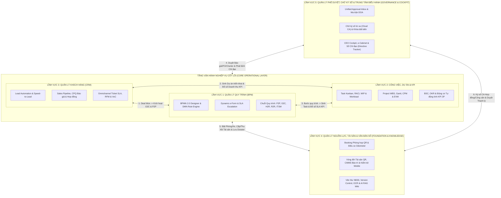
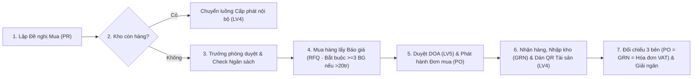
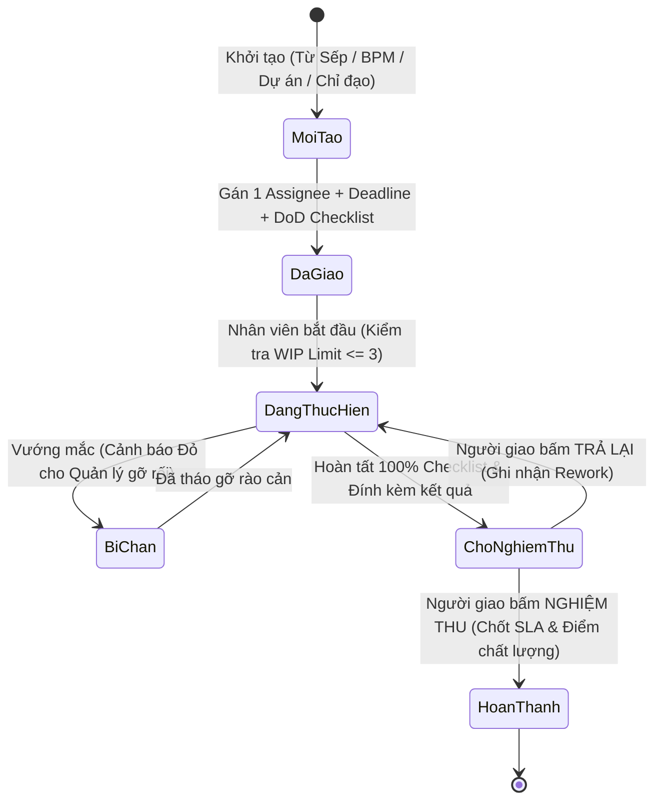
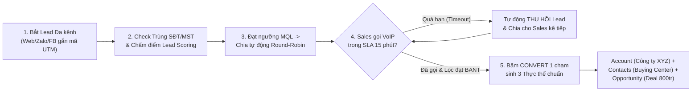
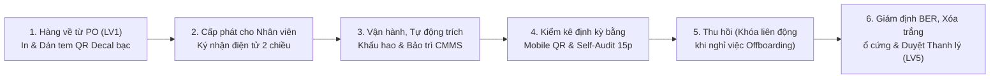
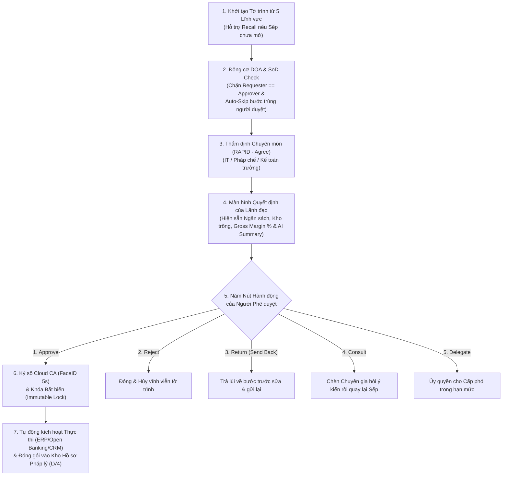

# BÁO CÁO NGHIÊN CỨU THỰC TRẠNG & ĐẶC TẢ YÊU CẦU PHẦN MỀM (SRS)
## ĐỀ TÀI: HỆ THỐNG QUẢN TRỊ DOANH NGHIỆP VÀ VẬN HÀNH TỔNG THỂ (ENTERPRISE MANAGEMENT SYSTEM)

> **THÔNG TIN HỒ SƠ BÁO CÁO NGHIÊN CỨU (DÀNH CHO GIẢNG VIÊN / HỘI ĐỒNG CHUYÊN MÔN NỘP BÁO CÁO):**
> - **Tên đề tài:** Nghiên cứu Thực trạng Nghiệp vụ Vận hành và Xây dựng Đặc tả Yêu cầu Phần mềm (SRS) cho Hệ thống Quản trị Doanh nghiệp và Vận hành Tổng thể (*Enterprise Management System / Unified Digital Workplace*).
> - **Mục tiêu & Nguyên tắc Báo cáo:** Báo cáo tập trung **phản ánh trung thực kết quả nghiên cứu thực trạng hiện tại** (*"Nghiên cứu được bao nhiêu, báo cáo bấy nhiêu"*). Trong đó, **mỗi Lĩnh vực (Domain/Pillar)** được bóc tách thành nhiều **Nghiệp vụ chuyên sâu (Business Operations)**; **mỗi 1 Nghiệp vụ tương ứng với 1 Quy trình vận hành trong thực tế (Real-world Operational Workflow)**, từ đó phân tích và chuyển hóa trực tiếp thành **Bộ Đặc tả Yêu cầu Phần mềm (SRS – Software Requirements Specification)** cho lĩnh vực đó.
> - **Ba Nguồn Tham khảo & Đối chứng Khoa học (3-Source Triangulation):**
>   1. **Nguồn 1 – Research trên Internet (Academic & Industry Standards):** Các bộ khung tiêu chuẩn quốc tế, mô hình quản trị và văn bản pháp quy hiện hành (*BPMN 2.0 ISO/IEC 19510, Lean/Six Sigma, PMBOK 8, Scrum Guide, BSC/OKR, BANT/MEDDIC/RFM, ISO 55000, ISO 15489, COSO/SoD, Luật Giao dịch điện tử 2023, Nghị định 30/2020/NĐ-CP, Thông tư 45/2013/TT-BTC*).
>   2. **Nguồn 2 – Khảo sát thực tế doanh nghiệp (Field Survey & As-Is Assessment):** Kết quả khảo sát thực địa, phỏng vấn 3 tầng, đi *Gemba Walk*, kiểm toán dữ liệu và phát 128 phiếu khảo sát định lượng (Likert 1–5) tại doanh nghiệp mẫu **Công ty A** (150 nhân sự, mô hình B2B & B2C kết hợp) cùng thương vụ thực tế 800 triệu đồng với **Công ty XYZ**.
>   3. **Nguồn 3 – Các ứng dụng doanh nghiệp đang sử dụng phổ biến (Market Application Benchmarking):** Phân tích đối sánh kiến trúc tính năng của các nền tảng *All-in-One* nội địa & quốc tế (*Base.vn, MISA AMIS, 1Office, Lark Suite, Odoo, FastWork*) và các ứng dụng *Best-of-Breed* đầu ngành (*Camunda 8, Jira, MS Project, Salesforce, HubSpot, Snipe-IT, SpeedMaint, Viettel vOffice, Cloud CA MySign/SmartCA, Power BI*).

---

## MỤC LỤC BÁO CÁO SRS

1. [CHƯƠNG 1: GIỚI THIỆU TỔNG QUAN, PHƯƠNG PHÁP NGHIÊN CỨU & KIẾN TRÚC TỔNG THỂ](#chương-1-giới-thiệu-tổng-quan-phương-pháp-nghiên-cứu--kiến-trúc-tổng-thể)
2. [CHƯƠNG 2: PHÂN TÍCH NGHIỆP VỤ & ĐẶC TẢ SRS LĨNH VỰC 1 – QUẢN LÝ QUY TRÌNH HOẠT ĐỘNG DOANH NGHIỆP (BPM & WORKFLOW)](#chương-2-phân-tích-nghiệp-vụ--đặc-tả-srs-lĩnh-vực-1--quản-lý-quy-trình-hoạt-động-doanh-nghiệp-bpm--workflow)
3. [CHƯƠNG 3: PHÂN TÍCH NGHIỆP VỤ & ĐẶC TẢ SRS LĨNH VỰC 2 – QUẢN LÝ CÔNG VIỆC, DỰ ÁN VÀ HIỆU SUẤT (TASK, PROJECT & KPI/OKR)](#chương-3-phân-tích-nghiệp-vụ--đặc-tả-srs-lĩnh-vực-2--quản-lý-công-việc-dự-án-và-hiệu-suất-task-project--kpiokr)
4. [CHƯƠNG 4: PHÂN TÍCH NGHIỆP VỤ & ĐẶC TẢ SRS LĨNH VỰC 3 – QUẢN LÝ QUAN HỆ KHÁCH HÀNG (CRM – MARKETING, SALES & SERVICE)](#chương-4-phân-tích-nghiệp-vụ--đặc-tả-srs-lĩnh-vực-3--quản-lý-quan-hệ-khách-hàng-crm--marketing-sales--service)
5. [CHƯƠNG 5: PHÂN TÍCH NGHIỆP VỤ & ĐẶC TẢ SRS LĨNH VỰC 4 – QUẢN LÝ NGUỒN LỰC, TÀI SẢN VÀ VĂN BẢN LƯU TRỮ SỐ (RESOURCE, ASSET & DMS)](#chương-5-phân-tích-nghiệp-vụ--đặc-tả-srs-lĩnh-vực-4--quản-lý-nguồn-lực-tài-sản-và-văn-bản-lưu-trữ-số-resource-asset--dms)
6. [CHƯƠNG 6: PHÂN TÍCH NGHIỆP VỤ & ĐẶC TẢ SRS LĨNH VỰC 5 – QUẢN LÝ PHÊ DUYỆT, CHỮ KÝ SỐ VÀ TRUNG TÂM ĐIỀU HÀNH (APPROVAL & EXECUTIVE COCKPIT)](#chương-6-phân-tích-nghiệp-vụ--đặc-tả-srs-lĩnh-vực-5--quản-lý-phê-duyệt-chữ-ký-số-và-trung-tâm-điều-hành-approval--executive-cockpit)
7. [CHƯƠNG 7: ĐẶC TẢ YÊU CẦU PHI CHỨC NĂNG (NFR), MA TRẬN LIÊN THÔNG DỮ LIỆU & KẾT LUẬN NGHIÊN CỨU](#chương-7-đặc-tả-yêu-cầu-phi-chức-năng-nfr-ma-trận-liên-thông-dữ-liệu--kết-luận-nghiên-cứu)

---

## CHƯƠNG 1: GIỚI THIỆU TỔNG QUAN, PHƯƠNG PHÁP NGHIÊN CỨU & KIẾN TRÚC TỔNG THỂ

### 1.1. Bối cảnh và Phạm vi Báo cáo Nghiên cứu Thực trạng
Báo cáo này tổng hợp toàn bộ kết quả nghiên cứu thực trạng từ 50 chuyên đề nghiệp vụ thuộc bài toán **Quản trị Doanh nghiệp và Vận hành (Enterprise Management)**. Thay vì xây dựng một tài liệu lý thuyết tách rời thực tiễn, nhóm nghiên cứu áp dụng phương pháp **"Từ Quy trình Thực tế đến Đặc tả Kỹ thuật" (Process-to-SRS Mapping)**:
- Mỗi lĩnh vực quản trị trong doanh nghiệp không phải là một khối đơn nhất mà bao gồm hàng loạt **nghiệp vụ con (Sub-domains / Business Operations)**.
- Mỗi nghiệp vụ con trong thực tế đều vận hành dưới dạng một **quy trình có đầu vào, các bước luân chuyển liên phòng ban, chốt chặn kiểm soát và đầu ra cụ thể**.
- Bằng cách đối chiếu 3 nguồn: **(1) Chuẩn lý thuyết/Internet**, **(2) Nỗi đau và số liệu khảo sát thực tế tại doanh nghiệp**, và **(3) Cách các phần mềm phổ biến đang giải quyết**, báo cáo rút trích ra bộ **Yêu cầu Chức năng (Functional Requirements - FR)**, **Quy tắc Nghiệp vụ (Business Rules - BR)** và **Mô hình Thực thể Dữ liệu (Data Entities)** chuẩn xác cho từng lĩnh vực.

### 1.2. Tổng hợp Kết quả Khảo sát Thực trạng Tổng thể tại Doanh nghiệp Mẫu (Công ty A)
Qua khảo sát thực tế tại **Công ty A** (150 nhân sự, kinh doanh thiết bị & giải pháp văn phòng B2B/B2C) với 18 phiên phỏng vấn sâu, 3 ngày quan sát hiện trường (*Gemba Walk*) và 128 phiếu khảo sát định lượng (25 câu hỏi Likert 1–5):

| Lĩnh vực khảo sát | Điểm khảo sát As-Is (Thang 5.0) | Cấp độ trưởng thành hiện tại (CMMI 1–5) | Thực trạng cốt lõi phát hiện từ khảo sát thực địa |
| :--- | :---: | :---: | :--- |
| **1. Quản lý Quy trình (BPM)** | **1.80 / 5.0** | **Cấp 1.7** (*Thủ công & Tự phát*) | Quy trình nằm trên giấy ISO nhưng thực tế chạy qua Zalo/trình ký giấy; *Cycle Time* mua hàng mất 5,2–10 ngày; *Flow Efficiency* chỉ đạt 1,1%; tỷ lệ hồ sơ bị trả lại (*Rework*) tới 38%. |
| **2. Công việc, Dự án & KPI** | **1.92 / 5.0** | **Cấp 1.9** (*Phân mảnh nhóm*) | Giao việc qua 24 nhóm chat Zalo làm 27% đầu việc bị trôi/trễ hạn; dự án thiếu đường găng CPM và cảnh báo EVM; cuối tháng mất 5 ngày công/phòng để cộng Excel chấm KPI cảm tính. |
| **3. Quản lý Khách hàng (CRM)** | **1.84 / 5.0** | **Cấp 1.8** (*Ốc đảo Excel cá nhân*) | 100% Sales giữ danh sách khách trên Excel riêng; trùng khách 18%; *Speed-to-Lead* mất 4,5 giờ; lập báo giá/hợp đồng mất 1,5 ngày; từng mất khách lớn khi Sales nghỉ việc. |
| **4. Nguồn lực, Tài sản & Văn bản** | **1.90 / 5.0** | **Cấp 1.9** (*Sổ sách lệch thực tế*) | Trùng phòng họp 4–5 lần/tháng; lệch 14% tài sản CNTT giữa sổ Kế toán và thực tế; kiểm kê mất 10 ngày; tìm kiếm hợp đồng/công văn giấy trong tủ sắt mất 25–40 phút. |
| **5. Phê duyệt & Điều hành** | **1.82 / 5.0** | **Cấp 1.8** (*Tắc nghẽn đỉnh tháp*) | Giám đốc ký giấy 45 tờ trình/ngày; đi công tác là hồ sơ đóng băng; họp giao ban mất 2 giờ đọc số liệu cũ trễ 5–7 ngày; 40% chỉ đạo sau họp bị lãng quên sau 2 tuần. |
| **TỔNG HỢP TOÀN CÔNG TY** | **1.86 / 5.0** *(46.5/125đ)* | **Cấp 1.8 / 5.0** | **Nỗi đau lớn nhất:** Sự phân mảnh thành các "Ốc đảo dữ liệu" (*Data Silos*), thiếu khóa liên động (*Hard Interlocks*) giữa các phòng ban và thiếu nguồn dữ liệu tự động (*Single Source of Truth*). |

### 1.3. Sơ đồ Kiến trúc Liên thông Tổng thể 5 Lĩnh vực trong SRS

---

## CHƯƠNG 2: PHÂN TÍCH NGHIỆP VỤ & ĐẶC TẢ SRS LĨNH VỰC 1 – QUẢN LÝ QUY TRÌNH HOẠT ĐỘNG DOANH NGHIỆP (BPM & WORKFLOW)

### 2.1. Tổng hợp Thực trạng Nghiên cứu từ 3 Nguồn Tham khảo

1. **Nguồn 1 – Research trên Internet (Tiêu chuẩn & Lý thuyết):**
   - Chuẩn mô hình hóa quy trình quốc tế **BPMN 2.0 (ISO/IEC 19510)** và bảng quyết định **DMN (Decision Model and Notation)** tách rời logic điều kiện khỏi sơ đồ luồng.
   - Phương pháp luận **Lean** (loại bỏ 8 lãng phí *DOWNTIME*, nâng cao Hiệu suất chu trình $\text{PCE} = \frac{\text{Value-Added Time}}{\text{Cycle Time}}$), **Six Sigma (DMAIC)** giảm tỷ lệ lỗi quy trình, và **Định luật Little**: $\text{WIP} = \text{Throughput} \times \text{Cycle Time}$.
   - Khung kiểm soát nội bộ **COSO** yêu cầu kiểm soát tiền kiểm (*Ex-ante*), đối chiếu 3 bên (*3-Way Matching*) và lưu vết kiểm toán bất biến (*Immutable Audit Trail*).
2. **Nguồn 2 – Khảo sát Thực tế Doanh nghiệp (Công ty A):**
   - Quy trình Đề nghị mua hàng trên quy chế viết 4 bước nhưng thực tế nhân viên phải cầm giấy đi bộ qua 3 tầng lầu với 7 bước ký; tổng *Cycle Time* mất **5,2 đến 10 ngày** trong khi thời gian xử lý thực (*Touch Time*) chỉ có **20 phút** (*Flow Efficiency* = **1,1%**).
   - **38% hồ sơ bị trả lại (Rework)** do nhân viên dùng sai mẫu file Word cũ, quên đính kèm đủ 3 báo giá cạnh tranh hoặc vượt ngân sách phòng ban mà người duyệt bước đầu không biết.
   - Nhân viên phải nhập đi nhập lại cùng một thông tin (Tên nhà cung cấp, Mã hàng, Số tiền) tới 4 lần trên Word, Excel, Email và phần mềm Kế toán.
3. **Nguồn 3 – Các Ứng dụng Doanh nghiệp Đang Sử dụng Phổ biến:**
   - *Phân khúc Chuyên sâu Quốc tế (Best-of-Breed):* **Camunda 8, Bizagi, Appian, Pega, ServiceNow** (mạnh về BPMN 2.0 Engine, DMN, điều phối API/Microservices), **UiPath & Power Automate** (RPA tự động nhập liệu), **Celonis & SAP Signavio** (Process Mining khai phá quy trình từ Event Logs).
   - *Phân khúc Phổ biến tại Việt Nam (All-in-One):* **Base Workflow (Base.vn)**, **MISA AMIS Quy trình (OneWorkflow)**, **1Office (1WORK)**, **Lark Approval/Base**. Điểm chung tạo nên giá trị thực tế là: Thiết kế kéo thả không cần code (*No-code Process Builder*), Biểu mẫu điện tử động (*Dynamic e-Form*), đếm ngược SLA theo lịch làm việc và liên thông trực tiếp với danh mục Nhân sự – Kế toán.

---

### 2.2. Phân tích Chi tiết Các Nghiệp vụ & Quy trình Vận hành Thực tế trong Lĩnh vực 1

Trong thực tế vận hành doanh nghiệp, Lĩnh vực 1 bao gồm **6 Nghiệp vụ cốt lõi**, mỗi nghiệp vụ là một quy trình vận hành xuyên suốt liên phòng ban:

#### Nghiệp vụ 1.1: Thiết kế, Phiên bản hóa và Vận hành Động cơ Quy trình (Process Modeling, Versioning & Execution)
* **Quy trình vận hành thực tế:** Chuyên viên Cải tiến quy trình (BA/Admin) khảo sát quy trình thực tế $\rightarrow$ Vẽ sơ đồ Swimlane/BPMN 2.0 gồm các bước (*User Task, Service Task*) và các cổng rẽ nhánh (*XOR, AND, OR*) $\rightarrow$ Thiết kế biểu mẫu nhập liệu điện tử (*e-Form*) gắn quyền ẩn/hiện/sửa từng trường theo từng bước $\rightarrow$ Cấu hình thời hạn xử lý (*SLA*) cho từng bước $\rightarrow$ Phát hành phiên bản `v1.0`. Khi công ty thay đổi chính sách, Admin phát hành bản `v2.0`: các hồ sơ đang chạy dở ở `v1.0` tiếp tục chạy hết theo luật `v1.0`, hồ sơ tạo mới từ thời điểm kích hoạt sẽ chạy theo `v2.0`.

#### Nghiệp vụ 1.2: Quy trình Mua hàng đến Thanh toán (Procure-to-Pay – P2P Workflow)
* **Quy trình vận hành thực tế:**
  1. Nhân viên các phòng lập **Phiếu đề nghị mua hàng (PR)** trên hệ thống.
  2. Hệ thống tự động kiểm tra kho Tài sản/Vật tư (Lĩnh vực 4): nếu kho còn hàng trống thì chuyển sang luồng Cấp phát nội bộ; nếu hết hàng mới chuyển sang bước Mua mới.
  3. Trưởng bộ phận duyệt nhu cầu $\rightarrow$ Hệ thống tự động kiểm tra Ngân sách phòng ban còn lại.
  4. Chuyên viên Mua hàng (*Chị Lan*) tiếp nhận PR, lấy báo giá nhà cung cấp (**RFQ**): nếu giá trị $> 20\text{ triệu đồng}$, hệ thống bắt buộc đính kèm tối thiểu 3 báo giá cạnh tranh (trừ khi mua từ Nhà cung cấp có Hợp đồng khung đã duyệt sẵn).
  5. Phê duyệt chọn nhà cung cấp theo hạn mức DOA (Lĩnh vực 5) $\rightarrow$ Hệ thống tự động sinh **Đơn đặt hàng (PO)** gửi cho Nhà cung cấp.
  6. Khi hàng về kho, Thủ kho kiểm đếm lập **Phiếu nhập kho (GRN)** (nếu là Tài sản/CCDC thì IT phải dán mã QR Code ở Lĩnh vực 4).
  7. Kế toán thanh toán nhận Hóa đơn điện tử (VAT Invoice), hệ thống thực hiện **Đối chiếu 3 bên tự động (3-Way Matching: PO + Phiếu nhập kho GRN + Hóa đơn VAT)** khớp 100% về số lượng và đơn giá mới mở khóa lệnh chi tiền qua ngân hàng (*Open Banking*).

#### Nghiệp vụ 1.3: Quy trình Đơn hàng đến Thu tiền (Order-to-Cash – O2C Workflow)
* **Quy trình vận hành thực tế:** Khi Sales chốt thắng thương vụ (`Closed-Won`) trên CRM (Lĩnh vực 3) $\rightarrow$ Hệ thống tự động kích hoạt quy trình O2C: Kiểm tra hạn mức tín dụng và công nợ quá hạn của khách hàng $\rightarrow$ Kiểm tra tồn kho khả dụng (nếu thiếu hàng thì tự động bắn yêu cầu sang quy trình Mua hàng P2P ở Nghiệp vụ 1.2) $\rightarrow$ Lập lệnh xuất kho và giao hàng/lắp đặt (đo chỉ số giao hàng đúng hạn & đủ số lượng **OTIF**) $\rightarrow$ Khách ký biên bản nghiệm thu điện tử $\rightarrow$ Kế toán phát hành Hóa đơn VAT $\rightarrow$ Theo dõi thu hồi công nợ theo từng đợt thanh toán (đo chỉ số kỳ thu tiền bình quân **DSO**).

#### Nghiệp vụ 1.4: Quy trình Tuyển dụng đến Nghỉ việc Liên phòng ban (Hire-to-Retire – H2R: Onboarding & Offboarding)
* **Quy trình vận hành thực tế:**
  - *Luồng Tiếp nhận nhân sự mới (Onboarding):* Ngay khi ứng viên xác nhận nhận việc, quy trình tự động rẽ nhánh song song (**Cổng AND**) giao việc đồng thời cho 3 bộ phận: (1) **IT** tạo email, tài khoản hệ thống và chuẩn bị Laptop; (2) **Hành chính** chuẩn bị bàn làm việc, thẻ từ chấm công; (3) **Nhân sự (HR)** chuẩn bị hợp đồng lao động và lộ trình đào tạo hội nhập. Tất cả phải hoàn tất trước 8h00 sáng ngày nhân viên đi làm đầu tiên.
  - *Luồng Giải quyết nghỉ việc (Offboarding):* Nhân viên nộp đơn xin nghỉ việc $\rightarrow$ Trưởng bộ phận duyệt và chỉ định người nhận bàn giao công việc/khách hàng (trên Lĩnh vực 2 & 3) $\rightarrow$ Hệ thống chạy cổng song song yêu cầu: **IT** thu hồi Laptop/thiết bị và khóa toàn bộ tài khoản truy cập đúng 17h30 ngày làm việc cuối; **Hành chính** thu hồi thẻ từ/vé xe; **Kế toán** kiểm tra công nợ tạm ứng chưa hoàn $\rightarrow$ Chỉ khi cả 3 bộ phận bấm xác nhận hoàn tất (**Hard Interlock**) thì HR và Kế toán lương mới được mở khóa bước thanh toán lương cuối kỳ.

#### Nghiệp vụ 1.5: Quy trình Tài chính – Kế toán Nội bộ (Record-to-Report – R2R: Tạm ứng, Hoàn ứng & Duyệt chi)
* **Quy trình vận hành thực tế:** Nhân viên lập Đề nghị tạm ứng công tác/mua sắm $\rightarrow$ Hệ thống tự động tra cứu sổ công nợ nội bộ: **Nếu nhân viên đó đang còn khoản tạm ứng cũ đã quá hạn hoàn ứng mà chưa thanh quyết toán, hệ thống tự động chặn cứng không cho gửi phiếu tạm ứng mới** $\rightarrow$ Nếu hợp lệ, phiếu chạy qua Trưởng phòng và Kế toán kiểm tra ngân sách $\rightarrow$ Giải ngân $\rightarrow$ Khi công việc xong, nhân viên lập Phiếu hoàn ứng đính kèm hóa đơn chứng từ gốc để tất toán.

#### Nghiệp vụ 1.6: Quy trình Hỗ trợ Dịch vụ Nội bộ & Khai phá Quy trình (Internal Service Desk / ITSM & Process Mining)
* **Quy trình vận hành thực tế:** Nhân viên gặp sự cố CNTT hoặc cần hỗ trợ hành chính tạo phiếu yêu cầu $\rightarrow$ Hệ thống phân loại theo 3 luồng chuẩn ITSM: **Sự cố (Incident)** cần khắc phục nhanh theo SLA, **Yêu cầu dịch vụ (Service Request)** cần phê duyệt cấp phát, hoặc **Thay đổi hệ thống (Change Management)**. Toàn bộ nhật ký thời gian thực thi (*Event Logs*: Ai làm, Bước nào, Giờ vào, Giờ ra, Hành động) của mọi quy trình trên được ghi nhận tự động để phục vụ báo cáo SLA và **Khai phá quy trình (Process Mining)** nhằm phát hiện nút thắt cổ chai.

---

### 2.3. Đặc tả Yêu cầu Phần mềm (SRS) cho Lĩnh vực 1 (BPM & Workflow)

#### A. Danh mục Yêu cầu Chức năng (Functional Requirements – FR)

| Mã FR | Tên Chức năng | Mô tả Chi tiết Yêu cầu Kỹ thuật & Nghiệp vụ | Độ ưu tiên |
| :---: | :--- | :--- | :---: |
| **FR-BPM-01** | **Trình thiết kế Quy trình Kéo thả (No-code BPMN 2.0 Designer)** | Hỗ trợ vẽ quy trình trực quan với đầy đủ phần tử BPMN 2.0: *Start/Intermediate/End Events, User Task, Service Task (gọi API/Webhook), Sub-process, Exclusive Gateway (XOR), Parallel Gateway (AND), Inclusive Gateway (OR)* và phân làn *Swimlane* theo vai trò. | **Bắt buộc (Must)** |
| **FR-BPM-02** | **Trình thiết kế Biểu mẫu Động (Dynamic e-Form & Field Matrix)** | Cho phép tạo biểu mẫu gồm các trường văn bản, số, công thức tính toán tự động, bảng chi tiết nhiều dòng (*Data Grid*), tải file đính kèm và tra cứu danh mục (*Lookup*). Cung cấp **Ma trận phân quyền trường dữ liệu theo từng bước**: Bước nào được *Xem (Read-only)*, *Sửa (Editable)*, *Bắt buộc nhập (Mandatory)* hoặc *Ẩn (Hidden)* (VD: ẩn giá dự toán ở bước nhân viên không liên quan). | **Bắt buộc (Must)** |
| **FR-BPM-03** | **Động cơ Quy tắc Nghiệp vụ & Bảng Quyết định (DMN Engine)** | Tách các điều kiện rẽ nhánh phức tạp (Hạn mức tiền, Nhóm hàng hóa, Phòng ban, Ngân sách) ra thành **Bảng quyết định (Decision Table)** để Admin chỉnh sửa ngưỡng số liệu mà không cần vẽ lại sơ đồ quy trình. | **Bắt buộc (Must)** |
| **FR-BPM-04** | **Quản lý Phiên bản Quy trình (Process Version Control)** | Khi cập nhật quy trình sang phiên bản mới (`v2.0`), hệ thống phải bảo toàn trạng thái cho toàn bộ các hồ sơ đang chạy dở (*In-flight Instances*) tiếp tục chạy theo logic của `v1.0`, chỉ áp dụng `v2.0` cho hồ sơ khởi tạo mới. | **Bắt buộc (Must)** |
| **FR-BPM-05** | **Động cơ Đếm ngược SLA & Tự động Leo thang (SLA & Escalation Engine)** | Cho phép cấu hình SLA từng bước theo giờ làm việc hành chính (trừ Thứ Bảy, Chủ Nhật, Ngày lễ theo lịch công ty). Tự động gửi cảnh báo khi đạt **75% thời gian SLA**; khi quá hạn (**100% SLA**), tự động đổi màu Đỏ, ghi nhận vi phạm vào bảng KPI cá nhân và kích hoạt quy tắc leo thang (nhắc cấp trên hoặc chuyển người xử lý dự phòng). | **Bắt buộc (Must)** |
| **FR-BPM-06** | **Kiểm soát Chốt chặn Nghiệp vụ P2P, O2C, H2R, R2R (Hard Interlocks)** | - **P2P:** Bắt buộc đính kèm $\ge 3$ file báo giá nếu tổng tiền $> 20\text{ triệu VNĐ}$; tự động kiểm tra khớp 3 bên (*PO – Nhập kho – Hóa đơn*) trước khi cho phép tạo lệnh thanh toán. - **R2R:** Tự động khóa nút tạo phiếu Tạm ứng mới nếu `User_ID` đang có phiếu Tạm ứng cũ quá hạn hoàn ứng. - **H2R Offboarding:** Khóa bước xác nhận hoàn tất nghỉ việc nếu còn bất kỳ Tài sản hoặc Công nợ nào gắn với nhân viên đó chưa được thu hồi. | **Bắt buộc (Must)** |
| **FR-BPM-07** | **Báo cáo Hiệu suất Quy trình & Khai phá Điểm nghẽn (Process Analytics & Mining)** | Tự động thống kê theo thời gian thực: *Cycle Time* (Trung bình, Trung vị Median, Phân vị P90), *Processing Time vs. Waiting Time*, *Hiệu suất chu trình (PCE %)*, *Tỷ lệ đạt ngay lần đầu (FPY & RTY)*, *Số lượng hồ sơ tồn đọng (WIP)* và biểu đồ nhiệt (*Bottleneck Heatmap*) chỉ ra bước nào đang làm ứ đọng hồ sơ lâu nhất. | **Cao (Should)** |
| **FR-BPM-08** | **Cổng Tích hợp Tự động hóa (REST API, Webhook & RPA Trigger)** | Hỗ trợ *Service Task* bắn dữ liệu JSON qua Webhook/REST API sang phần mềm Kế toán/ERP/CRM khi quy trình chạy đến bước chỉ định, hoặc nhận lệnh khởi tạo quy trình tự động từ hệ thống bên ngoài. | **Bắt buộc (Must)** |

#### B. Các Quy tắc Nghiệp vụ Cốt lõi (Business Rules – BR)
- **BR-BPM-01 (Quy tắc Toàn vẹn Dữ liệu Điền một lần – Single Data Entry):** Mọi trường dữ liệu đã nhập ở bước trước hoặc kéo từ hồ sơ CRM/Nhân sự phải được tự động kế thừa (*Auto-populate*) sang các bước sau và các phiếu liên quan (từ PR sang RFQ, sang PO, sang Phiếu nhập kho, sang Đề nghị thanh toán); nghiêm cấm bắt nhân viên nhập lại thủ công.
- **BR-BPM-02 (Quy tắc Chống Làm lại – Poka-Yoke Validation):** Hệ thống không cho phép bấm nút `[Gửi / Hoàn thành bước]` nếu các trường bắt buộc hoặc tài liệu đính kèm theo điều kiện chưa thỏa mãn.
- **BR-BPM-03 (Quy tắc Nhật ký Kiểm toán Bất biến – Immutable Event Log):** Mọi thao tác trên hồ sơ quy trình đều phải ghi vào bảng `Process_Event_Log` gồm: `Instance_ID`, `Step_ID`, `Actor_ID`, `Action_Type`, `Timestamp_In`, `Timestamp_Out`, `Old_Value`, `New_Value`, `IP_Address`. Không ai (kể cả System Admin) được phép xóa hoặc sửa bảng nhật ký này.

---

## CHƯƠNG 3: PHÂN TÍCH NGHIỆP VỤ & ĐẶC TẢ SRS LĨNH VỰC 2 – QUẢN LÝ CÔNG VIỆC, DỰ ÁN VÀ HIỆU SUẤT (TASK, PROJECT & KPI/OKR)

### 3.1. Tổng hợp Thực trạng Nghiên cứu từ 3 Nguồn Tham khảo

1. **Nguồn 1 – Research trên Internet (Tiêu chuẩn & Lý thuyết):**
   - Chuỗi liên kết chiến lược **Line of Sight** nối từ *Bản đồ chiến lược Balanced Scorecard (BSC 4 góc nhìn)* $\rightarrow$ *Mục tiêu OKR/KPI* $\rightarrow$ *Dự án (Project) & Quy trình (Process)* $\rightarrow$ *Công việc hằng ngày (Task)*.
   - Phương pháp quản lý công việc **Kanban** (giới hạn *WIP Limit* chống *Context Switching*), phân quyền trách nhiệm **RACI** (duy nhất 1 chữ **A – Accountable** cho mỗi đầu việc), và quản lý dự án chuẩn **PMBOK 8 / PRINCE2 / Agile Scrum (3-5-3)**.
   - Kỹ thuật lập tiến độ **WBS (Quy tắc 100%)**, **Phương pháp Đường găng (CPM – Critical Path Method)**, ước lượng **PERT** ($T_e = \frac{O + 4M + P}{6}$) và **Quản lý Giá trị Thu được (EVM: PV, EV, AC, SPI, CPI, EAC)**.
   - Lý thuyết đo lường hiệu suất: Phân biệt *Leading vs. Lagging KPI*, chuẩn hóa điểm số KPI thuận/nghịch có *Ngưỡng sàn (Floor) – Ngưỡng trần (Cap)*, kết nối **Lương 3P**, hội đồng hiệu chỉnh **Calibration (9-Box Grid)** và thiết kế **Cặp chỉ số đối trọng** chống **Định luật Goodhart** (*"Khi một thước đo trở thành mục tiêu, nó không còn là một thước đo tốt nếu đứng một mình"*).
2. **Nguồn 2 – Khảo sát Thực tế Doanh nghiệp (Công ty A):**
   - Nhân viên nhận việc qua **24 nhóm chat Zalo** khác nhau dẫn đến **27% đầu việc bị trôi, quên hoặc trễ hạn**; giao việc chung chung cho "cả phòng" không rõ ai chịu trách nhiệm chính và không có tiêu chí nghiệm thu (*Definition of Done*).
   - Các dự án triển khai lắp đặt thiết bị cho khách hàng B2B hoặc dự án nội bộ không có đường cơ sở (*Baseline*), khi trễ hạn hoặc đội vốn thì Ban Giám đốc chỉ biết khi sự đã rồi.
   - Cuối mỗi tháng/quý, các Trưởng phòng mất **5 ngày công** chỉ để gom file Excel chấm điểm KPI; 95% nhân viên đều được chấm loại A do sếp cả nể (*Leniency Bias*) hoặc chấm theo trí nhớ tuần cuối cùng (*Recency Bias*), gây bất bình đẳng trong trả thưởng.
3. **Nguồn 3 – Các Ứng dụng Doanh nghiệp Đang Sử dụng Phổ biến:**
   - *Quản lý Công việc & Agile (Best-of-Breed):* **Atlassian Jira, Linear** (chuẩn mực cho Scrum/Sprint/Backlog/Burndown), **Asana, Monday.com, ClickUp, Trello** (mạnh về Kanban, Timeline, Workload Heatmap).
   - *Quản lý Dự án Kỹ thuật & PPM:* **Microsoft Project, Oracle Primavera P6, Smartsheet** (đỉnh cao về WBS, Đường găng CPM, Baseline và tính toán EVM tự động).
   - *Quản trị Mục tiêu & Hiệu suất:* **Profit.co, Lattice** (Quốc tế); **1Office, Base Wework + Base Goal, MISA AMIS Công việc & Mục tiêu** (Việt Nam – đặc biệt 1Office và Base rất mạnh ở khả năng tự động kéo số liệu hoàn thành Task/Quy trình/CRM về bảng tính điểm KPI và đổ sang bảng Lương 3P).

---

### 3.2. Phân tích Chi tiết Các Nghiệp vụ & Quy trình Vận hành Thực tế trong Lĩnh vực 2

Lĩnh vực 2 bao gồm **5 Nghiệp vụ cốt lõi**, vận hành theo các quy trình thực tế sau:

#### Nghiệp vụ 2.1: Quy trình Giao việc, Thực thi Kanban, Kiểm soát Tải (Workload) và Nghiệm thu Công việc (Task Lifecycle)
* **Quy trình vận hành thực tế:**
  1. Công việc (*Task*) được sinh ra từ 4 nguồn: (a) Quản lý trực tiếp tạo giao việc, (b) Tự động sinh ra từ một bước của Quy trình BPM (Lĩnh vực 1), (c) Phân rã từ Gói công việc WBS của Dự án, hoặc (d) Tự động sinh từ Chỉ đạo cuộc họp của Giám đốc / Bút phê công văn đến (Lĩnh vực 4 & 5).
  2. Khi giao việc, hệ thống bắt buộc chỉ định **duy nhất 1 Người thực hiện chính (Assignee/Accountable)**, Người phối hợp (*Support*), Người giám sát (*Follower*), Hạn hoàn thành (*Deadline*), Số giờ ước lượng (*Estimated Hours*) và Danh sách tiêu chí nghiệm thu (*Checklist / Definition of Done - DoD*).
  3. Hệ thống kiểm tra **Bản đồ nhiệt tải nguồn lực (Workload Heatmap)** của nhân sự (quỹ chuẩn 24 giờ kế hoạch/tuần, chừa 20% buffer cho việc đột xuất) và kiểm tra giới hạn **WIP Limit** (mỗi nhân sự không mở quá 3 Task ở trạng thái `Đang thực hiện` cùng lúc).
  4. Nhân viên nhận việc $\rightarrow$ Kéo thẻ sang `Đang thực hiện (In Progress)` $\rightarrow$ Nếu gặp vướng mắc do chờ bên thứ ba thì bấm chuyển sang trạng thái 🔴 **`Bị chặn (Blocked)`** kèm nguyên nhân để hệ thống báo động ngay cho Quản lý tháo gỡ.
  5. Khi làm xong và tích đủ 100% Checklist DoD, nhân viên bấm `Chờ nghiệm thu (In Review)` đính kèm sản phẩm bàn giao (*Deliverable*).
  6. Người giao việc kiểm tra: Nếu đạt thì bấm `Hoàn thành (Done)` và chấm sao chất lượng (1–5 sao); nếu chưa đạt thì bấm `Trả lại (Returned)` kèm lý do để nhân viên sửa lại (hệ thống ghi nhận số lần bị trả lại để tính tỷ lệ *First-Time-Right*).

#### Nghiệp vụ 2.2: Quy trình Lập Kế hoạch Dự án, Phân rã WBS, Tính Đường găng (CPM) và Chốt Đường cơ sở (Project Planning & Baselining)
* **Quy trình vận hành thực tế:** Khi có dự án mới (VD: *Dự án triển khai 50 bộ máy tính cho Công ty XYZ* tự động sinh từ Hợp đồng CRM, hoặc *Dự án nội bộ triển khai e-Workflow ngân sách 550 triệu*) $\rightarrow$ Quản lý dự án (PM) lập **Điều lệ dự án (Project Charter)** trình duyệt qua Lĩnh vực 5 $\rightarrow$ Xây dựng **Cây phân rã công việc (WBS)** chia dự án thành các Giai đoạn (*Phases*) $\rightarrow$ Gói công việc (*Work Packages*) $\rightarrow$ Đầu việc (*Tasks*) $\rightarrow$ Thiết lập mối quan hệ phụ thuộc (**FS, SS, FF, SF** kèm độ trễ *Lag/Lead*) và thời lượng kỳ vọng (*PERT*) $\rightarrow$ Hệ thống tự động chạy thuật toán **CPM** vẽ biểu đồ **Gantt Chart**, tô màu đỏ chuỗi công việc nằm trên **Đường găng (Critical Path có Float = 0)** $\rightarrow$ PM bấm chốt **3 Đường cơ sở (Scope, Schedule, Cost Baselines)** để làm mốc so sánh xuyên suốt dự án.

#### Nghiệp vụ 2.3: Quy trình Thực thi Dự án Lai (Hybrid / Agile Scrum Sprint) và Giám sát Giá trị Thu được (EVM & Change Control)
* **Quy trình vận hành thực tế:**
  - Với các gói công việc phát triển sản phẩm/cấu hình phần mềm theo **Agile Scrum**: Product Owner quản lý *Product Backlog* $\rightarrow$ Đội dự án họp *Sprint Planning* chọn các *User Story* (ước lượng *Story Points*) đưa vào *Sprint Backlog* (chu kỳ 2 tuần) $\rightarrow$ Họp *Daily Scrum* 15 phút mỗi sáng theo dõi biểu đồ *Burndown Chart* & *Velocity* $\rightarrow$ Cuối Sprint tổ chức *Sprint Review* nghiệm thu sản phẩm chạy thật và *Sprint Retrospective* rút kinh nghiệm.
  - Định kỳ hằng tuần/tháng, hệ thống tự động tổng hợp dữ liệu tiến độ (% hoàn thành thực tế của các WBS) và chi phí thực chi từ Kế toán để tính bộ chỉ số **EVM (PV, EV, AC, SPI, CPI, EAC)**. Nếu $\text{SPI} < 0,9$ hoặc $\text{CPI} < 0,9$, dự án tự động chuyển trạng thái **Vàng/Đỏ** trên màn hình CEO Cockpit để PM áp dụng *Fast-tracking* hoặc *Crashing*. Mọi yêu cầu thay đổi phạm vi/ngân sách phải tạo phiếu **Change Request (CR)** trình Ban chỉ đạo duyệt mới được cập nhật lại Baseline.

#### Nghiệp vụ 2.4: Quy trình Thiết lập Chiến lược BSC, Phân bổ Cây Mục tiêu OKR/KPI và Từ điển KPI
* **Quy trình vận hành thực tế:** Đầu năm/quý, Ban Giám đốc thiết lập **Bản đồ chiến lược BSC 4 góc nhìn** (*Tài chính $\leftarrow$ Khách hàng $\leftarrow$ Quy trình nội bộ $\leftarrow$ Học hỏi & Phát triển*) $\rightarrow$ Phân bổ xuống các Phòng ban và Cá nhân thành 2 luồng song hành:
  1. **Luồng KPI Vận hành (BAU):** Mỗi vị trí được gán từ **3 đến 7 chỉ số KPI** lấy từ **Từ điển KPI chuẩn** (10 thuộc tính), tổng trọng số $\sum W_i = 100\%$ (mỗi KPI từ $10\%–50\%$), luôn đi theo **cặp chỉ số đối trọng** (Tốc độ đi kèm Chất lượng/CSAT) để chống thao túng số liệu.
  2. **Luồng OKR Đột phá (Projects/Improvements):** Thiết lập 1 *Objective* định tính truyền cảm hứng + 3–5 *Key Results* định lượng đo kết quả đầu ra (*Outcome*), thực hiện *Check-in* tiến độ hằng tuần theo mẫu **PPP (Progress – Plans – Problems)** và tách rời khỏi công thức tính lương thưởng trực tiếp.

#### Nghiệp vụ 2.5: Quy trình Tự động Kéo Dữ liệu Chấm điểm KPI, Hiệu chỉnh (Calibration) và Kết nối Lương 3P
* **Quy trình vận hành thực tế:** Trong suốt kỳ làm việc, nhân viên chỉ tập trung xử lý Quy trình (Lĩnh vực 1), Công việc/Dự án (Lĩnh vực 2), Bán hàng/CSKH (Lĩnh vực 3) và Quản lý Tài sản/Văn bản (Lĩnh vực 4). Cuối tháng/quý, **Động cơ tính điểm KPI (Scoring Engine)** tự động truy vấn kết quả thực tế ($A$) từ cơ sở dữ liệu của cả 5 lĩnh vực, áp dụng công thức chuẩn hóa KPI Thuận/Nghịch cùng ngưỡng Sàn (*Floor 60%*) và Trần (*Cap 120%*) để tính ra **Tổng điểm KPI khách quan** $\rightarrow$ Kết hợp với điểm đánh giá Năng lực/Hành vi (*What 80% $\times$ How 20%*) đưa lên ma trận **9-Box Grid** cho Hội đồng nhân sự họp **Calibration** $\rightarrow$ Tự động đẩy hệ số hoàn thành KPI sang phân hệ Tiền lương để tính **Lương hiệu suất P3 (Lương 3P)** hoặc kích hoạt kế hoạch cải thiện **PIP** cho nhân sự yếu kém.

---

### 3.3. Đặc tả Yêu cầu Phần mềm (SRS) cho Lĩnh vực 2 (Task, Project & KPI/OKR)

#### A. Danh mục Yêu cầu Chức năng (Functional Requirements – FR)

| Mã FR | Tên Chức năng | Mô tả Chi tiết Yêu cầu Kỹ thuật & Nghiệp vụ | Độ ưu tiên |
| :---: | :--- | :--- | :---: |
| **FR-PM-01** | **Quản lý Công việc Đa góc nhìn & Kiểm soát RACI / DoD** | Hiển thị công việc dưới 4 góc nhìn đồng bộ: *Danh sách (List), Bảng kéo thả (Kanban Board), Lịch (Calendar), Biểu đồ tiến độ (Timeline/Gantt)*. Bắt buộc mỗi Task chỉ có **1 Assignee chính**, hỗ trợ chia *Subtask*, *Checklist DoD*, luồng trạng thái có bước **`Blocked (Bị chặn)`** và bước **`In Review (Chờ nghiệm thu)`** (chỉ người giao việc/Reviewer mới có quyền bấm `Done` hoặc `Return`). | **Bắt buộc (Must)** |
| **FR-PM-02** | **Giới hạn WIP Limit & Bản đồ nhiệt Tải nguồn lực (Workload Heatmap)** | Cho phép cấu hình giới hạn số Task tối đa ở cột `In Progress` của mỗi cá nhân (VD: `WIP_Limit = 3`). Cung cấp màn hình **Workload Heatmap** tính toán tổng số giờ công việc được giao trên quỹ giờ khả dụng thực tế (mặc định 24h kế hoạch/tuần sau khi trừ giờ họp và 20% buffer), tô màu Đỏ cảnh báo nhân sự bị giao quá tải ($>100\%$). | **Cao (Should)** |
| **FR-PM-03** | **Lập kế hoạch Dự án WBS, Đường găng CPM & Đa Đường cơ sở (Baselines)** | Hỗ trợ cây phân rã **WBS đa cấp**, thiết lập 4 kiểu phụ thuộc (**FS, SS, FF, SF** + *Lag/Lead*), nhập ước lượng 3 điểm **PERT** ($O, M, P$). Tự động tính toán *Early Start (ES), Early Finish (EF), Late Start (LS), Late Finish (LF), Total Float* và tô đỏ **Đường găng (Critical Path: Float = 0)** trên Gantt Chart. Cho phép lưu tối đa 3 phiên bản **Baselines** để so sánh độ trượt tiến độ. | **Bắt buộc (Must)** |
| **FR-PM-04** | **Quản trị Dự án Agile Scrum (Backlog, Sprint & Burndown)** | Hỗ trợ không gian làm việc Scrum chuẩn: quản lý *Product Backlog*, viết *User Story* kèm *Acceptance Criteria*, chấm *Story Points (dãy Fibonacci)*, kéo thả lập *Sprint (1–4 tuần)*, tự động vẽ biểu đồ **Sprint Burndown Chart**, **Velocity Chart** và **Cumulative Flow Diagram (CFD)**. | **Cao (Should)** |
| **FR-PM-05** | **Động cơ Tính toán Giá trị Thu được (EVM Engine) Tự động** | Tự động tính toán theo thời gian thực cho từng dự án và toàn danh mục (*Portfolio*): **PV, EV, AC**, Sai lệch tiến độ ($\text{SV} = \text{EV} - \text{PV}$), Chỉ số tiến độ ($\text{SPI} = \frac{\text{EV}}{\text{PV}}$), Sai lệch chi phí ($\text{CV} = \text{EV} - \text{AC}$), Chỉ số chi phí ($\text{CPI} = \frac{\text{EV}}{\text{AC}}$) và Dự báo tổng chi phí khi hoàn thành ($\text{EAC} = \frac{\text{BAC}}{\text{CPI}}$). Tự động bật cờ Vàng/Đỏ khi $\text{SPI}$ hoặc $\text{CPI}$ xuống dưới ngưỡng cấu hình. | **Bắt buộc (Must)** |
| **FR-PM-06** | **Cây Mục tiêu Chiến lược BSC – OKR và Từ điển KPI 10 Thuộc tính** | Cho phép vẽ **Bản đồ chiến lược BSC 4 góc nhìn** và liên kết dạng cây (*Tree Alignment*) từ Mục tiêu Công ty $\rightarrow$ Phòng ban $\rightarrow$ Cá nhân. Quản lý **Từ điển KPI chuẩn** với 10 thuộc tính (*Mã, Tên, Mục tiêu, Phạm vi, Công thức Tử/Mẫu, Đơn vị, Chiều hướng Thuận/Nghịch, Ngưỡng RAG, Tần suất, Nguồn truy vấn tự động*). Hỗ trợ *Check-in* OKR hằng tuần theo khung **PPP**. | **Bắt buộc (Must)** |
| **FR-PM-07** | **Động cơ Tự động Kéo Dữ liệu & Chuẩn hóa Điểm số KPI (Automated KPI Scoring Engine)** | Tự động lấy dữ liệu thực tế ($A$) từ các phân hệ khác (tỷ lệ đúng SLA và Cycle Time từ Lĩnh vực 1; tỷ lệ Task/Milestone đúng hạn từ Lĩnh vực 2; Doanh thu, Win Rate, Speed-to-Lead, CSAT từ Lĩnh vực 3; MTBF, MTTR, PM Compliance từ Lĩnh vực 4; Approval TAT, Directive Completion từ Lĩnh vực 5). Tự động tính điểm theo công thức Thuận/Nghịch, áp dụng ngưỡng **Floor (60%)** và **Cap (120%)**, nhân trọng số $W_i$ và xuất bảng điểm KPI thời gian thực. | **Bắt buộc (Must)** |
| **FR-PM-08** | **Ma trận Hiệu chỉnh 9-Box Calibration & Kết nối Lương 3P** | Cung cấp giao diện ma trận **9-Box Grid** (Trục tung: Kết quả KPI *What*; Trục hoành: Năng lực/Thái độ *How*) phục vụ Hội đồng đánh giá điều chỉnh chống thiên kiến tâm lý, sau đó xuất trực tiếp hệ số thưởng hiệu suất sang bảng tính Lương 3P. | **Cao (Should)** |

#### B. Các Quy tắc Nghiệp vụ & Công thức Toán học Cốt lõi (Business Rules – BR)
- **BR-PM-01 (Quy tắc Ràng buộc Trọng số KPI):** Một bảng KPI cá nhân chỉ được phép chứa từ **3 đến 7 chỉ số**; trọng số mỗi chỉ số phải thỏa mãn $10\% \le W_i \le 50\%$ và tổng $\sum_{i=1}^{n} W_i = 100\%$.
- **BR-PM-02 (Công thức Chuẩn hóa Điểm KPI Thuận/Nghịch trong Code):**
  - Với **KPI Thuận** (Càng cao càng tốt, $T > 0$):
    $$P_i = \frac{A}{T} \times 100\%$$
  - Với **KPI Nghịch** (Càng thấp càng tốt, $T > 0$, ví dụ Cycle Time hoặc Tỷ lệ lỗi):
    $$P_i = \frac{2T - A}{T} \times 100\%$$
  - Với **KPI Zero-Defect** ($T = 0$): Điểm khởi đầu $100\%$, mỗi lần vi phạm trừ $k\%$ theo cấu hình bậc thang.
  - **Quy tắc Kẹp ngưỡng (Clamping Rule):** Nếu $P_i < \text{Floor}$ (VD: $60\%$) thì gán $P_i' = 0\%$; nếu $P_i > \text{Cap}$ (VD: $120\%$) thì gán $P_i' = 120\%$; ngược lại $P_i' = P_i$. Tổng điểm cuối kỳ: $\text{Total\_KPI} = \sum_{i=1}^{n} (P_i' \times W_i)$.
- **BR-PM-03 (Quy tắc Cặp Chỉ số Đối trọng – Anti-Goodhart Rule):** Khi Admin thiết lập một KPI đo tốc độ/số lượng cho nhân sự, hệ thống phải cảnh báo và yêu cầu gắn kèm ít nhất 1 KPI đối trọng đo chất lượng/độ hài lòng (VD: có *Tỷ lệ đúng hạn SLA* thì phải có *Tỷ lệ duyệt/nghiệm thu đạt lần đầu FPY* hoặc *Điểm hài lòng CSAT*).

---

## CHƯƠNG 4: PHÂN TÍCH NGHIỆP VỤ & ĐẶC TẢ SRS LĨNH VỰC 3 – QUẢN LÝ QUAN HỆ KHÁCH HÀNG (CRM – MARKETING, SALES & SERVICE)

### 4.1. Tổng hợp Thực trạng Nghiên cứu từ 3 Nguồn Tham khảo

1. **Nguồn 1 – Research trên Internet (Tiêu chuẩn & Lý thuyết):**
   - Kiến trúc 3 trụ cột CRM: **Operational CRM** (Tác nghiệp Marketing, Sales, Service), **Analytical CRM** (Phân tích RFM, LTV, CAC, Churn) và **Collaborative CRM** (Đa kênh Omnichannel).
   - Luồng chuyển đổi 7 thực thể dữ liệu chuẩn: $\text{Suspect} \rightarrow \text{Raw Lead} \rightarrow \text{MQL} \rightarrow \text{SQL} \xrightarrow{\text{Convert}} \{\text{Account}, \text{Contact (Buying Center)}, \text{Opportunity/Deal}\} \rightarrow \text{Customer}$.
   - Các phương pháp luận bán hàng B2B hiện đại: Sàng lọc cơ hội bằng **BANT** & **MEDDIC**; đặt câu hỏi tư vấn theo **SPIN Selling**; mô hình **Bánh đà (Flywheel)**; công thức **Vận tốc bán hàng (Sales Velocity)**:
     $$\text{Sales Velocity} = \frac{N_{\text{SQL}} \times \text{Average Deal Value} \times \text{Win Rate \%}}{\text{Sales Cycle Length (Days)}}$$
   - Tỷ lệ vàng kinh tế đơn vị: $\text{LTV} : \text{CAC} \ge 3 : 1$; độ phủ phễu $\text{Pipeline Coverage} \ge 3\text{x}$ chỉ tiêu doanh số.
2. **Nguồn 2 – Khảo sát Thực tế Doanh nghiệp (Công ty A):**
   - 100% nhân viên kinh doanh lưu thông tin khách hàng trên file Excel cá nhân và Zalo riêng; khi 1 Sales chủ lực nghỉ việc, công ty mất trắng lịch sử đàm phán và đánh rơi 2 khách hàng lớn.
   - Tỷ lệ trùng lặp khách hàng giữa các Sales lên tới **18%** gây tranh giành hoa hồng nội bộ.
   - Thời gian phản hồi Lead mới (**Speed-to-Lead**) mất trung bình **4,5 giờ** (trong khi chuẩn vàng là $\le 15\text{ phút}$), nhiều Lead được chia nhưng Sales "ôm khách bỏ bê" không gọi.
   - Khâu lập Báo giá và soạn Hợp đồng thủ công trên Word/Excel mất **1,5 ngày**, xảy ra tình trạng Sales tự ý hứa chiết khấu vượt khung làm âm biên lợi nhuận.
3. **Nguồn 3 – Các Ứng dụng Doanh nghiệp Đang Sử dụng Phổ biến:**
   - *Quốc tế (Best-of-Breed):* **Salesforce, Microsoft Dynamics 365** (Enterprise CRM), **HubSpot CRM, Zoho CRM** (Mid-market toàn diện), **Pipedrive** (Sales Pipeline trực quan), **Zendesk, Freshdesk** (Service Ticketing SLA).
   - *Việt Nam & Hạ tầng tích hợp:* **MISA AMIS CRM, Base CRM, 1Office CRM, Getfly, SlimCRM, Bizfly, Pancake/Haravan**, kết hợp **Tổng đài ảo VoIP (Stringee, Omicall, CareSoft)** để *Click-to-Call* ghi âm cuộc gọi và **Zalo OA / Zalo ZNS** để gửi thông báo đơn hàng & khảo sát CSAT tự động.

---

### 4.2. Phân tích Chi tiết Các Nghiệp vụ & Quy trình Vận hành Thực tế trong Lĩnh vực 3

Lĩnh vực 3 bao gồm **5 Nghiệp vụ cốt lõi**, vận hành theo các quy trình thực tế sau:

#### Nghiệp vụ 3.1: Quy trình Thu hút Đa kênh, Chấm điểm Lead (Lead Scoring), Tự động Chia Lead & Thu hồi theo SLA (Speed-to-Lead)
* **Quy trình vận hành thực tế:**
  1. Khách hàng tiềm năng (như *Chị Mai – Công ty XYZ*) điền form trên Website/Landing Page, nhắn tin qua Facebook/Zalo OA hoặc gọi vào tổng đài $\rightarrow$ Hệ thống tự động bắt **Raw Lead** kèm bộ tham số nguồn chiến dịch (`UTM_Source, UTM_Campaign`).
  2. Hệ thống tự động kiểm tra trùng lặp (*De-duplication*) theo Số điện thoại, Email và Mã số thuế.
  3. **Động cơ Chấm điểm Lead (Lead Scoring)** tự động cộng điểm dựa trên Quy mô doanh nghiệp/Chức danh + Hành vi tương tác: khi đạt ngưỡng $\ge 50\text{ điểm}$, Lead tự động nâng hạng thành **MQL (Marketing Qualified Lead)**.
  4. Hệ thống tự động phân bổ MQL ngay lập tức cho nhân viên Sales (như *Bạn Hùng*) theo quy tắc xoay vòng **Round-Robin** hoặc theo Vùng/Ngành, đồng thời kích hoạt đồng hồ đếm ngược **Speed-to-Lead SLA (15 phút)**.
  5. **Quy tắc Tự động Thu hồi (Auto Re-claiming):** Nếu quá thời hạn quy định (VD: 15 phút giờ hành chính hoặc tối đa 2 giờ) mà bạn Hùng chưa bấm gọi VoIP hoặc chưa ghi nhận tương tác trên CRM, hệ thống **tự động thu hồi Lead khỏi giỏ của Hùng**, ghi nhận 1 lần vi phạm SLA và chuyển ngay Lead đó cho nhân viên Sales tiếp theo trong danh sách trực!
  6. Khi Hùng gọi điện tư vấn và xác nhận khách thỏa mãn bộ tiêu chí **BANT** (*Budget, Authority, Need, Timeline*), Hùng bấm nút **`[Convert Lead]`**: hệ thống tự động tách và khởi tạo đồng thời 3 bản ghi liên kết chặt với nhau: **(1) Account** (*Pháp nhân Công ty XYZ*), **(2) Contacts** (*Chị Mai – Mua hàng, Anh Sơn – Trưởng IT, Ông Bình – Giám đốc* gắn vai trò trong *Buying Center*), và **(3) Opportunity / Deal** (*Cơ hội cung cấp 50 bộ máy tính – 800 triệu đồng*).

#### Nghiệp vụ 3.2: Quy trình Quản trị Đường ống Bán hàng B2B (Sales Pipeline), Phương pháp SPIN/MEDDIC & Dự báo Doanh số
* **Quy trình vận hành thực tế:** Cơ hội bán hàng (*Opportunity*) được quản lý trực quan trên bảng Kanban **Sales Pipeline** gồm 6 giai đoạn chuẩn: *(1) Khám phá nhu cầu (10%) $\rightarrow$ (2) Khảo sát & Demo giải pháp (25%) $\rightarrow$ (3) Lập & Gửi Báo giá CPQ (50%) $\rightarrow$ (4) Đàm phán thương mại & Hợp đồng (75%) $\rightarrow$ (5) Chốt thắng `Closed-Won` (100%) hoặc (6) Chốt thua `Closed-Lost` (0%)*.
  - Tại mỗi giai đoạn, Sales không thể kéo thẻ bừa bãi sang bước tiếp theo nếu chưa điền đủ **Điều kiện thoát bước (Stage Gate / Exit Criteria)** (VD: muốn sang bước Báo giá phải xác định xong *Economic Buyer* và *Champion* theo khung **MEDDIC**; phải điền biên bản khảo sát theo 4 nhóm câu hỏi **SPIN**).
  - Nếu một thương vụ nằm im tại một bước quá số ngày quy định mà không có hoạt động mới, thẻ tự động chuyển sang màu Đỏ cảnh báo **Thương vụ thối rữa (Deal Rotting)**.
  - Hệ thống tự động tính **Dự báo doanh số có trọng số (Weighted Sales Forecast)** theo thời gian thực gửi lên màn hình Giám đốc Kinh doanh và CEO.

#### Nghiệp vụ 3.3: Quy trình Cấu hình Bảng giá, Lập Báo giá Tự động (CPQ), Phê duyệt Chiết khấu & Chuyển đổi Hợp đồng – Công nợ
* **Quy trình vận hành thực tế:**
  1. Trên màn hình Cơ hội, Sales mở công cụ **CPQ (Configure – Price – Quote)**, chọn sản phẩm từ danh mục chuẩn (tự động hiển thị số lượng tồn kho khả dụng lấy từ Kho/ERP và áp dụng đúng Bảng giá *Pricebook* dành cho nhóm khách B2B).
  2. Sales nhập tỷ lệ chiết khấu:
     - Nếu chiết khấu nằm trong thẩm quyền của Sales ($\le 5\%$), hệ thống cho phép xuất ngay file Báo giá PDF chuẩn (`v1.0`) gửi khách trong 30 giây.
     - Nếu khách yêu cầu chiết khấu đặc biệt vượt thẩm quyền (VD: **chiết khấu 8%** cho đơn 800 triệu của Công ty XYZ), **hệ thống tự động khóa nút Xuất/Gửi báo giá** và kích hoạt luồng trình duyệt sang **Lĩnh vực 5 (Phê duyệt DOA)**, đồng thời tính sẵn **Biên lợi nhuận gộp còn lại (Gross Margin = 19%)** hiển thị trên màn hình của Trưởng phòng Tuấn và Giám đốc Hoàng.
  3. Ngay khi Giám đốc Hoàng bấm `[Phê duyệt]` trên điện thoại, báo giá `v2.0` được mở khóa gửi cho khách.
  4. Khi khách đồng ý, Sales bấm chuyển Báo giá thành **Hợp đồng bán hàng (Sales Contract)** tự động điền thông tin vào mẫu hợp đồng chuẩn $\rightarrow$ Trình ký số từ xa **Cloud CA** (Lĩnh vực 5) $\rightarrow$ Hợp đồng ký xong tự động kích hoạt quy trình **O2C & Mua hàng P2P** (Lĩnh vực 1), tự động sinh **Dự án lắp đặt** (Lĩnh vực 2), tự động lưu vào **Cặp hồ sơ pháp lý Dossier** (Lĩnh vực 4) và chia lịch nhắc thu tiền công nợ theo 3 đợt (Tạm ứng 30% – Giao hàng 50% – Nghiệm thu 20%).

#### Nghiệp vụ 3.4: Quy trình Chăm sóc Khách hàng Đa kênh, Quản lý Phiếu Hỗ trợ/Bảo hành (Ticketing SLA) và Vòng phản hồi VoC (CSAT/NPS)
* **Quy trình vận hành thực tế:**
  1. Sau khi bàn giao, khi khách hàng (Công ty XYZ) gọi điện hoặc nhắn Zalo báo lỗi bảo hành 2 màn hình máy tính $\rightarrow$ Màn hình trực tổng đài tự động **Pop-up Hồ sơ Khách hàng 360 độ** hiển thị ngay hợp đồng đã mua, danh sách mã Serial/QR của 50 máy tính và lịch sử tương tác.
  2. Nhân viên CSKH tạo phiếu **Ticket** gắn mức độ ưu tiên (*P1 – Khẩn cấp, P2 – Cao, P3 – Trung bình, P4 – Thấp*).
  3. Hệ thống kích hoạt độc lập **2 đồng hồ đếm ngược SLA**: **Thời gian phản hồi đầu tiên (FRT)** và **Thời gian xử lý dứt điểm (Resolution Time)** (tự động tạm dừng đồng hồ *Pause SLA* khi chuyển trạng thái `Chờ khách hàng phản hồi`).
  4. Ngay khi kỹ thuật viên xử lý xong và đóng Ticket, hệ thống tự động bắn tin nhắn **Zalo ZNS / Email** mời khách hàng chấm điểm hài lòng **CSAT (1–5 sao)**.
  5. **Vòng phản hồi khép kín (Closed-Loop Feedback):** Nếu khách chấm $\le 2\text{ sao}$, hệ thống lập tức tự động mở 1 **Ticket Khiếu nại Khẩn cấp (P1)** gán trực tiếp cho Trưởng bộ phận CSKH phải gọi điện xin lỗi và giải quyết trong vòng 2 giờ!

#### Nghiệp vụ 3.5: Quy trình Phân khúc Khách hàng Tự động theo Mô hình RFM và Bảo mật Chống Thất thoát Dữ liệu
* **Quy trình vận hành thực tế:**
  - Hằng đêm, hệ thống tự động quét toàn bộ lịch sử giao dịch thực thu để chấm điểm **R (Recency) – F (Frequency) – M (Monetary)** theo thang 1–5 cho từng khách hàng và phân loại tự động vào 6 nhóm chiến lược. Đặc biệt, khi một khách hàng lớn rơi vào nhóm **`1-5-5` (Mua nhiều tiền trong quá khứ nhưng đã lâu không quay lại – Nguy cơ rời bỏ cao)**, hệ thống tự động bật cảnh báo Đỏ và giao Task *"Chăm sóc cứu khách (Win-back)"* cho Trưởng phòng Kinh doanh.
  - Để bảo vệ tài sản dữ liệu khách hàng, nhân viên Sales trên màn hình chỉ nhìn thấy số điện thoại ở dạng che giấu (**Data Masking: `0903***689`**), bấm gọi trực tiếp qua nút **Click-to-Call (VoIP)**, bị khóa quyền xuất file Excel, và khi nghỉ việc thì Quản lý thu hồi/chuyển giao toàn bộ giỏ khách hàng chỉ bằng 1 nút bấm (*Mass Transfer*).

---

### 4.3. Đặc tả Yêu cầu Phần mềm (SRS) cho Lĩnh vực 3 (CRM)

#### A. Danh mục Yêu cầu Chức năng (Functional Requirements – FR)

| Mã FR | Tên Chức năng | Mô tả Chi tiết Yêu cầu Kỹ thuật & Nghiệp vụ | Độ ưu tiên |
| :---: | :--- | :--- | :---: |
| **FR-CRM-01** | **Thu thập Lead Đa kênh, Check Trùng, Chấm điểm & Chia Lead kèm Thu hồi Tự động** | Tích hợp Webhook nhận Lead từ Website Form, Facebook Lead Ads, Zalo OA kèm mã `UTM`. Tự động kiểm tra trùng SĐT/Email/MST. Hỗ trợ cấu hình quy tắc **Lead Scoring** để lọc MQL, chia tự động theo *Round-Robin / Territory*, đếm ngược **Speed-to-Lead SLA** và **tự động thu hồi – chia lại Lead** nếu Sales không phát sinh cuộc gọi/tương tác trong thời gian quy định. | **Bắt buộc (Must)** |
| **FR-CRM-02** | **Chuyển đổi Thực thể Chuẩn (1-Click Lead Conversion) & Hồ sơ Khách hàng 360 độ** | Khi Lead đạt chuẩn BANT, nút `[Convert]` phải tự động sinh đồng thời 3 bản ghi liên kết: `Account` (Tổ chức), `Contact` (Cá nhân gắn vai trò *Buying Center*: *Economic Buyer, Champion, Technical Influencer, Gatekeeper*), và `Opportunity` (Thương vụ). Màn hình **Customer 360** hiển thị tập trung 3 cột: Thông tin định danh & Hạng RFM – Dòng thời gian tương tác (*Activity Timeline* gồm file ghi âm VoIP, Zalo, Email, ghi chú SPIN) – Danh sách Báo giá, Hợp đồng, Hóa đơn công nợ, Dự án và Ticket bảo hành. | **Bắt buộc (Must)** |
| **FR-CRM-03** | **Quản trị Đường ống Bán hàng (Sales Pipeline), Stage Gate, MEDDIC & Dự báo Doanh số** | Giao diện Kanban kéo thả các bước bán hàng. Cấu hình **Điều kiện bắt buộc (Stage Gate)** cho từng bước theo khung **BANT/MEDDIC**. Tự động tô màu Đỏ cảnh báo các thương vụ nằm im quá hạn (**Deal Rotting**). Tự động tính **Doanh số dự báo có trọng số (Weighted Forecast)** và tỷ lệ **Pipeline Coverage** theo thời gian thực. | **Bắt buộc (Must)** |
| **FR-CRM-04** | **Quản lý Đa Bảng giá (Pricebooks), Báo giá CPQ & Khóa Liên động Duyệt Chiết khấu** | Quản lý danh mục sản phẩm, tồn kho khả dụng (đồng bộ từ Kho/ERP) và nhiều bảng giá theo phân khúc khách hàng. Cho phép tạo Báo giá đa phiên bản (`v1, v2`), tự động tính **Biên lợi nhuận gộp (Gross Margin %)**. Nếu `% Chiết khấu > Hạn mức của Role hiện tại`, hệ thống **khóa cứng chức năng Xuất PDF / Gửi báo giá** và tự động tạo tờ trình phê duyệt đẩy sang Lĩnh vực 5. | **Bắt buộc (Must)** |
| **FR-CRM-05** | **Quản lý Hợp đồng Bán hàng, Lịch Thu hồi Công nợ & Kích hoạt Liên phân hệ** | Chuyển đổi Báo giá đã duyệt thành Hợp đồng theo mẫu Word/PDF động, tích hợp ký số **Cloud CA** (Lĩnh vực 5). Khi Hợp đồng chuyển trạng thái `Active / Closed-Won`, tự động bắn sự kiện (*Event Trigger*) khởi tạo Quy trình O2C/P2P (Lĩnh vực 1), tạo Dự án triển khai (Lĩnh vực 2), lưu hồ sơ Dossier (Lĩnh vực 4) và tạo lịch nhắc thu tiền theo các đợt thanh toán. | **Bắt buộc (Must)** |
| **FR-CRM-06** | **Hệ thống Ticketing CSKH Đa kênh, 2 Đồng hồ SLA & Khảo sát CSAT Tự động** | Tiếp nhận yêu cầu bảo hành/hỗ trợ thành mã **Ticket** (mức ưu tiên P1–P4). Đếm ngược độc lập 2 đồng hồ **FRT** và **Resolution Time** (hỗ trợ *Pause SLA* khi `Pending Customer`). Tự động gửi tin nhắn Zalo ZNS/Email khảo sát **CSAT (1–5 sao)** và **NPS** khi đóng Ticket; tự động mở Ticket Khiếu nại P1 giao Trưởng phòng nếu $\text{CSAT} \le 2\text{ sao}$. | **Bắt buộc (Must)** |
| **FR-CRM-07** | **Động cơ Phân tích RFM Tự động & Cảnh báo Khách hàng Rời bỏ (Churn Alert)** | Định kỳ chạy thuật toán chấm điểm **R – F – M** (thang 1–5) cho toàn bộ khách hàng dựa trên dữ liệu hóa đơn thực thu; tự động phân vào 6 nhóm chiến lược và tự động sinh Task cảnh báo cứu khách khi khách VIP rơi vào nhóm nguy cơ rời bỏ (`R = 1, F = 5, M = 5`). | **Cao (Should)** |
| **FR-CRM-08** | **Tích hợp Tổng đài VoIP (CTI) & 5 Lớp Bảo mật Chống Đánh cắp Dữ liệu Khách hàng** | Tích hợp tổng đài VoIP hỗ trợ **Click-to-Call** và **Pop-up hồ sơ khách hàng** khi có cuộc gọi đến kèm lưu file ghi âm trực tiếp vào Timeline. Áp dụng 5 lớp bảo mật: (1) Phân quyền theo chủ sở hữu, (2) **Che số điện thoại (`0903***689`)**, (3) Khóa xuất Excel (*Disable Export*), (4) Cảnh báo và khóa tài khoản tự động khi một User mở xem vượt ngưỡng số lượng hồ sơ/giờ (*Anomaly Access Detection*), (5) Chuyển giao hàng loạt (*Mass Transfer*) khi nhân viên nghỉ việc. | **Bắt buộc (Must)** |

#### B. Các Quy tắc Nghiệp vụ Cốt lõi (Business Rules – BR)
- **BR-CRM-01 (Quy tắc Cấm Chốt Thắng Ảo):** Một Opportunity chỉ được chuyển sang trạng thái `Closed-Won` khi đã có Báo giá/Hợp đồng được phê duyệt hợp lệ; nếu chuyển sang `Closed-Lost` thì bắt buộc phải chọn **Lý do thất bại chuẩn hóa** (Giá cao, Thiếu tính năng, Đối thủ cạnh tranh, Khách hủy dự án) để phục vụ phân tích *Win-Loss Analysis*.
- **BR-CRM-02 (Quy tắc Tính Doanh thu KPI Sales):** Doanh số dùng để tính thưởng hoa hồng và điểm KPI cuối kỳ ở Lĩnh vực 2 phải được cấu hình đối soát với **Doanh thu xuất hóa đơn và Tiền thực thu về tài khoản** (tránh tình trạng Sales ký hợp đồng ảo để lấy thưởng nhưng công nợ không thu hồi được).

---

## CHƯƠNG 5: PHÂN TÍCH NGHIỆP VỤ & ĐẶC TẢ SRS LĨNH VỰC 4 – QUẢN LÝ NGUỒN LỰC, TÀI SẢN VÀ VĂN BẢN LƯU TRỮ SỐ (RESOURCE, ASSET & DMS)

### 5.1. Tổng hợp Thực trạng Nghiên cứu từ 3 Nguồn Tham khảo

1. **Nguồn 1 – Research trên Internet (Tiêu chuẩn & Pháp quy):**
   - Quản trị tài sản theo chuẩn quốc tế **ISO 55000** và tính **Chi phí trọn vòng đời (LCC – Life Cycle Costing)**:
     $$\text{LCC} = C_{\text{Mua & Lắp đặt}} + C_{\text{Vận hành}} + C_{\text{Bảo trì & Sửa chữa}} + C_{\text{Thiệt hại ngừng máy}} - V_{\text{Thanh lý}}$$
   - Phân loại Tài sản cố định ($\ge 30\text{ triệu đồng}$, thời gian sử dụng $> 1\text{ năm}$) và Công cụ dụng cụ ($< 30\text{ triệu đồng}$) theo **Thông tư 45/2013/TT-BTC**; quản lý tài sản CNTT & bản quyền phần mềm theo **ISO/IEC 19770 (ITAM/SAM)**; bảo trì năng suất toàn diện **TPM** với bộ 3 chỉ số vàng: **MTBF**, **MTTR** và **Độ sẵn sàng**: $\text{Availability} = \frac{\text{MTBF}}{\text{MTBF} + \text{MTTR}} \times 100\%$.
   - Quản lý văn thư hành chính theo **Nghị định 30/2020/NĐ-CP**; quản trị hồ sơ lưu trữ số theo **ISO 15489** (4 đặc tính: *Xác thực, Đáng tin cậy, Toàn vẹn, Khả dụng*); quy tắc sao lưu **3-2-1** và mô hình chuyển hóa tri thức **SECI (Nonaka & Takeuchi)**.
2. **Nguồn 2 – Khảo sát Thực tế Doanh nghiệp (Công ty A):**
   - Đặt phòng họp và xe công tác qua miệng hoặc nhắn Zalo làm xảy ra xung đột trùng phòng họp **4–5 lần/tháng**; nhiều phòng bị đặt giữ chỗ cả ngày nhưng không ai vào họp (*No-show*), gây lãng phí.
   - Chênh lệch tới **14% số lượng thiết bị CNTT (Laptop, Màn hình)** giữa sổ khấu hao của Kế toán và thực tế sử dụng tại các phòng ban; mỗi đợt kiểm kê cuối năm mất **10 ngày công** đi đếm thủ công.
   - Khi cần tra cứu một hợp đồng cũ hoặc công văn năm trước trong tủ sắt/Google Drive cá nhân, nhân viên mất trung bình **25–40 phút**; từng xảy ra sự cố nhân viên áp dụng nhầm bản Quy chế mua hàng cũ đã hết hiệu lực.
3. **Nguồn 3 – Các Ứng dụng Doanh nghiệp Đang Sử dụng Phổ biến:**
   - *Quản lý Tài sản & Bảo trì (EAM/CMMS/ITAM):* **IBM Maximo, SAP EAM, UpKeep** (Quốc tế); **SpeedMaint, MISA AMIS Tài sản, Base Asset, FastWork** (Việt Nam); **Snipe-IT, ManageEngine AssetExplorer** (ITAM/QR Code).
   - *Điều phối Phòng họp/Xe & Văn thư Lưu trữ (DMS/Wiki):* **Base Booking, AMIS Phòng họp**; **Viettel vOffice, VNPT iOffice, AMIS Văn thư** (chuẩn Nghị định 30); **Microsoft SharePoint, DocuWare, Atlassian Confluence, Notion, Lark Wiki** (kết hợp OCR và Trợ lý AI RAG).

---

### 5.2. Phân tích Chi tiết Các Nghiệp vụ & Quy trình Vận hành Thực tế trong Lĩnh vực 4

Lĩnh vực 4 bao gồm **6 Nghiệp vụ cốt lõi**, mỗi nghiệp vụ là một quy trình vận hành thực tế:

#### Nghiệp vụ 4.1: Quy trình Đặt lịch Phòng họp Thông minh & Tự động Giải phóng Phòng (Smart Facility Booking & No-show Auto-Release)
* **Quy trình vận hành thực tế:**
  1. Nhân viên cần họp mở lịch trực tuyến, nhập số người tham dự và thiết bị cần dùng (Máy chiếu, TV họp trực tuyến) $\rightarrow$ Hệ thống tự động lọc các phòng họp đủ sức chứa (chặn việc 2 người đặt phòng VIP 30 chỗ) và tự động cộng thêm **15 phút đệm dọn phòng (Buffer Time)** giữa 2 ca họp.
  2. Với phòng họp thường, hệ thống duyệt tự động tức thì (*Instant Booking*); với phòng họp VIP hoặc Hội trường lớn, yêu cầu chuyển sang Hành chính duyệt điều phối.
  3. **Quy tắc Check-in QR chống giữ chỗ ảo:** Khi đến giờ họp, người chủ trì dùng điện thoại quét mã QR dán ở cửa phòng để **Check-in nhận phòng**. Nếu **quá 15 phút kể từ giờ bắt đầu mà chưa ai Check-in**, hệ thống tự động hủy lịch đặt đó, chuyển trạng thái phòng về **"Đang trống (Available)"** để nhóm khác đặt ngay và ghi nhận 1 lần *No-show* cho người đặt!

#### Nghiệp vụ 4.2: Quy trình Điều phối Đội xe Công tác, Ghép chuyến (Carpooling) và Kiểm soát Công-tơ-mét (Fleet & Odometer Management)
* **Quy trình vận hành thực tế:**
  1. Nhân viên (*Bạn Hùng – Sales* và *Chị Lan – Mua hàng*) đặt xe đi công tác Bắc Ninh vào cùng sáng Thứ Tư $\rightarrow$ Màn hình điều phối của Trưởng phòng Hành chính (*Chị Hạnh*) tự động phát hiện 2 yêu cầu trùng tuyến đường và khung giờ, gợi ý nút **`[Ghép chuyến (Carpooling)]`** gộp cả 2 người lên chung chiếc xe 7 chỗ `30A-123.45` (tiết kiệm 100% chi phí thuê thêm xe ngoài).
  2. Tài xế nhận lệnh điều xe trên App di động: Khi xuất phát bắt buộc chụp ảnh/nhập chỉ số **Công-tơ-mét đầu (`Odometer_Start = 45.120 km`)**; khi kết thúc chuyến đi nhập chỉ số **Công-tơ-mét cuối (`Odometer_End = 45.210 km`)**.
  3. Hệ thống tự động tính quãng đường thực chạy ($90\text{ km}$), đối chiếu định mức tiêu hao nhiên liệu để phát hiện bất thường, phân bổ chi phí chuyến xe về đúng 2 phòng ban (Kinh doanh 50% – Mua hàng 50%) và **tự động cộng dồn số Km tích lũy sang phân hệ Bảo trì CMMS để kích hoạt lịch bảo dưỡng xe định kỳ mỗi $5.000\text{ km}$**.

#### Nghiệp vụ 4.3: Quy trình Quản lý Vòng đời Tài sản 7 Giai đoạn & 3 Chốt chặn Chống Thất thoát (Asset Lifecycle & QR Tracking)
* **Quy trình vận hành thực tế:**
  1. **Mua sắm & Tiếp nhận:** Khi thiết bị mới về kho từ quy trình Mua hàng P2P (Lĩnh vực 1), bộ phận IT/Hành chính (*Anh Khoa*) kiểm tra cấu hình, nhập vào hệ thống để sinh mã định danh duy nhất (VD: `TS-IT-2026-088`) và in **Tem mã QR Code bằng chất liệu Decal bạc (mực Resin chống nước/nhiệt)** dán lên thân máy. *(Chốt chặn 1: Phải dán mã QR và kích hoạt thẻ tài sản trên hệ thống thì Kế toán mới được mở khóa thanh toán cho Nhà cung cấp)*.
  2. **Cấp phát & Điều chuyển 2 chiều:** Khi bàn giao máy cho nhân viên (*Bạn Hùng*), anh Khoa tạo Phiếu cấp phát trên hệ thống $\rightarrow$ Bạn Hùng mở App bấm **`[Ký xác nhận nhận bàn giao điện tử]`** thì tài sản mới chính thức chuyển quyền quản lý sang tên bạn Hùng. Khi chuyển nhân sự sang phòng khác hoặc đổi máy, bắt buộc chạy *Phiếu điều chuyển* để hệ thống tự động hạch toán lại chi phí khấu hao/phân bổ hằng tháng về đúng bộ phận đang sử dụng.
  3. **Thu hồi khóa liên động khi nghỉ việc (Offboarding Interlock):** Khi nhân viên nghỉ việc (Lĩnh vực 1), hệ thống tự động liệt kê toàn bộ Tài sản cố định, Công cụ dụng cụ và Bản quyền phần mềm người đó đang giữ; chỉ khi thu hồi đủ 100% hoặc lập biên bản đền bù xong mới mở khóa chốt lương cuối kỳ.
  4. **Thanh lý & Xóa trắng dữ liệu:** Với tài sản hết khấu hao hoặc hỏng nặng vượt ngưỡng kinh tế (**BER**), hội đồng lập tờ trình thanh lý (duyệt qua Lĩnh vực 5), bắt buộc tích hoàn thành bước **Xóa trắng ổ cứng an toàn (Data Sanitization)** trước khi xuất bán phế liệu và ghi giảm sổ cái Kế toán.

#### Nghiệp vụ 4.4: Quy trình Bảo trì Phòng ngừa, Quét QR Báo hỏng & Kiểm kê Thần tốc bằng Mobile (CMMS & Crowdsourced Self-Audit)
* **Quy trình vận hành thực tế:**
  - *Luồng Bảo trì & Báo hỏng (CMMS):* Hệ thống tự động sinh **Lệnh bảo trì định kỳ (Preventive Maintenance Work Order)** theo chu kỳ thời gian (3–6 tháng vệ sinh máy lạnh/máy chủ) hoặc theo chỉ số vận hành (5.000 km xe ô tô). Khi thiết bị gặp sự cố đột xuất, nhân viên lấy điện thoại **quét mã QR trên thân máy để gửi phiếu báo hỏng trong 10 giây**. Ngay trên màn hình của kỹ thuật viên IT, hệ thống **tự động bật thông báo màu Xanh nếu thiết bị CÒN HẠN BẢO HÀNH CHÍNH HÃNG** (kèm SĐT trung tâm bảo hành để gọi hãng sửa miễn phí 0 đồng), đồng thời cảnh báo Đỏ nếu tổng chi phí sửa chữa lũy kế của máy đó đã vượt quá **50% giá trị mua mới (Ngưỡng BER)**.
  - *Luồng Kiểm kê Mobile QR & Tự kiểm kê (Crowdsourced Self-Audit):* Đến kỳ kiểm kê, thay vì tổ kiểm kê đi đếm từng bàn mất 10 ngày, hệ thống phát lệnh **"Tự kiểm kê toàn công ty"**: 150 nhân viên dùng App điện thoại tự quét mã QR trên Laptop/Màn hình mình đang giữ và chụp 1 tấm ảnh thực tế (GPS/Timestamp trực tiếp từ camera, chặn tải ảnh cũ từ thư viện) trong vòng 15 phút đầu giờ sáng. Hệ thống tự động đối soát sổ sách và phân thành 4 nhóm: 🟢 *Khớp 100%* – 🟡 *Sai vị trí/người giữ* – 🟠 *Báo hỏng* – 🔴 *Chưa quét/Thất lạc*.

#### Nghiệp vụ 4.5: Quy trình Quản lý Công văn Đến – Đi Chuẩn Nghị định 30/2020/NĐ-CP
* **Quy trình vận hành thực tế:**
  - *Quy trình Văn bản đến:* Văn thư (*Chị Hạnh*) nhận công văn giấy hoặc file điện tử $\rightarrow$ Quét **OCR/IDP** tự động bóc tách 5 trường (*Cơ quan ban hành, Số ký hiệu, Ngày ban hành, Loại văn bản, Trích yếu nội dung*) $\rightarrow$ Vào Sổ công văn đến tự động $\rightarrow$ Đẩy lên màn hình điện thoại của Giám đốc Hoàng $\rightarrow$ Giám đốc Hoàng **Bút phê chỉ đạo** và chọn người chủ trì $\rightarrow$ **Hệ thống tự động biến nội dung bút phê thành 1 Công việc (Task có hạn SLA ở Lĩnh vực 2)** giao cho Trưởng phòng liên quan và theo dõi đến khi phát hành công văn phúc đáp.
  - *Quy trình Văn bản đi:* Chuyên viên soạn dự thảo theo mẫu chuẩn $\rightarrow$ Trưởng phòng thẩm định nội dung $\rightarrow$ Pháp chế/Văn thư kiểm tra thể thức chuẩn Nghị định 30 $\rightarrow$ Trình Giám đốc phê duyệt và **Ký số cá nhân (Lĩnh vực 5)** $\rightarrow$ **Chốt chặn pháp lý: Chỉ SAU KHI Giám đốc ký số xong, hệ thống mới mở khóa cho Văn thư bấm cấp Số công văn đi tự động liên tiếp và đóng dấu Chữ ký số Pháp nhân công ty** (triệt tiêu hoàn toàn nạn nhảy cóc số hoặc xin chừa số trống để ký lùi ngày).

#### Nghiệp vụ 4.6: Quy trình Kiểm soát Phiên bản Quy chế (Version Control), Lưu trữ Hồ sơ Pháp lý (ISO 15489) và Hỏi đáp AI RAG
* **Quy trình vận hành thực tế:**
  - Khi ban hành Quy chế mới (`v2.0`), đến đúng ngày hiệu lực, hệ thống **tự động chuyển bản cũ (`v1.0`) sang trạng thái `Hết hiệu lực (Obsolete)` và ẩn hoàn toàn khỏi kết quả tìm kiếm của nhân viên**, đồng thời bật tính năng **Bắt buộc đọc & Xác nhận tuân thủ (Mandatory Read & Acknowledge)** theo dõi chính xác từng nhân sự đã đọc hay chưa.
  - Toàn bộ hồ sơ của một thương vụ/dự án (Báo giá, Hợp đồng đã ký CA, PO, Biên bản nghiệm thu, Hóa đơn) được gom tự động vào một **Cặp hồ sơ ảo (Dossier)**, đánh chỉ mục toàn văn tiếng Việt (**Full-text OCR**) tìm kiếm dưới 3 giây, khóa quyền xóa theo thời hạn bảo quản (**Retention Lock 10 năm**), phủ **Dấu chìm động (Dynamic Watermark)** tên người xem và tích hợp **Trợ lý AI Nội bộ (RAG)** chỉ trả lời dựa trên các văn bản đang có hiệu lực kèm trích dẫn rõ Điều, Khoản, Số trang.

---

### 5.3. Đặc tả Yêu cầu Phần mềm (SRS) cho Lĩnh vực 4 (Resource, Asset & DMS)

#### A. Danh mục Yêu cầu Chức năng (Functional Requirements – FR)

| Mã FR | Tên Chức năng | Mô tả Chi tiết Yêu cầu Kỹ thuật & Nghiệp vụ | Độ ưu tiên |
| :---: | :--- | :--- | :---: |
| **FR-RES-01** | **Cổng Đặt lịch Phòng họp Thông minh & Tự động Hủy phòng No-show** | Giao diện lịch trực quan (*Timeline Calendar*) lọc phòng theo sức chứa và trang thiết bị, tự động chèn *Buffer Time* 15 phút. Tạo mã QR Check-in cho từng cuộc họp: nếu sau $X$ phút (mặc định 15 phút) từ giờ bắt đầu mà người đặt chưa quét QR Check-in, hệ thống **tự động giải phóng phòng về trạng thái Trống** và gửi thông báo hủy lịch. | **Bắt buộc (Must)** |
| **FR-RES-02** | **Điều phối Đội xe, Gợi ý Ghép chuyến & Quản lý Công-tơ-mét (Odometer)** | Tự động phát hiện và gợi ý **Ghép chuyến (Carpooling)** cho các yêu cầu đặt xe trùng tuyến điểm đến và khung giờ. App Tài xế bắt buộc nhập/chụp ảnh `Odometer_Start` và `Odometer_End`; tự động tính số Km, chi phí/Km (**CPK**), phân bổ chi phí về các phòng ban đi chung và đồng bộ số Km tích lũy sang mô-đun Bảo trì CMMS. | **Cao (Should)** |
| **FR-AST-03** | **Hồ sơ Tài sản 360 độ, In Tem QR Code & Ký nhận Bàn giao Điện tử 2 chiều** | Quản lý tách biệt 4 nhóm: *TSCĐ ($\ge 30\text{tr}$), CCDC ($< 30\text{tr}$), Bản quyền phần mềm (SAM Licenses/Seats), Vật tư tiêu hao (Nhập-Xuất-Tồn & Quota)*. Hỗ trợ sinh mã tài sản tự động, xuất lệnh in tem **QR Code**, luồng cấp phát/điều chuyển bắt buộc người nhận bấm **Ký xác nhận điện tử trên App** và tự động đồng bộ bút toán trích khấu hao/phân bổ với Kế toán. | **Bắt buộc (Must)** |
| **FR-AST-04** | **Quản lý Bảo trì CMMS, Cảnh báo Bảo hành Hãng & Ngưỡng Thanh lý BER** | Tự động lập lịch bảo trì phòng ngừa (*Preventive Maintenance*) theo thời gian hoặc chỉ số vận hành (Km/Giờ chạy máy). Hỗ trợ quét QR trên thiết bị để báo hỏng; tự động hiển thị trạng thái **Còn/Hết hạn bảo hành của Nhà cung cấp**; tự động tính chỉ số **MTBF, MTTR, Availability %** và cảnh báo **BER** khi tổng chi phí sửa chữa vượt ngưỡng % nguyên giá cấu hình. | **Bắt buộc (Must)** |
| **FR-AST-05** | **Kiểm kê Tài sản bằng Mobile QR & Chế độ Tự kiểm kê (Crowdsourced Self-Audit)** | Cho phép phát động chiến dịch Tự kiểm kê: nhân viên dùng camera trên App quét QR tài sản cá nhân kèm chụp ảnh thực tế trực tiếp (chặn upload ảnh có sẵn trong máy). Hệ thống tự động tổng hợp bảng đối chiếu 4 trạng thái (*Khớp – Sai lệch vị trí/người giữ – Hư hỏng – Thất lạc*) và cho phép tạo phiếu điều chuyển/xử lý chênh lệch hàng loạt. | **Bắt buộc (Must)** |
| **FR-DMS-06** | **Quản lý Văn thư Hành chính Điện tử Chuẩn Nghị định 30/2020/NĐ-CP** | Bóc tách tự động thông tin công văn đến bằng **OCR/IDP**; quản lý Sổ văn bản đến/đi điện tử; luồng **Bút phê lãnh đạo tự động sinh Task (Lĩnh vực 2)**. Trên luồng văn bản đi, **khóa cứng chức năng Cấp số công văn đi và Đóng dấu số pháp nhân** cho đến khi Lãnh đạo hoàn tất bước Ký số phê duyệt. | **Bắt buộc (Must)** |
| **FR-DMS-07** | **Kiểm soát Phiên bản Quy chế (Version Control), Bắt buộc Đọc & Kho Hồ sơ Dossier** | Tự động ẩn phiên bản văn bản cũ (`Obsolete`) khi phiên bản mới có hiệu lực; theo dõi danh sách nhân viên đã bấm **`[Tôi đã đọc và cam kết tuân thủ]`**. Gom hồ sơ theo **Cặp hồ sơ ảo (Dossier)**, áp dụng khóa chống xóa theo thời hạn bảo quản (**Retention Lock** chuẩn ISO 15489). | **Bắt buộc (Must)** |
| **FR-DMS-08** | **Tìm kiếm Toàn văn OCR 3 Giây, Bảo mật DRM Watermark & Trợ lý AI RAG** | Đánh chỉ mục toàn văn tiếng Việt (*Full-text Search*) bên trong file PDF/Word/Ảnh scan với tốc độ trả kết quả $< 3\text{ giây}$. Tự động phủ lớp **Dynamic Watermark** (`Họ tên + Mã NV + Timestamp + IP`) lên màn hình xem tài liệu mật. Cung cấp Chatbot **AI RAG** chỉ truy xuất các quy chế có trạng thái `Active` và trả lời kèm trích dẫn số trang/điều khoản gốc. | **Cao (Should)** |

#### B. Các Quy tắc Nghiệp vụ Cốt lõi (Business Rules – BR)
- **BR-AST-01 (Quy tắc Khóa Thanh toán Mua Tài sản):** Phiếu đề nghị thanh toán cho đơn mua sắm TSCĐ/CCDC ở Lĩnh vực 1 chỉ được mở khóa khi toàn bộ thiết bị trong lô hàng đã được tạo mã tài sản và gắn trạng thái `Đã dán tem QR Code`.
- **BR-DMS-01 (Quy tắc Nguồn Tri thức Duy nhất cho AI RAG):** Khi một văn bản quy chế chuyển sang trạng thái `Obsolete (Hết hiệu lực)` hoặc `Draft (Dự thảo)`, hệ thống phải lập tức loại bỏ vector của văn bản đó khỏi kho truy xuất của Trợ lý AI để đảm bảo AI không bao giờ tư vấn luật cũ cho nhân viên.

---

## CHƯƠNG 6: PHÂN TÍCH NGHIỆP VỤ & ĐẶC TẢ SRS LĨNH VỰC 5 – QUẢN LÝ PHÊ DUYỆT, CHỮ KÝ SỐ VÀ TRUNG TÂM ĐIỀU HÀNH (APPROVAL & EXECUTIVE COCKPIT)

### 6.1. Tổng hợp Thực trạng Nghiên cứu từ 3 Nguồn Tham khảo

1. **Nguồn 1 – Research trên Internet (Tiêu chuẩn & Pháp quy):**
   - Thiết kế **Ma trận Phân quyền Phê duyệt (DOA – Delegation of Authority)** kết hợp mô hình phân vai ra quyết định **RAPID (Bain & Company: Recommend – Agree – Perform – Input – Decide)**.
   - Khung kiểm soát nội bộ **COSO**: **Nguyên tắc Bất kiêm nhiệm (SoD – Segregation of Duties)** tách bạch 4 vai trò (*Người đề xuất $\neq$ Người phê duyệt $\neq$ Người giữ tiền/kho $\neq$ Người ghi sổ kế toán*) và **Nguyên tắc Bốn mắt (Four-Eyes Principle)**.
   - Khung pháp lý về Chữ ký điện tử và Chữ ký số công cộng theo **Luật Giao dịch điện tử 2023**, **Nghị định 130/2018/NĐ-CP** và tiêu chuẩn Châu Âu **eIDAS** (3 cấp độ: *SES – Click Approve*, *AES – Chữ ký nội bộ OTP/FaceID*, và *QES – Chữ ký số công cộng PKI / Cloud CA / Remote Signing* sử dụng hàm băm **SHA-256** và dấu thời gian **TSA** chống chối bỏ 100%).
2. **Nguồn 2 – Khảo sát Thực tế Doanh nghiệp (Công ty A):**
   - Giám đốc Hoàng bị biến thành "cỗ máy ký giấy" với trung bình **45 tờ trình và hợp đồng/ngày** từ vài trăm nghìn đến hàng trăm triệu đồng vì thiếu Ma trận DOA tự động; mỗi khi Giám đốc đi công tác là toàn bộ hoạt động mua sắm, ký hợp đồng bị "đóng băng".
   - Khi duyệt tờ trình trên giấy hoặc qua Zalo, người duyệt không nhìn thấy dữ liệu ngữ cảnh (Ngân sách phòng ban còn bao nhiêu? Kho còn máy trống không? Biên lợi nhuận đơn hàng sau chiết khấu còn mấy %?), dẫn đến tình trạng **"Bấm duyệt nhắm mắt" (Rubber-stamping)** hoặc phải gọi điện hỏi kế toán rất mất thời gian.
   - Cuộc họp giao ban sáng Thứ Hai kéo dài 2 giờ chỉ để nghe các phòng đọc báo cáo Excel số liệu cũ của tuần trước; **40% kết luận chỉ đạo của Giám đốc trong cuộc họp bị trôi và lãng quên sau 2 tuần** vì không có sổ theo dõi thực thi liên kết với hệ thống giao việc.
3. **Nguồn 3 – Các Ứng dụng Doanh nghiệp Đang Sử dụng Phổ biến:**
   - *Phê duyệt Hợp nhất & e-Request:* **Base Request + Base Sign, MISA AMIS Quy trình + WeSign, 1Office Approval, Lark Approval**.
   - *Chữ ký số từ xa (Cloud CA) & Hợp đồng điện tử (CeCA):* **DocuSign, Adobe Sign** (Quốc tế); **Viettel MySign / vContract, VNPT SmartCA / eContract, FPT.eContract, MISA eSign** (Việt Nam).
   - *Họp không giấy tờ & Trung tâm Chỉ huy BI:* **VNPT e-Cabinet, Viettel e-Cabinet**; **Microsoft Power BI, Tableau** kết hợp Dashboard điều hành thời gian thực của các nền tảng ERP/All-in-One.

---

### 6.2. Phân tích Chi tiết Các Nghiệp vụ & Quy trình Vận hành Thực tế trong Lĩnh vực 5

Lĩnh vực 5 đóng vai trò là **"Đỉnh tháp chỉ huy"** điều phối vòng tuần hoàn quyền lực 2 chiều (*Bottom-Up Approval* & *Top-Down Directive*) thông qua **5 Nghiệp vụ cốt lõi**:

#### Nghiệp vụ 5.1: Quy trình Đệ trình, Kiểm tra Ngân sách Tức thời & Định tuyến Động theo Ma trận DOA (Dynamic DOA Routing & Context-Aware Approval)
* **Quy trình vận hành thực tế:**
  1. Khi một tờ trình phát sinh từ bất kỳ bộ phận nào (Đề nghị thanh toán/mua sắm từ Lĩnh vực 1; Project Charter/Change Request/Bảng KPI từ Lĩnh vực 2; Báo giá chiết khấu vượt khung/Hợp đồng từ Lĩnh vực 3; Thanh lý tài sản/Công văn đi từ Lĩnh vực 4; hoặc Tờ trình xin chủ trương đột xuất *Ad-hoc Request*), toàn bộ đều hội tụ về một **Hộp thư Phê duyệt Hợp nhất (Unified Approval Inbox)** duy nhất. *(Nếu cấp trên chưa mở xem, người trình có quyền bấm nút **`[Rút lại (Recall)]`** để tự chỉnh sửa)*.
  2. Ngay tại thời điểm gửi, **Động cơ Ma trận DOA** tự động đọc số tiền, tỷ lệ chiết khấu và loại tờ trình để co giãn luồng duyệt:
     - Chi phí $\le 2\text{ triệu đồng}$ (trong ngân sách): Chỉ qua Trưởng bộ phận duyệt chốt (1 bước).
     - Chi phí từ $2\text{ – }20\text{ triệu đồng}$: Trưởng bộ phận thẩm định $\rightarrow$ Kế toán trưởng duyệt chốt.
     - Chi phí từ $20\text{ – }200\text{ triệu đồng}$ (hoặc Báo giá chiết khấu $> 5\%$ như đơn 800 triệu của Công ty XYZ): Trưởng bộ phận & Chuyên gia (IT/Pháp chế/Kế toán trưởng) thẩm định (*Agree*) $\rightarrow$ Giám đốc Hoàng quyết định cuối cùng (*Decide*).
     - Chi phí $> 200\text{ triệu đồng}$ hoặc ngoài ngân sách: Chuyển sang luồng **Hội đồng biểu quyết quá bán ($\ge 3/5$ phiếu thuận)**.
  3. **Quy tắc Tự động Bỏ qua Người duyệt trùng (Auto-Skip Duplicate Approver):** Nếu Trưởng phòng là người trực tiếp lập tờ trình hoặc một cá nhân kiêm nhiệm 2 vai trò liên tiếp trên luồng duyệt, hệ thống tự động bỏ qua bước trùng để người đó không phải tự bấm duyệt 2 lần.
  4. **Màn hình Phê duyệt Giàu Ngữ cảnh (Context-Aware Decision Card):** Khi Giám đốc Hoàng mở tờ trình trên điện thoại, màn hình tự động hiển thị sẵn hộp thông tin tham chiếu thực tế (*Số dư ngân sách quý còn lại của phòng*, *Số lượng tài sản cùng loại đang rảnh trong kho*, *Biên lợi nhuận gộp còn lại = 19%*, và *Bản tóm tắt 5 dòng cốt lõi do AI tạo ra*) để Sếp ra quyết định trong 10 giây mà không cần mở file đính kèm dài 30 trang!

#### Nghiệp vụ 5.2: Quy trình Ra Quyết định 5 Hành động, Tham vấn Chuyên gia & Ủy quyền Thông minh khi Đi vắng (5-Action Decision & Smart Delegation)
* **Quy trình vận hành thực tế:**
  - Trên màn hình phê duyệt, Lãnh đạo có **5 nút quyền lực rõ ràng**:
    1. **`[Phê duyệt (Approve)]`**: Chấp thuận cho đi tiếp hoặc chốt duyệt.
    2. **`[Từ chối hẳn (Reject)]`**: Bác bỏ hoàn toàn chủ trương, đóng vĩnh viễn hồ sơ (bắt buộc nhập lý do).
    3. **`[Trả lại yêu cầu bổ sung (Return / Send Back)]`**: Chủ trương đúng nhưng thiếu báo giá hoặc sai con số $\rightarrow$ Trả lùi về đúng bước người trình hoặc bước thẩm định trước đó để sửa và gửi lại chạy tiếp, không bắt nhân viên phải tạo lại tờ trình mới từ đầu!
    4. **`[Tham vấn chuyên gia (Consult)]`**: Khi gặp điều khoản phức tạp, Giám đốc bấm chọn Luật sư hoặc Trưởng IT để hỏi ý kiến; chuyên gia nhập ý kiến tư vấn xong thì hồ sơ tự động quay trở lại đúng màn hình của Giám đốc để Giám đốc bấm duyệt.
    5. **`[Ủy quyền (Delegate)]`**: Chuyển tờ trình cho Phó Giám đốc xử lý thay.
  - **Cơ chế Ủy quyền tự động khi đi công tác/nghỉ phép (Smart Delegation Rule):** Trước khi đi công tác nước ngoài 1 tuần, Giám đốc cấu hình quy tắc ủy quyền gồm 4 tham số: *(1) Người nhận ủy quyền (Phó GĐ) + (2) Thời gian hiệu lực (Tự động bật từ 08:00 Thứ Hai và tự động thu hồi quyền vào 17:30 Thứ Sáu) + (3) Phạm vi loại tờ trình + (4) Trần giá trị tối đa được duyệt thay ($\le 50\text{ triệu đồng}$)*. Nhật ký kiểm toán ghi rõ: *"Phó Giám đốc B duyệt thay Giám đốc Hoàng theo Lệnh ủy quyền số #DLG-09"*.

#### Nghiệp vụ 5.3: Quy trình Ký số Pháp lý 3 Cấp độ, Ký số Từ xa trên Di động (Cloud CA) và Khóa Hồ sơ Bất biến
* **Quy trình vận hành thực tế:** Hệ thống phân tầng 3 cấp độ ký theo đúng rủi ro pháp lý để vừa nhanh vừa đúng luật:
  - **Cấp độ 1 (Click-Approve / SES):** Dùng cho 70% bước duyệt nội bộ thông thường (nghỉ phép, đặt xe, mua văn phòng phẩm nhỏ) $\rightarrow$ Bấm duyệt 1 chạm trong 1 giây.
  - **Cấp độ 2 (Chữ ký điện tử nội bộ nâng cao / AES):** Dùng cho Biên bản bàn giao tài sản, Bảng chốt điểm KPI, Tờ trình ngân sách nội bộ $\rightarrow$ Xác thực sinh trắc học/OTP và đóng dấu chữ ký hình ảnh kèm Timestamp khóa file PDF.
  - **Cấp độ 3 (Chữ ký số công cộng từ xa Cloud CA / QES):** Dùng cho Hợp đồng thương mại B2B (như Hợp đồng 800 triệu với Công ty XYZ), Công văn đi, Phụ lục hợp đồng lao động $\rightarrow$ Hệ thống gọi API sang nhà cung cấp **Cloud CA (Viettel MySign / VNPT SmartCA / MISA eSign)** $\rightarrow$ Điện thoại của Giám đốc Hoàng bật thông báo đẩy $\rightarrow$ Giám đốc quét **FaceID/Vân tay trong 5 giây** $\rightarrow$ Cloud HSM đóng chữ ký số mã hóa **SHA-256 + Dấu thời gian TSA** vào file PDF $\rightarrow$ Văn thư đóng tiếp dấu Chữ ký số Pháp nhân công ty và hệ thống gửi đường link bảo mật cho Giám đốc Công ty XYZ ký số đối ứng $\rightarrow$ Ngay khi đủ chữ ký, hồ sơ bị **Khóa bất biến (Immutable Record Lock)** không ai có thể chỉnh sửa dù chỉ 1 dấu chấm.

#### Nghiệp vụ 5.4: Quy trình Họp Điều hành Không giấy tờ (e-Cabinet) và Theo dõi Thực thi Chỉ đạo đến Cùng (Executive Directive Tracker)
* **Quy trình vận hành thực tế:**
  1. Trước cuộc họp giao ban sáng Thứ Hai 24 giờ, hệ thống tự động đóng gói các Dashboard số liệu thời gian thực và tài liệu trình bày vào lịch họp **e-Cabinet** trên máy tính bảng (không in một tờ giấy nào).
  2. Trong cuộc họp, các thành viên xem số liệu sống, thảo luận và bấm biểu quyết điện tử trực tiếp (*Live Voting*) cho các quyết sách lớn.
  3. Ngay tại cuộc họp, từng kết luận chỉ đạo của Giám đốc Hoàng được Thư ký (hoặc Trợ lý AI ghi âm cuộc họp) chuyển hóa ngay lập tức thành bản ghi **Chỉ đạo Điều hành (`Executive Directive #CĐ-1201`)**, gắn duy nhất 1 Trưởng phòng chịu trách nhiệm chính và hạn hoàn thành.
  4. Mỗi Chỉ đạo tự động sinh ra một **Dự án hoặc Công việc gắn nhãn đỏ ưu tiên cao nhất `[Chỉ đạo Ban Giám đốc]`** tại Lĩnh vực 2.
  5. Khi nhân viên các phòng cập nhật tiến độ các công việc con ở Lĩnh vực 2, tỷ lệ `% Hoàn thành` tự động cộng dồn (**Roll-up**) theo thời gian thực lên **Sổ Theo dõi Chỉ đạo (Directive Tracker)** trên màn hình của Giám đốc Hoàng. Một Chỉ đạo chỉ được phép đóng khi Giám đốc (hoặc Văn phòng CEO) bấm **`[Nghiệm thu kết quả chỉ đạo]`**, xóa sổ hoàn toàn căn bệnh "họp xong để đấy"!

#### Nghiệp vụ 5.5: Quy trình Giám sát Trung tâm Chỉ huy (CEO Cockpit), Khoan sâu 3 Tầng (Drill-down) & Kiểm soát Gian lận bằng AI
* **Quy trình vận hành thực tế:**
  - Mỗi buổi sáng, Giám đốc Hoàng mở màn hình **Trung tâm Chỉ huy Đa phân hệ (CEO Cockpit)** được thiết kế theo nguyên tắc **Quản trị theo ngoại lệ (Management by Exception)**: những gì đang chạy tốt (Màu Xanh) được thu gọn; những gì đang trễ hạn, vượt ngân sách hoặc có rủi ro (Màu Vàng/Đỏ) được đẩy lên đầu màn hình.
  - Khi thấy chỉ số *"Dự án lắp đặt thiết bị Q3"* báo màu Vàng ($\text{SPI} = 0,89$), Giám đốc bấm chuột **Khoan sâu 3 tầng (3-Level Drill-down)**: từ *Cấp 1 (Chỉ số tổng công ty)* $\rightarrow$ *Cấp 2 (Danh sách dự án/phòng ban gây trễ)* $\rightarrow$ *Cấp 3 (Mở trực tiếp thẻ Task đang bị `Blocked` hoặc tờ trình PO mua hàng đang nằm chờ ở bàn Kế toán)*.
  - Ngay tại điểm nghẽn đó, Giám đốc bấm nút **`[Phát lệnh Chỉ đạo (Click-to-Direct)]`** gắn trực tiếp vào hồ sơ đang tắc để yêu cầu giải quyết trong 2 giờ.
  - Song song đó, **Động cơ AI Kiểm soát Nội bộ (AI Anomaly & Fraud Detection)** liên tục quét ngầm các tờ trình để bắt sống hành vi **Chia nhỏ giao dịch để lách hạn mức DOA (Split-Transaction Fraud)**: ví dụ cùng một người trình tạo 2 phiếu mua hàng trị giá 19,5 triệu đồng cho cùng một nhà cung cấp trong vòng 48 giờ nhằm né ngưỡng 20 triệu phải trình Giám đốc!

---

### 6.3. Đặc tả Yêu cầu Phần mềm (SRS) cho Lĩnh vực 5 (Approval & Executive Cockpit)

#### A. Danh mục Yêu cầu Chức năng (Functional Requirements – FR)

| Mã FR | Tên Chức năng | Mô tả Chi tiết Yêu cầu Kỹ thuật & Nghiệp vụ | Độ ưu tiên |
| :---: | :--- | :--- | :---: |
| **FR-APR-01** | **Hộp thư Phê duyệt Hợp nhất (Unified Approval Inbox) & Thẻ Quyết định Giàu Ngữ cảnh** | Gom toàn bộ tờ trình/đề xuất từ cả 5 lĩnh vực về 1 giao diện duy nhất trên Web và Mobile App. Trên màn hình duyệt của Sếp, hệ thống phải tự động truy vấn và hiển thị **Hộp dữ liệu căn cứ (Contextual Decision Box)** gồm: *Số dư ngân sách phòng ban còn lại, Lịch sử tạm ứng chưa hoàn, Tồn kho tài sản rảnh (Lĩnh vực 4), Biên lợi nhuận gộp Gross Margin % (Lĩnh vực 3), Tác động tiến độ EVM (Lĩnh vực 2)*. | **Bắt buộc (Must)** |
| **FR-APR-02** | **Động cơ Ma trận Phân quyền DOA Động, 6 Mô hình Luồng & Auto-Skip** | Cho phép cấu hình bảng **Ma trận DOA** đa chiều (Theo Loại tờ trình $\times$ Phòng ban $\times$ Ngưỡng số tiền / % Chiết khấu $\times$ Trong/Ngoài ngân sách). Hỗ trợ 6 kiểu định tuyến: *Tuần tự (Sequential), Song song tất cả (Parallel AND), Song song 1 người (Parallel OR), Biểu quyết quá bán (Quorum Voting $\ge k/n$), Luồng tự do (Ad-hoc)* và **Tự động bỏ qua bước trùng người duyệt (Auto-Skip Duplicate Approver)**. | **Bắt buộc (Must)** |
| **FR-APR-03** | **5 Nút Hành động Phê duyệt, Rút lại (Recall) & Ủy quyền Đi vắng Thông minh** | Cung cấp đủ 5 nút cho người duyệt: `Approve`, `Reject` (bắt buộc nhập lý do), `Return / Send Back` (trả lùi về bước chỉ định sửa rồi chạy tiếp), `Consult` (hỏi ý kiến chuyên gia không làm mất quyền duyệt của Sếp), `Delegate`. Cho phép người trình bấm `Recall` khi bước tiếp theo chưa xử lý. Hỗ trợ cấu hình **Smart Delegation** có thời hạn tự bật/tắt và giới hạn trần số tiền ủy quyền. | **Bắt buộc (Must)** |
| **FR-APR-04** | **Kiểm soát Bất kiêm nhiệm (COSO SoD) & Phát hiện Gian lận Chia nhỏ Tờ trình** | Tự động chặn cứng không cho phép `Approver_ID == Requester_ID` (trừ trường hợp chủ tịch/giám đốc được cấu hình ngoại lệ đặc biệt). Tự động quét và bật **Cảnh báo Đỏ (Split-Transaction Alert)** trên màn hình Kế toán trưởng & CEO khi phát hiện nhiều tờ trình của cùng bộ phận/cùng nhà cung cấp trong khung thời gian $T$ ngày có tổng giá trị vượt ngưỡng DOA cấp trên. | **Bắt buộc (Must)** |
| **FR-APR-05** | **Tích hợp Chữ ký số 3 Cấp độ, Cloud CA (Remote Signing) & Khóa Bất biến** | Hỗ trợ *Click-Approve (Cấp 1)*, *Internal e-Sign OTP/FaceID (Cấp 2)* và tích hợp API tiêu chuẩn với các nhà cung cấp **Chữ ký số từ xa Cloud CA tại Việt Nam** (*Viettel MySign, VNPT SmartCA, FPT-CA, MISA eSign*) cùng cổng ký đối ứng cho khách hàng bên ngoài. Sau khi ký duyệt hoàn tất, tự động khóa bản ghi và file PDF ở chế độ **Immutable** kèm mã kiểm tra toàn vẹn **SHA-256**. | **Bắt buộc (Must)** |
| **FR-EXE-06** | **Phòng họp Không giấy tờ (e-Cabinet) & Sổ Theo dõi Chỉ đạo (Executive Directive Tracker)** | Quản lý lịch họp điều hành, đính kèm Dashboard sống, biểu quyết trực tiếp (*Live Voting*). Cho phép tạo **Chỉ đạo Điều hành (`Directive`)** ngay trong biên bản họp $\rightarrow$ Tự động sinh Task gắn nhãn `[Chỉ đạo Ban GĐ]` ở Lĩnh vực 2 $\rightarrow$ Tự động cộng dồn (**Roll-up**) `% Tiến độ hoàn thành` từ các Task con lên Sổ Chỉ đạo của CEO và yêu cầu CEO bấm nghiệm thu mới được đóng chỉ đạo. | **Bắt buộc (Must)** |
| **FR-EXE-07** | **Trung tâm Chỉ huy Đa phân hệ (CEO Cockpit) với Drill-down 3 Tầng & Click-to-Direct** | Màn hình tổng hợp thời gian thực 5 khối chỉ số từ 5 lĩnh vực: *(1) Tờ trình khẩn & SLA Phê duyệt, (2) Doanh thu, Pipeline, Forecast & Công nợ CRM, (3) Tiến độ BSC/OKR, Sức khỏe Dự án EVM & KPI phòng ban, (4) SLA Quy trình BPM, Kiểm kê Tài sản & Công văn đến, (5) Cảnh báo sớm RAG*. Hỗ trợ **Khoan sâu 3 tầng (3-Level Drill-down)** xuống tận chứng từ gốc và nút **`[Click-to-Direct]`** phát lệnh chỉ đạo ngay tại điểm cảnh báo. | **Bắt buộc (Must)** |
| **FR-EXE-08** | **Trợ lý AI Lãnh đạo (AI Approval Summarizer & Conversational BI)** | Tự động tóm tắt tờ trình/hợp đồng dài thành 5 gạch đầu dòng cốt lõi kèm cảnh báo điều khoản bất lợi trước khi Sếp bấm duyệt; hỗ trợ Lãnh đạo tra cứu số liệu điều hành bằng câu hỏi ngôn ngữ tự nhiên tiếng Việt. | **Cao (Should)** |

#### B. Các Quy tắc Nghiệp vụ Cốt lõi (Business Rules – BR)
- **BR-APR-01 (Quy tắc Chống Duyệt Nhắm Mắt – Anti-Rubber-Stamping KPI):** Hệ thống tự động đo chỉ số **Tỷ lệ tờ trình đã được Trưởng phòng duyệt ở Bước 1 nhưng bị Bước 2 (Kế toán trưởng/Pháp chế/CEO) trả lại do sai sót cơ bản**. Nếu tỷ lệ này vượt quá $5\%$, hệ thống tự động trừ điểm KPI quản lý của Trưởng phòng đó ở Lĩnh vực 2.
- **BR-APR-02 (Quy tắc Kiểm soát Trình duyệt Muộn – Retroactive Approval Control):** Nếu ngày phát sinh giao dịch thực tế diễn ra trước ngày tạo tờ trình phê duyệt (*"Tiền trảm hậu tấu"*), hệ thống bắt buộc gắn nhãn cảnh báo cam **`[Trình duyệt bổ sung sau sự kiện (Retroactive)]`**, yêu cầu giải trình lý do và thống kê tỷ lệ này vào báo cáo tuân thủ nội bộ (ngưỡng cho phép $\le 2\%$).

---

## CHƯƠNG 7: ĐẶC TẢ YÊU CẦU PHI CHỨC NĂNG (NFR), MA TRẬN LIÊN THÔNG DỮ LIỆU & KẾT LUẬN NGHIÊN CỨU

### 7.1. Ma trận Liên thông Thực thể Dữ liệu Xuyên suốt 5 Lĩnh vực (Cross-Domain Data Traceability Matrix)

Để xóa bỏ hoàn toàn "Ốc đảo dữ liệu" (*Data Silos*), cơ sở dữ liệu của hệ thống phải tuân thủ kiến trúc **Liên kết Thực thể Khép kín** dưới đây:

| Sự kiện Kích hoạt (Trigger Event) | Lĩnh vực Nguồn | Thực thể Nguồn | Tự động Sinh / Cập nhật Thực thể Đích | Lĩnh vực Đích | Cơ chế Khóa Liên động (Hard Interlock) |
| :--- | :---: | :--- | :--- | :---: | :--- |
| **1. Sales nhập Chiết khấu báo giá $> 5\%$** | **Lĩnh vực 3 (CRM)** | `Quotation (v2.0)` | Tự động sinh `Approval_Request` kèm `Gross_Margin %` | **Lĩnh vực 5 (Phê duyệt)** | Khóa cứng nút Xuất/Gửi Báo giá trên CRM cho đến khi `Approval_Status = Approved`. |
| **2. Chốt thắng Hợp đồng B2B (`Closed-Won`)** | **Lĩnh vực 3 (CRM)** | `Sales_Contract` | • Sinh `Process_Instance (O2C & P2P)` • Sinh `Project (WBS/Gantt)` • Sinh `Legal_Dossier (Retention 10y)` | **Lĩnh vực 1** **Lĩnh vực 2** **Lĩnh vực 4** | Chỉ kích hoạt khi Hợp đồng đã hoàn tất ký số **Cloud CA** ở Lĩnh vực 5. |
| **3. Hàng hóa thiết bị từ PO về kho** | **Lĩnh vực 1 (BPM)** | `Purchase_Order (PO)` | Sinh thẻ `Asset_360` & cấp mã `QR_Code_Tag` | **Lĩnh vực 4 (Tài sản)** | Khóa bước Thanh toán của Kế toán ở Lĩnh vực 1 nếu thiết bị chưa kích hoạt mã QR ở Lĩnh vực 4. |
| **4. Nhân viên nộp đơn Nghỉ việc** | **Lĩnh vực 1 (BPM)** | `Offboarding_Flow` | • Lệnh thu hồi `Asset_360 & License` • Lệnh `Mass_Transfer` khách hàng CRM | **Lĩnh vực 4** **Lĩnh vực 3** | Khóa bước Chốt lương cuối kỳ cho đến khi IT, Hành chính và Sales Manager xác nhận thu hồi đủ 100%. |
| **5. Giám đốc Bút phê Công văn đến / Kết luận Họp** | **Lĩnh vực 4 & 5** | `Incoming_Doc` / `Directive` | Sinh `Task` gắn nhãn đỏ `[Chỉ đạo Ban GĐ]` có hạn SLA | **Lĩnh vực 2 (Task/Project)** | Tiến độ `% Done` của Task ở Lĩnh vực 2 tự động Roll-up lên Sổ Chỉ đạo của CEO ở Lĩnh vực 5. |
| **6. Hoàn tất Quy trình, Task, Deal, Bảo trì, Duyệt** | **Lĩnh vực 1, 2, 3, 4, 5** | `Event_Logs` & `Transactions` | Tự động cập nhật biến Thực tế ($A$) trong `KPI_Scorecard` | **Lĩnh vực 2 (KPI & 3P)** | Nhân viên và Trưởng phòng không được sửa tay con số thực tế ($A$) được kéo tự động từ hệ thống. |

---

### 7.2. Đặc tả Yêu cầu Phi Chức năng Toàn Hệ thống (Non-Functional Requirements – NFR)

| Mã NFR | Nhóm Yêu cầu | Đặc tả Tiêu chuẩn Kỹ thuật Cần Đạt |
| :---: | :--- | :--- |
| **NFR-01** | **Hiệu năng & Tốc độ phản hồi (Performance)** | - Thời gian tải màn hình tác nghiệp thông thường (Kanban, Hộp thư phê duyệt, Hồ sơ CRM 360) $\le 1,5\text{ giây}$. - Thời gian tìm kiếm toàn văn (**Full-text OCR Search**) trên kho 100.000 văn bản PDF/Word $\le 3,0\text{ giây}$. - Thời gian tính toán lại Đường găng (CPM), chỉ số EVM và bảng điểm KPI tự động cuối kỳ cho 500 nhân sự $\le 10\text{ giây}$. |
| **NFR-02** | **Bảo mật Đa lớp & Phân quyền (Security & Access Control)** | - Hỗ trợ đăng nhập một lần **SSO (OAuth 2.0 / OpenID Connect / Active Directory)** và xác thực đa nhân tố **MFA / Sinh trắc học FaceID** khi ký số từ xa. - Phân quyền kết hợp **RBAC (Theo vai trò)** + **ABAC / Data-level Security (Theo cây phòng ban và chủ sở hữu bản ghi)** + **Field-level Security (Ẩn/Che trường nhạy cảm như SĐT khách hàng, Giá vốn, Lương)**. - Mã hóa dữ liệu truyền tải bằng **TLS 1.3** và mã hóa dữ liệu lưu trữ bằng **AES-256**; kiểm tra tính toàn vẹn văn bản đã ký số bằng hàm băm **SHA-256**. |
| **NFR-03** | **Tính Sẵn sàng, Sao lưu & Khôi phục (Availability & Backup)** | - Độ sẵn sàng của hệ thống (**System Uptime SLA**) đạt $\ge 99,9\%$ (thời gian ngừng hoạt động ngoài kế hoạch $< 45\text{ phút/tháng}$). - Tuân thủ nghiêm ngặt **Quy tắc Sao lưu 3-2-1** (3 bản sao dữ liệu, trên 2 phương tiện lưu trữ khác nhau, với 1 bản lưu ở Cloud/Data Center khác vùng địa lý); mục tiêu điểm khôi phục **RPO $\le 15\text{ phút}$** và thời gian khôi phục **RTO $\le 2\text{ giờ}$**. |
| **NFR-04** | **Khả năng Tích hợp Mở (Interoperability & API)** | - Kiến trúc **API-First (RESTful API / GraphQL & Webhook)** có tài liệu chuẩn **OpenAPI / Swagger**, cho phép đấu nối hai chiều thời gian thực với: Phần mềm Kế toán/ERP (*MISA, Bravo, Fast, SAP, Odoo*), Tổng đài ảo VoIP (*Stringee, Omicall*), Zalo OA/ZNS, Nhà cung cấp Chữ ký số Cloud CA (*Viettel, VNPT, FPT, MISA*) và Ngân hàng điện tử (*Open Banking*). |
| **NFR-05** | **Trải nghiệm Đa thiết bị (Mobile-First UX)** | - Ứng dụng di động (iOS / Android) phải hỗ trợ xử lý trọn vẹn 100% tác vụ hiện trường và điều hành: *Bấm duyệt tờ trình DOA, Ký số Cloud CA bằng FaceID, Quét mã QR Check-in phòng họp / Kiểm kê tài sản / Báo hỏng thiết bị, Chụp ảnh Odometer xe công tác, Gọi VoIP Click-to-Call và Xem màn hình CEO Cockpit*. |

---

### 7.3. Kết luận Tổng kết Báo cáo Nghiên cứu Thực trạng

1. **Về tính đầy đủ và thực chứng của báo cáo:** Toàn bộ tài liệu SRS trên được đúc kết trực tiếp từ **50 chuyên đề nghiên cứu**, đối chiếu chặt chẽ qua 3 lăng kính: **Chuẩn mực học thuật/pháp lý trên Internet** – **Số liệu khảo sát thực địa tại doanh nghiệp (Công ty A)** – **Tinh hoa tính năng của các phần mềm quản trị phổ biến nhất tại Việt Nam và Thế giới**.
2. **Về giá trị cốt lõi của kiến trúc SRS:** Báo cáo đã chứng minh rằng mỗi lĩnh vực quản trị không thể đứng độc lập. Khi **27 quy trình vận hành thực tế** thuộc **5 Lĩnh vực (BPM – Task/Project/KPI – CRM – Resource/Asset/DMS – Approval/CEO Cockpit)** được thiết kế liên thông trên một cơ sở dữ liệu hợp nhất với các **Chốt chặn liên động (Hard Interlocks)**, doanh nghiệp sẽ chuyển đổi thành công từ trạng thái **Cấp độ 1.8 (Thủ công, phân mảnh, cảm tính)** lên **Cấp độ 4.0 (Liên thông End-to-End, Tự động hóa và Quản trị bằng dữ liệu thời gian thực)**.
